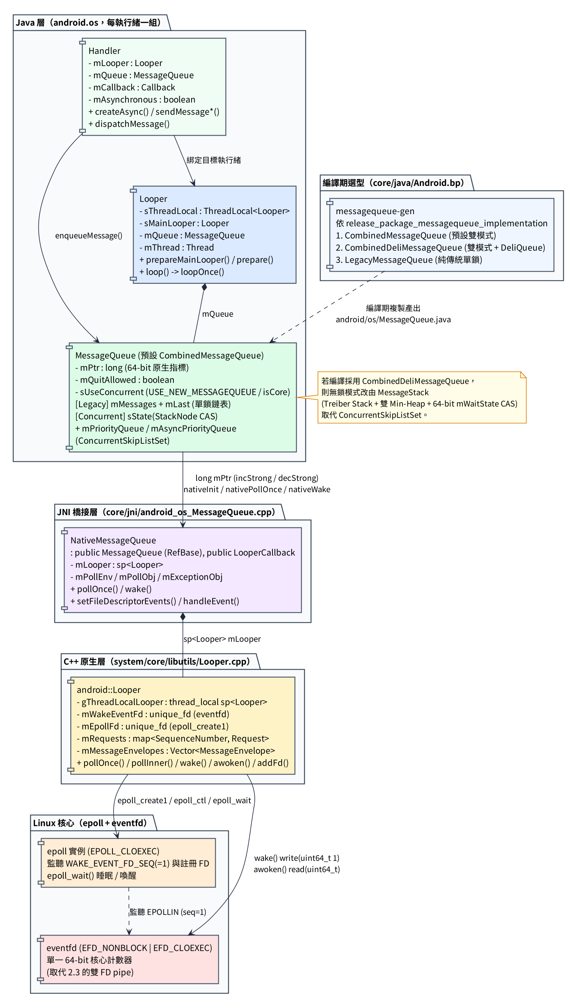
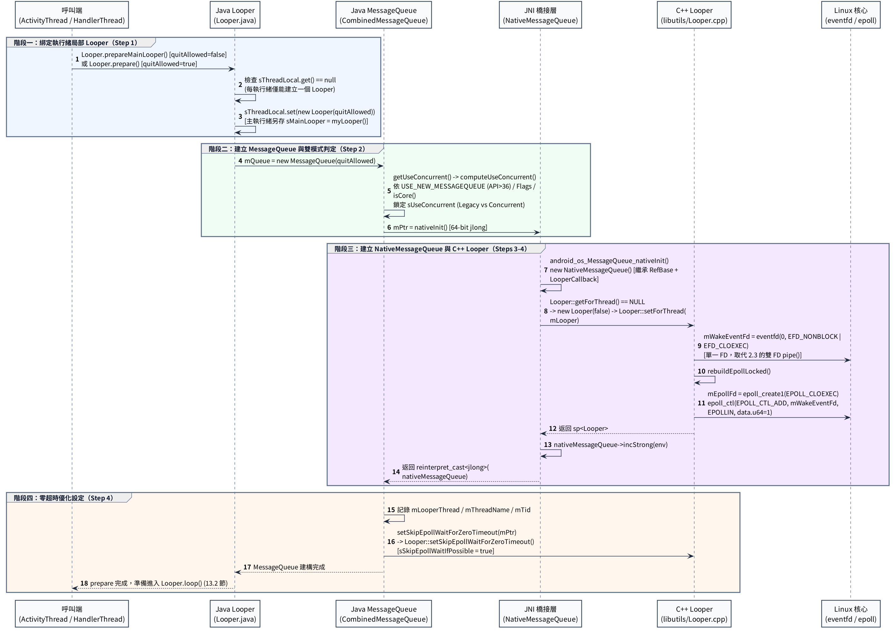

# 13.1 建立執行緒消息隊列（`Looper.prepare`、`MessageQueue` 三實作選型、`NativeMessageQueue` 與 `eventfd` / `epoll`）

- **情景說明**：如果 Android 應用程式的主執行緒（UI 執行緒）或工作執行緒沒有建立消息隊列，它就只能像傳統命令列程式一樣跑完一段程式碼隨即結束，既無法持續接收來自系統服務（AMS / WMS / Input）的非同步事件，也無法讓其他執行緒安全地把工作排回 UI 執行緒執行。第 12 章 `12.3` 節看到 `ActivityThread.main()` 進入主迴圈前，第一步就是呼叫 `Looper.prepareMainLooper()`；工作執行緒（例如 `HandlerThread`）則是呼叫 `Looper.prepare()`。而在 Android 17 中，這條看似平靜的建立路徑底下藏著三項重大演進：Soong 編譯期對三套 `MessageQueue` 實作（`CombinedMessageQueue` / `CombinedDeliMessageQueue` / `LegacyMessageQueue`）的選型與執行期雙模式切換、64 位元 `long mPtr` 搭配 `RefBase` 保護的 `NativeMessageQueue`，以及 `libutils/Looper` 以單一 `eventfd` + `epoll_create1(EPOLL_CLOEXEC)` + `SequenceNumber` 取代早期的 `pipe()` 雙管道。本節從 `Looper.prepareMainLooper()` / `prepare()` 一路向下追至 C++ `Looper::rebuildEpollLocked()`。
- **對應原書**：第 13 章引言與 13.1 節〈创建线程消息队列〉（p.653–658）
- **涉及專案與版本基準**：
  - `platform/frameworks/base` 〔`android-17.0.0_r1`，commit `94b4c163b`〕
  - `platform/system/core` 〔`android-17.0.0_r1`，commit `545d248`〕

---

## 13.1.1 跨層架構與 Android 17 三套 `MessageQueue` 實作選型

> 對應原書 13.1 開頭與圖 13-1（p.653–655）。原書 2.3 中 Java 層 `Looper` / `MessageQueue` 與 C++ 層 `NativeMessageQueue` / `Looper` 的四物件對應骨架在 Android 17 依然保留，但底層實作已大幅現代化。



整條建立呼叫鏈如下：

```text
Looper.prepareMainLooper() / Looper.prepare()             ## Step 1、檢查 ThreadLocal 唯一性並呼叫 prepare(quitAllowed)
  new Looper(quitAllowed)                                 ## Step 1、建立綁定當前執行緒的 Looper 與 mQueue
    new MessageQueue(quitAllowed)                         ## Step 2、依 Android.bp 選出 CombinedMessageQueue；執行 getUseConcurrent() 鎖定雙模式
      MessageQueue.nativeInit()                           ## Step 3、JNI 建構 NativeMessageQueue 並 incStrong 回傳 64-bit jlong mPtr
        new NativeMessageQueue()                          ## Step 3、查詢或建立 C++ thread_local sp<Looper>
          new Looper(false)                               ## Step 4、eventfd(0, EFD_NONBLOCK | EFD_CLOEXEC) 取代 pipe()
            Looper::rebuildEpollLocked()                  ## Step 4、epoll_create1(EPOLL_CLOEXEC) + EPOLL_CTL_ADD(mWakeEventFd, WAKE_EVENT_FD_SEQ)
      MessageQueue.setSkipEpollWaitForZeroTimeout(mPtr)   ## Step 4、依旗標開啟零超時略過 epoll_wait 優化
```

### Step 0（建構背景）：`core/java/Android.bp` 的三套 `MessageQueue` 實作選型
**位置**：`platform/frameworks/base/core/java/Android.bp` 〔`android-17.0.0_r1`，lines 252–265〕

```bp
// Android.bp:252-265
// Output the selected android/os/MessageQueue.java implementation
release_package_messagequeue_implementation_srcs {
    name: "messagequeue-gen",
    soong_config_variables: {
        release_package_messagequeue_implementation: {
            srcs: ["android/os/%s"],
            conditions_default: {
                srcs: ["android/os/CombinedMessageQueue/*.java"],
            },
        },
    },
    cmd: "mkdir -p android/os/; cp $(in) $(out);",
    out: ["android/os/MessageQueue.java"],
}
```

Android 17 原始碼樹在 `core/java/android/os/` 下不再有單一的 `MessageQueue.java`，而是由 Soong `messagequeue-gen` 在編譯期從三個目錄擇一複製產出 `android/os/MessageQueue.java`：

| 目錄 / 實作 | 編譯地位 | 執行期模式與核心資料結構 | 適用對象 |
|---|---|---|---|
| `CombinedMessageQueue/` | **AOSP 預設**（`conditions_default`） | **雙模式**：Legacy 單鎖鏈表（含 `mLast` 尾指針） + Concurrent 雙 `ConcurrentSkipListSet`（`mPriorityQueue` / `mAsyncPriorityQueue`）與無鎖 `StackNode` CAS 堆疊 | 系統核心進程與 Android 17+ App 走 Concurrent；舊 App／反射測試走 Legacy |
| `CombinedDeliMessageQueue/` | 透過旗標啟用（12.3 節 `--use-deliqueue=`） | **雙模式**：Legacy 單鎖鏈表 + 無鎖 **DeliQueue**（`MessageStack` Treiber Stack + 雙 Min-Heap + 64-bit `mWaitState` CAS） | 啟用 DeliQueue 編譯配置時，於 `ActivityThread.main()` 執行期切換 |
| `LegacyMessageQueue/` | 純傳統回退版 | 僅單一 `synchronized (this)` 保護的有序單向鏈表 | 需完全關閉併發佇列的除錯或相容建置 |

> 〔與 2.3 差異〕架構重構：原書 13.1（p.656）只有單一 `frameworks/base/core/java/android/os/MessageQueue.java`；Android 17 改由 Soong 編譯期三選一產出，預設採用雙模式 `CombinedMessageQueue`，並備有下一代無鎖 `CombinedDeliMessageQueue`。

---

## 13.1.2 逐步驟原始碼分析

### Step 1：`Looper.prepareMainLooper`、`Looper.prepare` 與 `new Looper`
**位置**：`platform/frameworks/base/core/java/android/os/Looper.java` 〔`android-17.0.0_r1`，lines 147–174、484–500〕

```java
// Looper.java:147-174, 484-500
    public static void prepare() {
        prepare(true);
    }

    private static void prepare(boolean quitAllowed) {
        if (sThreadLocal.get() != null) {
            throw new RuntimeException("Only one Looper may be created per thread");
        }
        sThreadLocal.set(new Looper(quitAllowed));
    }
    ...
    @Deprecated
    public static void prepareMainLooper() {
        prepare(false);
        synchronized (Looper.class) {
            if (sMainLooper != null) {
                throw new IllegalStateException("The main Looper has already been prepared.");
            }
            sMainLooper = myLooper();
        }
    }
    ...
    public static @Nullable Looper myLooper() {
        return sThreadLocal.get();
    }
    ...
    private Looper(boolean quitAllowed) {
        mQueue = new MessageQueue(quitAllowed);
        mThread = Thread.currentThread();
    }
```

1. **一執行緒一 `Looper` 鐵律**：`sThreadLocal` 為 `ThreadLocal<Looper>`，確保同一執行緒最多只能呼叫一次 `prepare()`，重複呼叫直接拋出 `RuntimeException`。
2. **主執行緒禁止退出（`quitAllowed = false`）**：一般工作執行緒呼叫 `Looper.prepare()` 時傳入 `quitAllowed = true`，日後可透過 `quit()` / `quitSafely()` 優雅結束迴圈；主執行緒於 `ActivityThread.main()` 呼叫 `prepareMainLooper()` 則傳入 `quitAllowed = false`，並將實例加鎖存入靜態欄位 `sMainLooper`（若有人嘗試呼叫 `Looper.getMainLooper().quit()`，`MessageQueue.quit()` 會直接拋出 `IllegalStateException("Main thread not allowed to quit.")`）。
3. **建立專屬 `MessageQueue`**：`Looper` 建構子立刻建立 `mQueue = new MessageQueue(quitAllowed)` 並記錄歸屬執行緒 `mThread = Thread.currentThread()`。

> 〔與 2.3 差異〕邏輯微調：原書 13.1（p.655–656）的 `prepare()` 與 `Looper()` 不帶 `quitAllowed` 參數且主 `Looper` 欄位名為 `mMainLooper`；Android 17 加入 `quitAllowed` 防止主執行緒被退出，並改名為 `sMainLooper`（`prepareMainLooper()` 亦標記 `@Deprecated` 提醒 App 勿自行呼叫）。

---

### Step 2：`MessageQueue` 建構子與執行期雙模式判定（`computeUseConcurrent`）
**位置**：`platform/frameworks/base/core/java/android/os/CombinedMessageQueue/MessageQueue.java` 〔`android-17.0.0_r1`，lines 83–104、148–230〕

```java
// MessageQueue.java:83-104, 148-230 (CombinedMessageQueue)
    @ChangeId
    @EnabledAfter(targetSdkVersion = android.os.Build.VERSION_CODES.BAKLAVA)
    public static final long USE_NEW_MESSAGEQUEUE = 421623328L;
    ...
    private final boolean mQuitAllowed;
    ...
    @UnsupportedAppUsage
    @SuppressWarnings("unused")
    private long mPtr; // used by native code
    ...
    private native static long nativeInit();
    private native static void nativeDestroy(long ptr);
    @UnsupportedAppUsage
    private native void nativePollOnce(long ptr, int timeoutMillis); /*non-static for callbacks*/

    private native static void nativeWake(long ptr);
    private native static boolean nativeIsPolling(long ptr);
    private native static void nativeSetFileDescriptorEvents(long ptr, int fd, int events);
    private native static void nativeSetSkipEpollWaitForZeroTimeout(long ptr);

    MessageQueue(boolean quitAllowed) {
        getUseConcurrent();
        mQuitAllowed = quitAllowed;
        mPtr = nativeInit();
        mLooperThread = Thread.currentThread();
        mThreadName = mLooperThread.getName();
        mTid = Process.myTid();
        setSkipEpollWaitForZeroTimeout(mPtr);
    }
    ...
    static boolean getUseConcurrent() {
        if (!sUseConcurrentInitialized) {
            final boolean useConcurrent = computeUseConcurrent();
            sUseConcurrent = useConcurrent;
            sUseConcurrentInitialized = true;
            return useConcurrent;
        }
        return sUseConcurrent;
    }
    ...
    private static boolean computeUseConcurrent() {
        if (CompatChanges.isChangeEnabled(USE_NEW_MESSAGEQUEUE)
                || Flags.useConcurrentMessageQueueInApps()) {
            return true;
        }

        final String processName = Process.myProcessName();
        if (processName == null) {
            // Assume that this is a host-side test and avoid concurrent mode for now.
            return false;
        }

        if (UserHandle.isCore(Process.myUid())) {
            return true;
        }

        return false;
    }

    static void setSkipEpollWaitForZeroTimeout(long ptr) {
        if (Flags.nativeLooperSkipEpollWaitForZeroTimeout()) {
            nativeSetSkipEpollWaitForZeroTimeout(ptr);
        }
    }
```

1. **為何需要雙模式自動切換？**：許多舊版 App 與自動化測試框架（例如 Robolectric / 舊 Instrumentation 測試）會直接用反射存取 `MessageQueue.mMessages` 私有欄位。Android 17 透過 `@EnabledAfter(targetSdkVersion = Build.VERSION_CODES.BAKLAVA)`（即 targetSdk > 36 的 Android 17+ App）、全域旗標 `Flags.useConcurrentMessageQueueInApps()` 或核心系統 UID（`UserHandle.isCore(Process.myUid())`，如 `system_server`）啟用 `sUseConcurrent = true`；舊版 App 與宿主測試則自動保留 Legacy 單鎖鏈表以維持二進位與反射相容性。
2. **64 位元 `long mPtr` 與記錄歸屬執行緒**：`mPtr = nativeInit()` 改以 `long` 直接接回 C++ `NativeMessageQueue*` 位址（不再在 JNI 內反射呼叫 `SetIntField`）；並記下 `mLooperThread`、`mThreadName` 與 `mTid` 供併發模式判斷「是否正處於 Looper 執行緒（快路徑直插優先佇列）」及 Perfetto 追蹤使用。
3. **開啟零超時略過 `epoll_wait`**：建構尾端呼叫 `setSkipEpollWaitForZeroTimeout(mPtr)`，當系統旗標啟用時通知原生 `Looper`：若呼叫 `nativePollOnce(mPtr, 0)` 且沒有額外監聽 FD，直接跳過 `epoll_wait()` 系統呼叫以節省核心態切換開銷。

> 〔與 2.3 差異〕架構重構 + 邏輯改變：原書 13.1（p.656）的 `MessageQueue()` 只呼叫無回傳值的 `nativeInit()` 寫入 32 位元 `int mPtr`；Android 17 升級為 64 位元 `long mPtr` 直接回傳，新增雙模式判定 `computeUseConcurrent()`、執行緒元資料紀錄與 `setSkipEpollWaitForZeroTimeout()`。

---

### Step 3：`android_os_MessageQueue_nativeInit` 與 `NativeMessageQueue::NativeMessageQueue`
**位置**：
- `platform/frameworks/base/core/jni/android_os_MessageQueue.h` 〔`android-17.0.0_r1`，lines 25–63〕
- `platform/frameworks/base/core/jni/android_os_MessageQueue.cpp` 〔`android-17.0.0_r1`，lines 42–74、94–101、207–221〕

```cpp
// android_os_MessageQueue.h:25-30, 57-63
class MessageQueue : public virtual RefBase {
public:
    /* Gets the message queue's looper. */
    inline sp<Looper> getLooper() const {
        return mLooper;
    }
    ...
protected:
    MessageQueue();
    virtual ~MessageQueue();

protected:
    sp<Looper> mLooper;
};
```

```cpp
// android_os_MessageQueue.cpp:42-54, 94-101, 207-221
class NativeMessageQueue : public MessageQueue, public LooperCallback {
public:
    NativeMessageQueue();
    virtual ~NativeMessageQueue();

    virtual void raiseException(JNIEnv* env, const char* msg, jthrowable exceptionObj);

    void pollOnce(JNIEnv* env, jobject obj, int timeoutMillis);
    void wake();
    void setFileDescriptorEvents(int fd, int events);

    virtual int handleEvent(int fd, int events, void* data);
    ...
};
...
NativeMessageQueue::NativeMessageQueue() :
        mPollEnv(NULL), mPollObj(NULL), mExceptionObj(NULL) {
    mLooper = Looper::getForThread();
    if (mLooper == NULL) {
        mLooper = new Looper(false);
        Looper::setForThread(mLooper);
    }
}
...
static jlong android_os_MessageQueue_nativeInit(JNIEnv* env, jclass clazz) {
    NativeMessageQueue* nativeMessageQueue = new NativeMessageQueue();
    if (!nativeMessageQueue) {
        jniThrowRuntimeException(env, "Unable to allocate native queue");
        return 0;
    }

    nativeMessageQueue->incStrong(env);
    return reinterpret_cast<jlong>(nativeMessageQueue);
}

static void android_os_MessageQueue_nativeDestroy(JNIEnv* env, jclass clazz, jlong ptr) {
    NativeMessageQueue* nativeMessageQueue = reinterpret_cast<NativeMessageQueue*>(ptr);
    nativeMessageQueue->decStrong(env);
}
```

1. **納入 `RefBase` 強引用生命週期**：`NativeMessageQueue` 繼承自 `android::MessageQueue`（`public virtual RefBase`，見第 3 章智能指標）與 `LooperCallback`。`nativeInit()` 建立後顯式呼叫 `incStrong(env)` 交給 Java 層 `mPtr` 持有；直到 Java 側 `dispose()` 呼叫 `nativeDestroy(ptr)` 才以 `decStrong(env)` 釋放，杜絕與其他原生模組（例如 Input 系統透過 `android_os_MessageQueue_getMessageQueue()` 取得 `sp<MessageQueue>`）之間的懸空指標問題。
2. **雙重角色（`LooperCallback`）**：`NativeMessageQueue` 同時作為 `LooperCallback` 實作 `setFileDescriptorEvents()` 與 `handleEvent()`，讓 Java 層 `MessageQueue.addOnFileDescriptorEventListener()` 能把任意 FD 掛進原生 `Looper` 的 `epoll` 集合並於就緒時回呼 Java `dispatchEvents(fd, events)`（並以 `WeakLooperCallback` 避免循環強引用）。
3. **與 C++ `Looper` 共享執行緒局部實例**：若當前執行緒尚未建立原生 `Looper`（`Looper::getForThread() == NULL`），便以 `allowNonCallbacks = false` 建立 `new Looper(false)` 並存入 C++11 `thread_local static sp<Looper> gThreadLocalLooper`。

> 〔與 2.3 差異〕邏輯擴充 + 安全強化：原書 13.1（p.656–657）的 `NativeMessageQueue` 非 `RefBase` 物件、透過 `SetIntField` 寫入 32 位元 `mPtr`；Android 17 改為 `RefBase` + `LooperCallback`，以 `incStrong`/`decStrong` 管理 64 位元 `jlong mPtr`，並支援原生 FD 回呼與跨 JNI 例外傳遞。

---

### Step 4：`Looper::Looper`、`Looper::rebuildEpollLocked` 與 `setSkipEpollWaitForZeroTimeout`
**位置**：`platform/system/core/libutils/Looper.cpp` 〔`android-17.0.0_r1`，lines 30–34、74–105、125–152〕

```cpp
// Looper.cpp:30-34, 74-105, 125-152
constexpr uint64_t WAKE_EVENT_FD_SEQ = 1;

epoll_event createEpollEvent(uint32_t events, uint64_t seq) {
    return {.events = events, .data = {.u64 = seq}};
}
...
thread_local static sp<Looper> gThreadLocalLooper;

Looper::Looper(bool allowNonCallbacks)
    : mAllowNonCallbacks(allowNonCallbacks),
      mSendingMessage(false),
      mPolling(false),
      mEpollRebuildRequired(false),
      mRequestsGeneration(0),
      mNextRequestSeq(WAKE_EVENT_FD_SEQ + 1),
      mResponseIndex(0),
      mNextMessageUptime(LLONG_MAX) {
    mWakeEventFd.reset(eventfd(0, EFD_NONBLOCK | EFD_CLOEXEC));
    LOG_ALWAYS_FATAL_IF(mWakeEventFd.get() < 0, "Could not make wake event fd: %s", strerror(errno));

    std::scoped_lock _l(mLock);
    rebuildEpollLocked();
}
...
void Looper::setSkipEpollWaitForZeroTimeout() {
    Looper::sSkipEpollWaitIfPossible = true;
}
...
void Looper::rebuildEpollLocked() {
    // Close old epoll instance if we have one.
    if (mEpollFd >= 0) {
        mEpollFd.reset();
    }

    // Allocate the new epoll instance and register the WakeEventFd.
    mEpollFd.reset(epoll_create1(EPOLL_CLOEXEC));
    LOG_ALWAYS_FATAL_IF(mEpollFd < 0, "Could not create epoll instance: %s", strerror(errno));

    epoll_event wakeEvent = createEpollEvent(EPOLLIN, WAKE_EVENT_FD_SEQ);
    int result = epoll_ctl(mEpollFd.get(), EPOLL_CTL_ADD, mWakeEventFd.get(), &wakeEvent);
    LOG_ALWAYS_FATAL_IF(result != 0, "Could not add wake event fd to epoll instance: %s",
                        strerror(errno));

    for (const auto& [seq, request] : mRequests) {
        epoll_event eventItem = createEpollEvent(request.getEpollEvents(), seq);

        int epollResult = epoll_ctl(mEpollFd.get(), EPOLL_CTL_ADD, request.fd, &eventItem);
        if (epollResult < 0) {
            ALOGE("Error adding epoll events for fd %d while rebuilding epoll set: %s",
                  request.fd, strerror(errno));
        }
    }
}
```

1. **`pipe()` → `eventfd(0, EFD_NONBLOCK | EFD_CLOEXEC)`**：
   - 原書 2.3 為了喚醒一個執行緒必須呼叫 `pipe()` 消耗**兩個**檔案描述符（`mWakeReadPipeFd` / `mWakeWritePipeFd`）與核心管道緩衝區；Android 17 改用 Linux **`eventfd`**（`mWakeEventFd`，以 RAII `unique_fd` 管理），只需 **1 個 FD** 與核心內單一 64 位元無號計數器，且強制加上 `EFD_NONBLOCK | EFD_CLOEXEC`（避免阻塞喚醒端與洩漏給子進程）。
2. **`epoll_create1(EPOLL_CLOEXEC)` 與 64 位元 `SequenceNumber`**：
   - `rebuildEpollLocked()` 以現代系統呼叫 `epoll_create1(EPOLL_CLOEXEC)` 建立 `mEpollFd`，把 `mWakeEventFd` 註冊為 `EPOLLIN`。
   - 最值得留意的細節是 `epoll_event.data` 不再存放裸 `fd`（`eventItem.data.fd`），而是改存單調遞增的 64 位元序號 **`data.u64 = seq`**（其中 `WAKE_EVENT_FD_SEQ = 1` 固定保留給 `mWakeEventFd`，其餘 `addFd()` 從 `2` 遞增）。這樣即使某個監聽 FD 在回呼中被關閉又立即被核心復用為相同數字，也能靠 `seq` 與 `mRequestsGeneration` 精準識別過期事件（stale response），不會誤派發給新 FD。
3. **多工能力為第 14 章鋪路**：除了 `mWakeEventFd`，`rebuildEpollLocked()` 還會把 `mRequests` 中透過 `Looper::addFd()` 註冊的其他 FD（例如第 14 章 Input 系統的 `InputChannel` socketpair、`DisplayEventReceiver` VSync 通道與 Java 層 FD 監聽器）全數加入同一個 `mEpollFd`，讓單一執行緒同時處理 Java 消息、C++ `MessageEnvelope` 與核心 I/O 事件。

> 〔與 2.3 差異〕搬家 + 邏輯重寫：原書 13.1（p.657–658）的 `frameworks/base/libs/utils/Looper.cpp` 使用 `pipe()` 雙 FD、`epoll_create(EPOLL_SIZE_HINT)` 與 `eventItem.data.fd`；Android 17 搬至 `platform/system/core/libutils/Looper.cpp`，改用 `eventfd`（`EFD_NONBLOCK | EFD_CLOEXEC`）、`epoll_create1(EPOLL_CLOEXEC)`、RAII `unique_fd`、`SequenceNumber` 防 FD 重用錯派，並新增 `setSkipEpollWaitForZeroTimeout()`。

---

## 13.1.3 本節總結與時序圖



| 層級 / 步驟 | 核心類別與函式 | 關鍵產出與 Android 17 演進 |
|---|---|---|
| **編譯期選型** | `core/java/Android.bp`（`messagequeue-gen`） | 從 `CombinedMessageQueue`（預設）、`CombinedDeliMessageQueue`（無鎖 DeliQueue）、`LegacyMessageQueue` 三選一產出 `MessageQueue.java` |
| **Java 層初始化** | `Looper.prepareMainLooper()` / `prepare()` → `new Looper()` → `new MessageQueue()` | 綁定 `sThreadLocal`（主線程 `quitAllowed = false`）；執行 `computeUseConcurrent()` 鎖定雙模式；啟用零超時略過 `epoll_wait` |
| **JNI 橋接層** | `android_os_MessageQueue_nativeInit()` → `new NativeMessageQueue()` | 建立繼承 `RefBase` + `LooperCallback` 的 `NativeMessageQueue`，`incStrong()` 後回傳 64 位元 `long mPtr` |
| **C++ 原生層** | `libutils/Looper::Looper(false)` → `rebuildEpollLocked()` | 建立單一 `eventfd(0, EFD_NONBLOCK \| EFD_CLOEXEC)` 與 `epoll_create1(EPOLL_CLOEXEC)`，以 `WAKE_EVENT_FD_SEQ = 1` 註冊喚醒監聽 |
