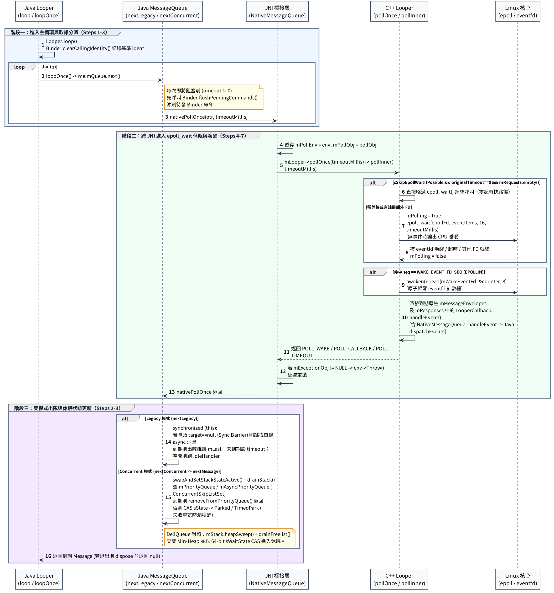

# 13.2 執行緒消息循環過程（`Looper.loop` / `loopOnce`、`MessageQueue.next` 雙模式、`nativePollOnce` 與 `Looper::pollInner`）

- **情景說明**：執行緒呼叫 `Looper.prepareMainLooper()` 或 `Looper.prepare()` 建好消息隊列後，如果沒有主動進入取訊與睡眠的循環，佇列裡的消息永遠不會被消費；反過來，如果這個循環只是空轉 `while (true)` 輪詢，CPU 電力幾小時就會耗盡。Android 透過 `Looper.loop()` 驅動 `MessageQueue.next()`，在有到期消息時立刻出隊返回、無到期消息時先沖刷待處理的 Binder 命令（`Binder.flushPendingCommands()`），再跨 JNI 進入 `libutils/Looper::pollInner()` 呼叫 `epoll_wait()` 讓出 CPU 睡眠。本節追蹤 Android 17 這條核心循環鏈路——涵蓋預設 `CombinedMessageQueue` 的 Legacy 單鎖模式（含 Sync Barrier 掃描）與 Concurrent 無鎖模式（雙 `ConcurrentSkipListSet` + `StackNode` 狀態機）、對照 `CombinedDeliMessageQueue` 的無鎖 `heapSweep` / `drainFreelist`，並一路追到原生層零超時略過 `epoll_wait()`、`eventfd` 喚醒清理（`awoken()`）與原生回呼派發。
- **對應原書**：13.2 節〈线程消息循环过程〉（p.658–663）
- **涉及專案與版本基準**：
  - `platform/frameworks/base` 〔`android-17.0.0_r1`，commit `94b4c163b`〕
  - `platform/system/core` 〔`android-17.0.0_r1`，commit `545d248`〕

---

## 13.2.1 總呼叫樹

```text
Looper.loop()                                              ## Step 1、取 myLooper()、清 CallingIdentity、無限呼叫 loopOnce()
  Looper.loopOnce()                                        ## Step 1、向 mQueue.next() 取下一筆到期 Message（回 null 即退出）
    MessageQueue.next()                                    ## Step 2、依 sUseConcurrent 分流 nextConcurrent() / nextLegacy()
      ├─[Legacy 模式] nextLegacy()                          ## Step 2、單鎖鏈表：遇 target==null(Sync Barrier) 跳找 async 消息
      ├─[Concurrent 模式] nextConcurrent() -> nextMessage() ## Step 3、swap+drain StackNode -> 查雙 ConcurrentSkipListSet -> CAS Park/TimedPark
      └─[DeliQueue 對照] nextDeliQueue() -> nextMessage()   ## Step 3、Treiber Stack heapSweep/drainFreelist -> 雙 Min-Heap -> WaitState CAS
      Binder.flushPendingCommands()                        ## Step 2/3、睡眠前先沖刷待發 Binder 命令（如 deref）
      MessageQueue.nativePollOnce(ptr, timeoutMillis)      ## Step 4、跨 JNI 進入 NativeMessageQueue::pollOnce()
        NativeMessageQueue::pollOnce(env, obj, timeout)    ## Step 4、暫存 mPollEnv/mPollObj；呼叫 mLooper->pollOnce()；重拋延遲例外
          Looper::pollOnce(timeoutMillis)                  ## Step 5、先消化既有 mResponses，再進 pollInner()
            Looper::pollInner(timeoutMillis)               ## Step 6、零超時無註冊 FD 略過 epoll_wait；否則 epoll_wait() 阻塞睡眠
              Looper::awoken()                             ## Step 7、seq == WAKE_EVENT_FD_SEQ 時 read 8B uint64_t 清除 eventfd 計數
              派發 mMessageEnvelopes & LooperCallback      ## Step 6、執行原生消息與 FD 回呼（含 NativeMessageQueue::handleEvent）
```

---

## 13.2.2 逐步驟原始碼分析

### Step 1：`Looper.loop` 與 `Looper.loopOnce` 取訊入口
**位置**：`platform/frameworks/base/core/java/android/os/Looper.java` 〔`android-17.0.0_r1`，lines 230–236、373–401〕

```java
// Looper.java:373-401
    public static void loop() {
        final Looper me = myLooper();
        if (me == null) {
            throw new RuntimeException("No Looper; Looper.prepare() wasn't called on this thread.");
        }
        if (me.mInLoop) {
            Slog.w(TAG, "Loop again would have the queued messages be executed"
                    + " before this one completed.");
        }

        me.mInLoop = true;

        // Make sure the identity of this thread is that of the local process,
        // and keep track of what that identity token actually is.
        Binder.clearCallingIdentity();
        final long ident = Binder.clearCallingIdentity();

        // Allow overriding a threshold with a system prop. e.g.
        // adb shell 'setprop log.looper.1000.main.slow 1 && stop && start'
        final int thresholdOverride = getThresholdOverride();

        me.mSlowDeliveryDetected = false;

        for (;;) {
            if (!loopOnce(me, ident, thresholdOverride)) {
                return;
            }
        }
    }
```

```java
// Looper.java:230-236
    private static boolean loopOnce(final Looper me,
            final long ident, final int thresholdOverride) {
        Message msg = me.mQueue.next(); // might block
        if (msg == null) {
            // No message indicates that the message queue is quitting.
            return false;
        }
```

1. **單輪抽離與退出語意**：`Looper.loop()` 取出當前執行緒的 `Looper` 後，連續呼叫 `Binder.clearCallingIdentity()` 記下本進程基準身分 token `ident`（供每輪派發完畢核驗有無遺漏還原身分），接著在 `for (;;)` 內反覆呼叫 `loopOnce()`。`loopOnce()` 第一行呼叫 `me.mQueue.next()`——這可能阻塞休眠；一旦 `next()` 回傳 **`null`**，即代表該 `MessageQueue` 正在退出，`loopOnce()` 返回 `false` 終止整個 `Looper.loop()`。

> 〔與 2.3 差異〕邏輯改變：原書 13.2 Step 1（p.659）把迴圈全寫在 `Looper.loop()` 並以 `msg.target == null` 判退出；Android 17 抽離為 `loopOnce()`，改以 `msg == null` 作為退出信號，並加入 `Binder.clearCallingIdentity()` 身分防護與慢消息閾值覆寫。

---

### Step 2：`MessageQueue.next` 與 Legacy 模式（`nextLegacy` + Sync Barrier 掃描）
**位置**：`platform/frameworks/base/core/java/android/os/CombinedMessageQueue/MessageQueue.java` 〔`android-17.0.0_r1`，lines 959–1044、1080–1086〕

```java
// MessageQueue.java:1080-1086 (CombinedMessageQueue)
    Message next() {
        if (sUseConcurrent) {
            return nextConcurrent();
        } else {
            return nextLegacy();
        }
    }
```

先看與原書結構最接近、仍保留給舊版 App 反射相容使用的 `nextLegacy()`：

```java
// MessageQueue.java:959-1039 (CombinedMessageQueue)
    private Message nextLegacy() {
        final long ptr = mPtr;
        if (ptr == 0) {
            return null;
        }

        int pendingIdleHandlerCount = -1; // -1 only during first iteration
        int nextPollTimeoutMillis = 0;
        for (;;) {
            if (nextPollTimeoutMillis != 0) {
                Binder.flushPendingCommands();
            }

            nativePollOnce(ptr, nextPollTimeoutMillis);

            synchronized (this) {
                // Try to retrieve the next message.  Return if found.
                final long now = SystemClock.uptimeMillis();
                Message prevMsg = null;
                Message msg = mMessages;
                if (msg != null && msg.target == null) {
                    // Stalled by a barrier.  Find the next asynchronous message in the queue.
                    do {
                        prevMsg = msg;
                        msg = msg.next;
                    } while (msg != null && !msg.isAsynchronous());
                }
                if (msg != null) {
                    if (now < msg.when) {
                        // Next message is not ready.  Set a timeout to wake up when it is ready.
                        nextPollTimeoutMillis = (int) Math.min(msg.when - now, Integer.MAX_VALUE);
                    } else {
                        // Got a message.
                        mBlocked = false;
                        if (prevMsg != null) {
                            prevMsg.next = msg.next;
                            if (prevMsg.next == null) {
                                mLast = prevMsg;
                            }
                        } else {
                            mMessages = msg.next;
                            if (msg.next == null) {
                                mLast = null;
                            }
                        }
                        msg.next = null;
                        msg.markInUse();
                        if (msg.isAsynchronous()) {
                            mAsyncMessageCount--;
                        }
                        decAndTraceMessageCount();
                        return msg;
                    }
                } else {
                    // No more messages.
                    nextPollTimeoutMillis = -1;
                }

                // Process the quit message now that all pending messages have been handled.
                if (mQuitting) {
                    dispose();
                    return null;
                }

                if (pendingIdleHandlerCount < 0
                        && (mMessages == null || now < mMessages.when)) {
                    pendingIdleHandlerCount = mIdleHandlers.size();
                }
                if (pendingIdleHandlerCount <= 0) {
                    // No idle handlers to run.  Loop and wait some more.
                    mBlocked = true;
                    continue;
                }
                ...
```

1. **三段超時語意與 `Binder.flushPendingCommands()`**：首次進入迴圈 `nextPollTimeoutMillis = 0`（非阻塞先查一次）；若隊列空則設為 `-1`（無限休眠直到 `nativeWake()`），若隊頭未到期則設為 `Math.min(msg.when - now, Integer.MAX_VALUE)`。每次即將阻塞前（`nextPollTimeoutMillis != 0`）先呼叫 `Binder.flushPendingCommands()`，確保本執行緒先前積在 `IPCThreadState::mOut` 的待處理 Binder 命令（例如減引用計數 `BC_DECREFS`）立刻寫進驅動，不會跟著主執行緒一起睡過頭。
2. **Sync Barrier 跳過同步消息**：若隊頭滿足 `msg != null && msg.target == null`，代表 UI 繪製等子系統插入了同步屏障（見 13.3 節 `postSyncBarrier()`），迴圈立刻略過所有普通同步消息，沿 `msg.next` 尋找第一個 `msg.isAsynchronous() == true` 的非同步消息；只有找到且已到期才把它從鏈表摘下並維護 `mLast` 尾指針與 `mAsyncMessageCount`！若沒有非同步消息，就算後面排了一堆已經到期的普通消息，也會進入 `nextPollTimeoutMillis = -1` 休眠，直到非同步消息抵達或屏障被 `removeSyncBarrier()` 移除。
3. **空閒時觸發 `IdleHandler`**：只有在第一次無到期消息（`pendingIdleHandlerCount < 0`）且「隊列為空或隊頭尚未到期」時才會執行 `IdleHandler`（細節見 13.4 節）；否則標記 `mBlocked = true` 回到迴圈頂端進入 `nativePollOnce()` 休眠。

> 〔與 2.3 差異〕邏輯擴充：原書 13.2 Step 2（p.659–660）的 `MessageQueue.next()` 沒有 `msg.target == null` 同步屏障掃描、沒有 `mLast` / `mAsyncMessageCount` 維護，也沒有 `mQuitting` 觸發 `dispose()` 回傳 `null`；Android 17 補齊上述機制並將其封裝為 `nextLegacy()` 供相容模式使用。

---

### Step 3：Concurrent 模式（`nextConcurrent` / `nextMessage`）與無鎖 DeliQueue 對照
**位置**：
- `platform/frameworks/base/core/java/android/os/CombinedMessageQueue/MessageQueue.java` 〔`android-17.0.0_r1`，lines 663–708、730–794、826–910〕
- `platform/frameworks/base/core/java/android/os/CombinedDeliMessageQueue/MessageQueue.java` 〔`android-17.0.0_r1`，lines 571–605、733–762〕

對核心系統進程與 Android 17+ App，預設走 `CombinedMessageQueue` 的 `nextConcurrent()` → `nextMessage(false, false)`，徹底移除與發送執行緒爭搶的 `synchronized (this)` 全域鎖：

```java
// MessageQueue.java:881-910 (CombinedMessageQueue)
    private Message nextConcurrent() {
        final long ptr = mPtr;
        if (ptr == 0) {
            return null;
        }

        mNextPollTimeoutMillis = 0;
        int pendingIdleHandlerCount = -1; // -1 only during first iteration
        while (true) {
            if (mNextPollTimeoutMillis != 0) {
                Binder.flushPendingCommands();
            }

            mMessageDirectlyQueued = false;
            nativePollOnce(ptr, mNextPollTimeoutMillis);

            Message msg = nextMessage(false, false);
            if (msg != null) {
                msg.markInUse();
                decAndTraceMessageCount();
                return msg;
            }

            // Prevent any race between quit()/nativeWake() and dispose()
            if (mWorkerShouldQuit) {
                setMptrTeardownAndWaitForRefsToDrop();
                dispose();
                return null;
            }
            ...
```

```java
// MessageQueue.java:663-700, 731-793, 826-878 (CombinedMessageQueue)
    private Message nextMessage(boolean peek, boolean returnEarliest) {
        while (true) {
            ...
            StackNode oldTop;
            QuittingNode quittingNode = null;
            oldTop = swapAndSetStackStateActive();
            boolean shouldRemoveMessages = false;
            if (oldTop.isQuittingNode()) {
                quittingNode = (QuittingNode) oldTop;
                if (!mWorkerShouldQuit) {
                    mWorkerShouldQuit = true;
                    shouldRemoveMessages = true;
                }
            }
            drainStack(oldTop);
            ...
            /* Get the first node from each queue */
            Message msg = first(mPriorityQueue);
            Message asyncMsg = first(mAsyncPriorityQueue);
            final long now = SystemClock.uptimeMillis();

            Message found = null;
            Message next = null;

            if (isBarrier(msg)) {
                if (asyncMsg != null && (returnEarliest || now >= asyncMsg.when)) {
                    found = asyncMsg;
                } else {
                    next = asyncMsg;
                }
            } else { /* No barrier. */
                Message earliest = msg;
                if (msg == null) {
                    earliest = asyncMsg;
                } else if (asyncMsg != null) {
                    if (Message.compareMessages(msg, asyncMsg) > 0) {
                        earliest = asyncMsg;
                    }
                }

                if (earliest != null) {
                    if (returnEarliest || now >= earliest.when) {
                        found = earliest;
                    } else {
                        next = earliest;
                    }
                }
            }
            ...
            StateNode nextOp = sStackStateActive;
            if (found == null) {
                if (mWorkerShouldQuit) {
                    mNextPollTimeoutMillis = 0;
                } else if (next == null) {
                    mNextPollTimeoutMillis = -1;
                    nextOp = sStackStateParked;
                } else {
                    long nextMessageWhen = next.when;
                    if (nextMessageWhen > now) {
                        mNextPollTimeoutMillis = (int) Math.min(nextMessageWhen - now,
                                Integer.MAX_VALUE);
                    } else {
                        mNextPollTimeoutMillis = 0;
                    }
                    mStackStateTimedPark.mWhenToWake = now + mNextPollTimeoutMillis;
                    nextOp = mStackStateTimedPark;
                }
            }

            if (mWorkerShouldQuit || sState.compareAndSet(this, sStackStateActive, nextOp)) {
                mMessageCounts.clearCounts();
                if (found != null) {
                    if (!peek && !removeFromPriorityQueue(found)) {
                        continue;
                    }
                    return found;
                }
                return null;
            }
        }
    }
```

1. **批次抽乾無鎖入隊堆疊 + 雙優先佇列 O(1) 判屏障**：
   - 其他執行緒發送消息時只做一次 CAS 壓入無鎖 `sState` 堆疊（見 13.3 節）；Looper 執行緒在 `nextMessage()` 透過 `swapAndSetStackStateActive()` 一次把整串新壓入的 `StackNode` 換出來、`drainStack(oldTop)` 倒進兩個有序 `ConcurrentSkipListSet`：**`mPriorityQueue`**（放同步消息與 Sync Barrier）與 **`mAsyncPriorityQueue`**（專放非同步消息）。
   - 因此遇到 Sync Barrier（`isBarrier(msg)`）時**不再需要 O(n) 走訪整個鏈表**，直接看 `first(mAsyncPriorityQueue)` 即可 O(1) 取得最早非同步消息！
2. **無鎖休眠狀態機（CAS 防喚醒遺失）**：若無到期消息，依 `next` 決定目標狀態為 `sStackStateParked`（無限休眠）或 `mStackStateTimedPark`（記下 `mWhenToWake = now + mNextPollTimeoutMillis`），然後嘗試 `sState.compareAndSet(this, sStackStateActive, nextOp)`；如果就在這瞬間有其他執行緒壓入了新消息把 `sState` 改掉，CAS 失敗直接重跑迴圈吸收新消息，絕不漏喚醒！
3. **退出安全防護（`setMptrTeardownAndWaitForRefsToDrop()`）**：退出時先立起 `MPTR_TEARDOWN_MASK` 阻止新執行緒取得 `mPtr`，等所有正在執行 `concurrentWake()` 的引用歸零後才呼叫 `dispose()` → `nativeDestroy(mPtr)`。
4. **對照 `CombinedDeliMessageQueue`（無鎖 DeliQueue）**：若啟用 DeliQueue 建置，`nextDeliQueue()` 內呼叫 `nextMessage()` 改採 **64-bit `mWaitState` 原子變數**（低位元標記目前為計數器或睡眠截止時間戳），執行 `mStack.heapSweep()`（將 Treiber Stack 掃進單執行緒雙 Min-Heap）與 `mStack.drainFreelist()`（延遲實體回收被標記刪除的消息），再透過 `sWaitState.compareAndSet(this, oldWaitState, WaitState.composeDeadline(nextDeadline, syncBarrier != null))` 進入休眠——相較 `ConcurrentSkipListSet` 更進一步壓低記憶體配置與 O(log n) 堆操作常數開銷。

> 〔與 2.3 差異〕新增：原書 2.3 完全沒有雙優先佇列、無鎖 `StackNode` 狀態機、DeliQueue Treiber Stack + Min-Heap 與 `mPtr` 引用計數保護；這是 Android 17 為徹底根除主執行緒 `MessageQueue` 鎖競爭與優先權反轉所引入的核心架構革新。

---

### Step 4：`MessageQueue.nativePollOnce` 與 `NativeMessageQueue::pollOnce`
**位置**：`platform/frameworks/base/core/jni/android_os_MessageQueue.cpp` 〔`android-17.0.0_r1`，lines 106–135、223–227〕

```cpp
// android_os_MessageQueue.cpp:123-135, 223-227
void NativeMessageQueue::pollOnce(JNIEnv* env, jobject pollObj, int timeoutMillis) {
    mPollEnv = env;
    mPollObj = pollObj;
    mLooper->pollOnce(timeoutMillis);
    mPollObj = NULL;
    mPollEnv = NULL;

    if (mExceptionObj) {
        env->Throw(mExceptionObj);
        env->DeleteLocalRef(mExceptionObj);
        mExceptionObj = NULL;
    }
}
...
static void android_os_MessageQueue_nativePollOnce(JNIEnv* env, jobject obj,
        jlong ptr, jint timeoutMillis) {
    NativeMessageQueue* nativeMessageQueue = reinterpret_cast<NativeMessageQueue*>(ptr);
    nativeMessageQueue->pollOnce(env, obj, timeoutMillis);
}
```

1. **跨 JNI 回呼環境與例外延遲重拋**：因為 `mLooper->pollOnce()` 執行期間可能觸發 FD 事件回呼（如 Input 事件或 Java `OnFileDescriptorEventListener`）再次呼叫 Java 程式碼並拋出例外，所以 `NativeMessageQueue::pollOnce()` 先將當前執行緒的 `env` 與 Java `MessageQueue` 物件存進 `mPollEnv` / `mPollObj`；若回呼過程發生例外，會被 `raiseAndClearException()` 暫存至 `mExceptionObj`，待原生 `pollOnce()` 乾淨返回後再呼叫 `env->Throw(mExceptionObj)` 安全拋回 Java 層。

> 〔與 2.3 差異〕邏輯擴充：原書 13.2 Step 3–4（p.661）的 `pollOnce(int timeoutMillis)` 沒有 `env`/`pollObj` 暫存與 `mExceptionObj` 延遲重拋機制，且 `ptr` 為 `jint`；Android 17 改為 `jlong ptr` 並完整支援原生回呼例外回傳。

---

### Step 5：`Looper::pollOnce`
**位置**：`platform/system/core/libutils/Looper.cpp` 〔`android-17.0.0_r1`，lines 164–202〕

```cpp
// Looper.cpp:164-202
int Looper::pollOnce(int timeoutMillis, int* outFd, int* outEvents, void** outData) {
    int result = 0;
    for (;;) {
        const uint64_t generation = mRequestsGeneration.load(std::memory_order_acquire);
        while (mResponseIndex < mResponses.size()) {
            const Response& response = mResponses[mResponseIndex++];
            int ident = response.request.ident;
            if (ident >= 0) {
                if (isResponseStale(generation, response.seq)) {
                    continue;
                }
                int fd = response.request.fd;
                int events = response.events;
                void* data = response.request.data;
                if (outFd != nullptr) *outFd = fd;
                if (outEvents != nullptr) *outEvents = events;
                if (outData != nullptr) *outData = data;
                return ident;
            }
        }

        if (result != 0) {
            if (outFd != nullptr) *outFd = 0;
            if (outEvents != nullptr) *outEvents = 0;
            if (outData != nullptr) *outData = nullptr;
            return result;
        }

        result = pollInner(timeoutMillis);
    }
}
```

1. **先消化無回呼回應並過濾 Stale Response**：對於未綁定 `LooperCallback`（`ident >= 0`）的 FD 事件，先用 `mRequestsGeneration` 搭配 `isResponseStale(generation, response.seq)` 濾掉已被 `removeFd()` 移除的殘留回應，逐一交回呼叫端；針對 Java `MessageQueue` 來說，所有註冊 FD 皆走 `POLL_CALLBACK`（負值），因此直接進入 Step 6 `pollInner(timeoutMillis)`，一旦 `result != 0`（例如 `POLL_WAKE`、`POLL_CALLBACK` 或 `POLL_TIMEOUT`）便返回。

> 〔與 2.3 差異〕邏輯微調：原書 13.2 Step 5（p.661–662）沒有 `mRequestsGeneration` 與 `isResponseStale()` 過期事件檢查；Android 17 透過原子版本號徹底消除 FD 移除後的殘留事件風險。

---

### Step 6：`Looper::pollInner` 與 Step 7：`Looper::awoken`
**位置**：`platform/system/core/libutils/Looper.cpp` 〔`android-17.0.0_r1`，lines 204–385、428–435〕

```cpp
// Looper.cpp:204-314, 316-385, 428-435
int Looper::pollInner(int timeoutMillis) {
    int originalTimeout = timeoutMillis;

    // Adjust the timeout based on when the next message is due.
    if (timeoutMillis != 0 && mNextMessageUptime != LLONG_MAX) {
        nsecs_t now = systemTime(SYSTEM_TIME_MONOTONIC);
        int messageTimeoutMillis = toMillisecondTimeoutDelay(now, mNextMessageUptime);
        if (messageTimeoutMillis >= 0
                && (timeoutMillis < 0 || messageTimeoutMillis < timeoutMillis)) {
            timeoutMillis = messageTimeoutMillis;
        }
    }

    // Poll.
    int result = POLL_WAKE;
    mResponses.clear();
    mResponseIndex = 0;

    int eventCount = 0;
    struct epoll_event eventItems[EPOLL_MAX_EVENTS];

    int epollFd;
    bool hasRequests;
    {
        std::scoped_lock _l(mLock);
        epollFd = mEpollFd.get();
        hasRequests = !mRequests.empty();
    }

    if (!sSkipEpollWaitIfPossible || originalTimeout != 0 || hasRequests) {
        // We are about to idle.
        std::atomic_store_explicit(&mPolling, true, std::memory_order_relaxed);

        eventCount = epoll_wait(epollFd, eventItems, EPOLL_MAX_EVENTS, timeoutMillis);

        // No longer idling.
        std::atomic_store_explicit(&mPolling, false, std::memory_order_relaxed);
    }

    // Acquire lock.
    mLock.lock();

    // Rebuild epoll set if needed.
    if (mEpollRebuildRequired) {
        mEpollRebuildRequired = false;
        rebuildEpollLocked();
        goto Done;
    }

    if (eventCount < 0) {
        if (errno == EINTR) {
            goto Done;
        }
        ALOGW("Poll failed with an unexpected error: %s", strerror(errno));
        result = POLL_ERROR;
        goto Done;
    }

    if (eventCount == 0) {
        result = POLL_TIMEOUT;
        goto Done;
    }

    for (int i = 0; i < eventCount; i++) {
        const SequenceNumber seq = eventItems[i].data.u64;
        uint32_t epollEvents = eventItems[i].events;
        if (seq == WAKE_EVENT_FD_SEQ) {
            if (epollEvents & EPOLLIN) {
                awoken();
            } else {
                ALOGW("Ignoring unexpected epoll events 0x%x on wake event fd.", epollEvents);
            }
        } else {
            const auto& request_it = mRequests.find(seq);
            if (request_it != mRequests.end()) {
                const auto& request = request_it->second;
                int events = 0;
                if (epollEvents & EPOLLIN) events |= EVENT_INPUT;
                if (epollEvents & EPOLLOUT) events |= EVENT_OUTPUT;
                if (epollEvents & EPOLLERR) events |= EVENT_ERROR;
                if (epollEvents & EPOLLHUP) events |= EVENT_HANGUP;
                mResponses.push_back({.seq = seq, .events = events, .request = request});
            }
        }
    }
Done: ;

    // Invoke pending message callbacks.
    mNextMessageUptime = LLONG_MAX;
    while (!mMessageEnvelopes.empty()) {
        nsecs_t now = systemTime(SYSTEM_TIME_MONOTONIC);
        const MessageEnvelope& messageEnvelope = mMessageEnvelopes.front();
        if (messageEnvelope.uptime <= now) {
            { // obtain handler
                sp<MessageHandler> handler = messageEnvelope.handler;
                Message message = messageEnvelope.message;
                mMessageEnvelopes.erase(mMessageEnvelopes.begin());
                mSendingMessage = true;
                mLock.unlock();

                handler->handleMessage(message);
            } // release handler

            mLock.lock();
            mSendingMessage = false;
            result = POLL_CALLBACK;
        } else {
            mNextMessageUptime = messageEnvelope.uptime;
            break;
        }
    }

    const uint64_t generation = mRequestsGeneration.load(std::memory_order_acquire);
    mLock.unlock();

    // Invoke all response callbacks.
    for (size_t i = 0; i < mResponses.size(); i++) {
        Response& response = mResponses[i];
        if (response.request.ident == POLL_CALLBACK) {
            ...
            if (isResponseStale(generation, response.seq)) {
                continue;
            }
            int callbackResult = response.request.callback->handleEvent(fd, events, data);
            if (callbackResult == 0) {
                std::scoped_lock _l(mLock);
                removeSequenceNumberLocked(response.seq);
            }
            response.request.callback.clear();
            result = POLL_CALLBACK;
        }
    }
    return result;
}
```

```cpp
// Looper.cpp:428-435
void Looper::awoken() {
    uint64_t counter;
    TEMP_FAILURE_RETRY(read(mWakeEventFd.get(), &counter, sizeof(uint64_t)));
}
```

1. **Android 17 零超時跳過 `epoll_wait()` 優化**：每處理完一條 Java 消息後，`MessageQueue.next()` 下一輪會先以 `timeoutMillis == 0` 進來。若開啟了 `sSkipEpollWaitIfPossible`、本次 `originalTimeout == 0` 且目前沒有註冊任何額外 FD（`!hasRequests`），則完全略過 `epoll_wait()` 系統呼叫，免去一次無謂的使用者態／核心態切換！
2. **進入 `epoll_wait()` 與 `awoken()` 清理 `eventfd`**：需要等待或有註冊 FD 時，將原子旗標 `mPolling` 設為 `true` 後呼叫 `epoll_wait()` 讓出 CPU。一旦被其他執行緒透過 `Looper::wake()`（13.3 節）寫入 `mWakeEventFd` 喚醒，`eventItems[i].data.u64 == WAKE_EVENT_FD_SEQ` 命中並呼叫 `awoken()`——對 `mWakeEventFd` 執行一次 8 位元組 `read(&counter, sizeof(uint64_t))`，由核心原子將 `eventfd` 計數器歸零，確保下一次 `epoll_wait()` 不會因殘留計數而立刻空醒。
3. **三類事件統一分派**：`epoll_wait()` 返回後，同一次 `pollInner()` 依序處理：① `mWakeEventFd` 喚醒清理；② 到期的原生 C++ `mMessageEnvelopes`（解鎖後呼叫 `handler->handleMessage()`）；③ 其他註冊 FD 的 `LooperCallback::handleEvent()`（若是透過 Java `MessageQueue.addOnFileDescriptorEventListener()` 註冊，便走 `NativeMessageQueue::handleEvent()` 回呼 Java `dispatchEvents(fd, events)`；若回傳 `0` 則自動註銷該 FD）。完成後返回 Java 層 `MessageQueue.next()` 繼續取出一筆到期 Java `Message`。

> 〔與 2.3 差異〕邏輯重寫：原書 13.2 Step 6–7（p.662–663）以 `data.fd == mWakeReadPipeFd` 判斷並用 `char buffer[16]` 迴圈 `read()` 排空管道；Android 17 改以 `data.u64 == WAKE_EVENT_FD_SEQ` 搭配單次 8 位元組 `eventfd` `read()`，新增 `sSkipEpollWaitIfPossible` 零超時跳過系統呼叫、`mPolling` 原子狀態、`mEpollRebuildRequired` 重建機制與 `mMessageEnvelopes` / `LooperCallback` 完整原生事件派發。

---

## 13.2.3 本節總結與時序圖



| 階段 | 核心方法 | 關鍵機制與演進 |
|---|---|---|
| **迴圈驅動** | `Looper.loop()` → `loopOnce()` | 以 `me.mQueue.next() == null` 判斷退出；維護基準 `Binder.clearCallingIdentity()` |
| **Java 雙模式取訊** | `nextLegacy()` / `nextConcurrent()`（對照 `nextDeliQueue()`） | Legacy 單鎖遇 `target == null` 跳找非同步消息；Concurrent 一次抽乾無鎖 `StackNode` 至雙 `ConcurrentSkipListSet` 並以 CAS 寫入 `Parked`/`TimedPark`；睡眠前必先 `Binder.flushPendingCommands()` |
| **JNI 橋接與例外保護** | `NativeMessageQueue::pollOnce()` | 暫存 `mPollEnv` / `mPollObj`，將回呼中發生的 Java 例外安全延遲至返回時 `env->Throw()` |
| **核心阻塞與喚醒** | `Looper::pollOnce()` → `pollInner()` → `awoken()` | 零超時無註冊 FD 直接略過 `epoll_wait()`；否則阻塞於 `mEpollFd`，命中 `WAKE_EVENT_FD_SEQ` 讀 8B `uint64_t` 歸零 `eventfd`，並依序派發原生 `mMessageEnvelopes` 與 `LooperCallback` |
