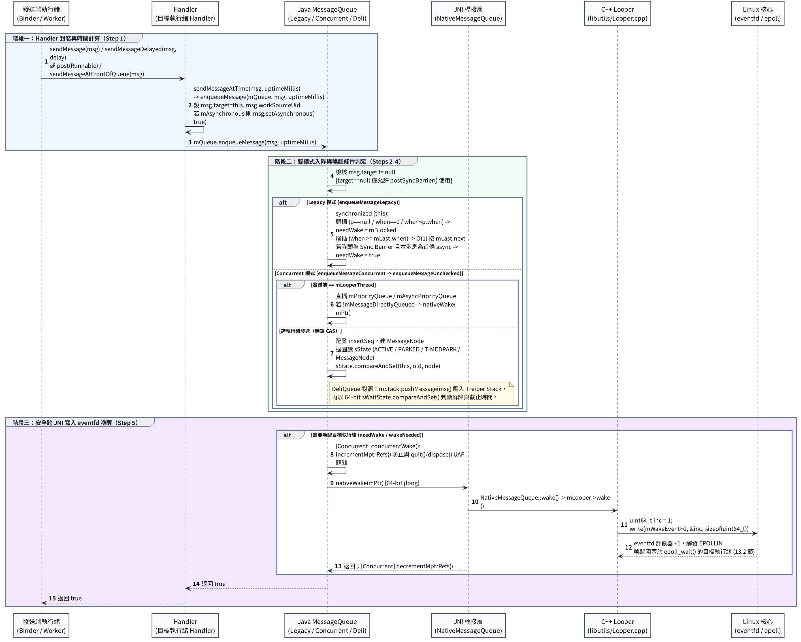

# 13.3 執行緒消息發送過程（`Handler.sendMessage`、`enqueueMessage` 雙模式、Sync Barrier 與 `eventfd` 喚醒）

- **情景說明**：承接 13.2 節，當主執行緒因為沒有到期消息而沉睡在 `epoll_wait()` 裡時，另一條執行緒（例如 Binder 執行緒收到 AMS 的 `IApplicationThread` 呼叫，或背景工作執行緒讀完磁碟準備更新 UI）必須透過目標執行緒的 `Handler` 將一筆 `Message` 放進目標 `MessageQueue`，並在「這筆新消息比目前排程的喚醒時間更早（或正好穿過 Sync Barrier）」時透過 `eventfd` 把沉睡中的目標執行緒叫醒。原書 2.3 的入隊只有單一 `synchronized (this)` + O(n) 走訪鏈表；Android 17 不僅在 Legacy 模式加入 `mLast` 尾指針 O(1) 尾插與 Sync Barrier 非同步喚醒判定，更在預設 `CombinedMessageQueue` 的 Concurrent 模式導入無鎖 `StackNode` CAS 推送 + `incrementMptrRefs()` 防 UAF 喚醒（並提供 `CombinedDeliMessageQueue` 的 Treiber Stack + 64-bit `WaitState` CAS 演進），原生層則改以對 `mWakeEventFd` 寫入 8 位元組 `uint64_t inc = 1` 完成喚醒。本節完整追蹤從 `Handler.sendMessage()` 到 `Looper::wake()` 的全鏈路，並一併解剖 `postSyncBarrier()` / `removeSyncBarrier()`。
- **對應原書**：13.3 節〈线程消息发送过程〉（p.663–668）
- **涉及專案與版本基準**：
  - `platform/frameworks/base` 〔`android-17.0.0_r1`，commit `94b4c163b`〕
  - `platform/system/core` 〔`android-17.0.0_r1`，commit `545d248`〕

---

## 13.3.1 總呼叫樹

```text
Handler(Looper) / Handler.createAsync(Looper)              ## Step 1、顯式綁定目標 Looper/mQueue 與 mAsynchronous
  Handler.sendMessage(msg)                                 ## Step 1、轉呼 sendMessageDelayed(msg, 0)
    Handler.sendMessageDelayed(msg, delayMillis)           ## Step 1、以 SystemClock.uptimeMillis() + delayMillis 算絕對時間
      Handler.sendMessageAtTime(msg, uptimeMillis)         ## Step 1、檢核 mQueue != null（sendMessageAtFrontOfQueue 則傳 0）
        Handler.enqueueMessage(queue, msg, uptimeMillis)   ## Step 1、設 msg.target=this、workSourceUid、若 mAsynchronous 則設非同步旗標
          MessageQueue.enqueueMessage(msg, when)           ## Step 2、檢核 msg.target != null，依 sUseConcurrent 分流
            ├─[Legacy 模式] enqueueMessageLegacy()          ## Step 2、synchronized(this) 頭插 / mLast O(1) 尾插 / Sync Barrier 喚醒判定
            ├─[Concurrent 模式] enqueueMessageConcurrent()  ## Step 3、Looper 執行緒直插雙 SkipList；他執行緒 CAS 壓入 StackNode 堆疊
            ├─[DeliQueue 對照] enqueueMessageDeliQueue()    ## Step 3、Treiber Stack mStack.pushMessage() + 64-bit sWaitState CAS
            └─[同步屏障控制] postSyncBarrier/removeSyncBarrier## Step 4、插入 target==null 屏障節點阻擋同步消息，移除時視條件喚醒
            MessageQueue.nativeWake(mPtr)                  ## Step 5、Concurrent 經 concurrentWake() + incrementMptrRefs() 防 UAF
              NativeMessageQueue::wake()                   ## Step 5、轉呼 mLooper->wake()
                Looper::wake()                             ## Step 5、write(mWakeEventFd, &inc[uint64_t=1], 8) 喚醒 epoll_wait()
```

---

## 13.3.2 逐步驟原始碼分析

### Step 1：`Handler` 建構子、`Handler.createAsync` 與 `sendMessage` → `enqueueMessage`
**位置**：`platform/frameworks/base/core/java/android/os/Handler.java` 〔`android-17.0.0_r1`，lines 163–210、297–322、705–855〕

```java
// Handler.java:163-210, 297-322
    @Deprecated
    public Handler() {
        this(null, false);
    }
    ...
    public Handler(@NonNull Looper looper) {
        this(looper, null, false);
    }
    ...
    public Handler(@NonNull Looper looper, @Nullable Callback callback, boolean async,
            boolean shared) {
        mLooper = looper;
        mQueue = looper.mQueue;
        mCallback = callback;
        mAsynchronous = async;
        mIsShared = shared;
    }

    @NonNull
    public static Handler createAsync(@NonNull Looper looper) {
        if (looper == null) throw new NullPointerException("looper must not be null");
        return new Handler(looper, null, true);
    }
```

```java
// Handler.java:705-707, 764-822, 845-855
    public final boolean sendMessage(@NonNull Message msg) {
        return sendMessageDelayed(msg, 0);
    }
    ...
    public final boolean sendMessageDelayed(@NonNull Message msg, long delayMillis) {
        if (delayMillis < 0) {
            delayMillis = 0;
        }
        return sendMessageAtTime(msg, SystemClock.uptimeMillis() + delayMillis);
    }

    public boolean sendMessageAtTime(@NonNull Message msg, long uptimeMillis) {
        MessageQueue queue = mQueue;
        if (queue == null) {
            RuntimeException e = new RuntimeException(
                    this + " sendMessageAtTime() called with no mQueue");
            Log.w("Looper", e.getMessage(), e);
            return false;
        }
        return enqueueMessage(queue, msg, uptimeMillis);
    }

    public final boolean sendMessageAtFrontOfQueue(@NonNull Message msg) {
        MessageQueue queue = mQueue;
        if (queue == null) {
            RuntimeException e = new RuntimeException(
                    this + " sendMessageAtTime() called with no mQueue");
            Log.w("Looper", e.getMessage(), e);
            return false;
        }
        return enqueueMessage(queue, msg, 0);
    }
    ...
    private boolean enqueueMessage(@NonNull MessageQueue queue, @NonNull Message msg,
            long uptimeMillis) {
        msg.target = this;
        msg.workSourceUid = ThreadLocalWorkSource.getUid();

        if (mAsynchronous) {
            msg.setAsynchronous(true);
        }
        onBeforeEnqueue(queue, msg, uptimeMillis);
        return queue.enqueueMessage(msg, uptimeMillis);
    }
```

1. **顯式指定 `Looper` 與非同步 Handler**：原書 2.3 常用的無參 `new Handler()` 在 Android 17 已標記 `@Deprecated`，強制建議傳入明確的 `Looper`（如 `Looper.getMainLooper()`），避免在未呼叫 `Looper.prepare()` 的執行緒隱式崩潰或誤綁錯誤執行緒。若需要發送不受 Sync Barrier 阻擋的高優先中斷／繪製事件，則呼叫 `Handler.createAsync(looper)` 將 `mAsynchronous` 設為 `true`。
2. **`uptimeMillis` 時鐘基準與 `enqueueMessage()` 統一收口**：所有 `sendMessage*` / `post*` 最後都以 `SystemClock.uptimeMillis()`（系統開機時間，**不含深度休眠時間**）計算絕對觸發時間，並收口到私有的 `Handler.enqueueMessage()`——填入 `msg.target = this`、捕獲發送端 `ThreadLocalWorkSource.getUid()`（供跨執行緒歸因耗電與 Binder 呼叫來源），以及依 `mAsynchronous` 打上 `FLAG_ASYNCHRONOUS` 旗標，最後交給 `queue.enqueueMessage(msg, uptimeMillis)`。

> 〔與 2.3 差異〕API 演進 + 邏輯擴充：原書 13.3 Step 1（p.664–665）在 `sendMessageAtTime()` 裡直接設定 `msg.target = this` 並呼叫 `queue.enqueueMessage()`；Android 17 棄用無參建構子、新增 `Handler.createAsync()`、`mAsynchronous`、`msg.workSourceUid` 追蹤與統一收口 `Handler.enqueueMessage()`。

---

### Step 2：`MessageQueue.enqueueMessage` 與 Legacy 模式（`enqueueMessageLegacy` + `mLast` O(1) 尾插）
**位置**：`platform/frameworks/base/core/java/android/os/CombinedMessageQueue/MessageQueue.java` 〔`android-17.0.0_r1`，lines 1462–1545〕

```java
// MessageQueue.java:1462-1545 (CombinedMessageQueue)
    private boolean enqueueMessageLegacy(Message msg, long when) {
        synchronized (this) {
            if (msg.isInUse()) {
                throw new IllegalStateException(msg + " This message is already in use.");
            }

            if (mQuitting) {
                logDeadThread(msg);
                return false;
            }

            msg.markInUse();
            msg.when = when;
            incAndTraceMessageCount(msg, when);

            Message p = mMessages;
            boolean needWake;
            if (p == null || when == 0 || when < p.when) {
                // New head, wake up the event queue if blocked.
                msg.next = p;
                mMessages = msg;
                needWake = mBlocked;
                if (p == null) {
                    mLast = mMessages;
                }
            } else {
                // Message is to be inserted at tail or middle of queue. Usually we don't have to
                // wake up the event queue unless there is a barrier at the head of the queue and
                // the message is the earliest asynchronous message in the queue.
                needWake = mBlocked && p.target == null && msg.isAsynchronous();

                if (when >= mLast.when) {
                    needWake = needWake && mAsyncMessageCount == 0;
                    msg.next = null;
                    mLast.next = msg;
                    mLast = msg;
                } else {
                    // Inserted within the middle of the queue.
                    Message prev;
                    for (;;) {
                        prev = p;
                        p = p.next;
                        if (p == null || when < p.when) {
                            break;
                        }
                        if (needWake && p.isAsynchronous()) {
                            needWake = false;
                        }
                    }
                    if (p == null) {
                        /* Inserting at tail of queue */
                        mLast = msg;
                    }
                    msg.next = p; // invariant: p == prev.next
                    prev.next = msg;
                }
            }

            if (msg.isAsynchronous()) {
                mAsyncMessageCount++;
            }

            // We can assume mPtr != 0 because mQuitting is false.
            if (needWake) {
                nativeWake(mPtr);
            }
        }
        return true;
    }

    boolean enqueueMessage(Message msg, long when) {
        if (msg.target == null) {
            throw new IllegalArgumentException("Message must have a target.");
        }

        if (sUseConcurrent) {
            return enqueueMessageConcurrent(msg, when);
        } else {
            return enqueueMessageLegacy(msg, when);
        }
    }
```

1. **禁止普通入隊傳入 `msg.target == null`**：因為 `target == null` 已被保留給 Sync Barrier，入口第一行即強硬拒絕！
2. **`mLast` 尾指針 O(1) 尾插優化**：絕大多數 `sendMessage()` 都是以當前遞增的 `uptimeMillis` 順序發送，落點就在隊尾；現代 Legacy 實作維護尾指針 `mLast` 與非同步消息計數 `mAsyncMessageCount`，只要 `when >= mLast.when` 就直接 O(1) 接在 `mLast.next`，不必像原書 2.3 那樣每次都從隊頭 O(n) 掃到隊尾。
3. **精準的 Sync Barrier 喚醒判定**：
   - 頭插（`p == null || when == 0 || when < p.when`）：只要目標執行緒正在休眠（`mBlocked == true`），`needWake` 為真。
   - 中／尾插：平常不需要喚醒；**唯一例外**是「目標執行緒正在休眠（`mBlocked`）且隊頭卡著同步屏障（`p.target == null`）且這筆新消息是非同步消息（`msg.isAsynchronous()`）且在它之前沒有更早的非同步消息」——此時這筆新非同步消息可以越過屏障立刻執行，必須喚醒！

> 〔與 2.3 差異〕邏輯擴充 + 效能優化：原書 13.3 Step 2（p.665–666）無 `mLast` O(1) 尾插、無 `msg.isInUse()` 重複入隊保護、無 `mQuitting` 回收，且中／尾插一律 `needWake = false`；Android 17 補齊 Sync Barrier 非同步喚醒規則與 `mLast` / `mAsyncMessageCount` 加速。

---

### Step 3：Concurrent 無鎖入隊（`enqueueMessageUnchecked` + `concurrentWake`）與 DeliQueue 對照
**位置**：
- `platform/frameworks/base/core/java/android/os/CombinedMessageQueue/MessageQueue.java` 〔`android-17.0.0_r1`，lines 2688–2729、2875–2973〕
- `platform/frameworks/base/core/java/android/os/CombinedDeliMessageQueue/MessageQueue.java` 〔`android-17.0.0_r1`，lines 399–485〕

在預設 Concurrent 模式下，`enqueueMessageConcurrent()` 檢查 `msg.isInUse()` 後直接進入 `enqueueMessageUnchecked()`：

```java
// MessageQueue.java:2875-2973 (CombinedMessageQueue)
    private boolean enqueueMessageUnchecked(@NonNull Message msg, long when) {
        long seq = when != 0 ? ((long) sNextInsertSeq.getAndAdd(this, 1L) + 1L)
                : ((long) sNextFrontInsertSeq.getAndAdd(this, -1L) - 1L);
        msg.when = when;
        msg.insertSeq = seq;
        msg.markInUse();
        incAndTraceMessageCount(msg, when);

        /* If we are running on the looper thread we can add directly to the priority queue */
        if (Thread.currentThread() == mLooperThread) {
            if (getQuitting()) {
                logDeadThread(msg);
                return false;
            }

            insertIntoPriorityQueue(msg);
            if (!mMessageDirectlyQueued) {
                mMessageDirectlyQueued = true;
                nativeWake(mPtr);
            }
            return true;
        }

        MessageNode node = new MessageNode(msg);
        while (true) {
            StackNode old = (StackNode) sState.getVolatile(this);
            boolean wakeNeeded;
            boolean inactive;

            node.mNext = old;
            switch (old.getNodeType()) {
                case STACK_NODE_ACTIVE:
                    node.mBottomOfStack = (StateNode) old;
                    inactive = false;
                    node.mWokeUp = true;
                    wakeNeeded = false;
                    break;

                case STACK_NODE_PARKED:
                    node.mBottomOfStack = (StateNode) old;
                    inactive = true;
                    node.mWokeUp = true;
                    wakeNeeded = true;
                    break;

                case STACK_NODE_TIMEDPARK:
                    node.mBottomOfStack = (StateNode) old;
                    inactive = true;
                    wakeNeeded = mStackStateTimedPark.mWhenToWake >= msg.when;
                    node.mWokeUp = wakeNeeded;
                    break;

                case STACK_NODE_QUITTING:
                    logDeadThread(msg);
                    decAndTraceMessageCount();
                    return false;

                default:
                    MessageNode oldMessage = (MessageNode) old;

                    node.mBottomOfStack = oldMessage.mBottomOfStack;
                    int bottomType = node.mBottomOfStack.getNodeType();
                    inactive = bottomType >= STACK_NODE_PARKED;
                    wakeNeeded = (bottomType == STACK_NODE_TIMEDPARK
                            && mStackStateTimedPark.mWhenToWake >= node.mMessage.when
                            && !oldMessage.mWokeUp);
                    node.mWokeUp = oldMessage.mWokeUp || wakeNeeded;
                    break;
            }
            if (sState.compareAndSet(this, old, node)) {
                if (inactive) {
                    if (wakeNeeded) {
                        concurrentWake();
                    } else {
                        mMessageCounts.incrementQueued();
                    }
                }
                return true;
            }
        }
    }
```

```java
// MessageQueue.java:2688-2729 (CombinedMessageQueue)
    private boolean incrementMptrRefs() {
        while (true) {
            final long oldVal = mMptrRefCountValue;
            if ((oldVal & MPTR_TEARDOWN_MASK) != 0) {
                return false;
            }
            if (sMptrRefCount.compareAndSet(this, oldVal, oldVal + 1L)) {
                return true;
            }
        }
    }

    private void decrementMptrRefs() {
        long oldVal = (long) sMptrRefCount.getAndAdd(this, -1L);
        if (oldVal - 1 == MPTR_TEARDOWN_MASK) {
            LockSupport.unpark(mLooperThread);
        }
    }

    private void concurrentWake() {
        if (incrementMptrRefs()) {
            try {
                nativeWake(mPtr);
            } finally {
                decrementMptrRefs();
            }
        }
    }
```

1. **雙序號保序（`insertSeq`）**：普通消息（`when != 0`）拿遞增正序號 `sNextInsertSeq`，插隊頭消息（`when == 0`）拿遞減負序號 `sNextFrontInsertSeq`，讓優先佇列在 `when` 相同時嚴格維持 FIFO（而 `when == 0` 維持 LIFO 插隊頭語意，與 Legacy 鏈表完全等價）。
2. **本執行緒直插快路徑 vs 跨執行緒無鎖 CAS**：
   - 若發送端就是 `mLooperThread` 本人，直接 `insertIntoPriorityQueue(msg)` 寫入對應的 `ConcurrentSkipListSet`；
   - 若是其他執行緒發送，完全不加鎖！只需建一個 `MessageNode`，讀取當前堆疊頂 `old = sState.getVolatile(this)`，根據堆疊底部的 `StateNode`（`ACTIVE` 不喚、`PARKED` 必喚、`TIMEDPARK` 僅當 `mWhenToWake >= msg.when` 且尚未被前面節點喚醒過 `!oldMessage.mWokeUp` 才喚）用 `sState.compareAndSet(this, old, node)` 壓入堆疊，最後按需呼叫 `concurrentWake()`。
3. **`incrementMptrRefs()` 杜絕跨執行緒 UAF**：因為無鎖模式下不再持有 `synchronized (this)`，另一執行緒呼叫 `nativeWake(mPtr)` 時，Looper 執行緒可能正好在 `quit()` → `dispose()` 銷毀 `NativeMessageQueue`；因此 `concurrentWake()` 必須先用 CAS 遞增 `mMptrRefCountValue`（若已設 `MPTR_TEARDOWN_MASK` 則直接放棄），用完再 `decrementMptrRefs()`（若為最後一個引用則 `LockSupport.unpark(mLooperThread)` 放行 `dispose()`）。
4. **對照 `CombinedDeliMessageQueue`（無鎖 DeliQueue）**：DeliQueue 的 `enqueueMessageUnchecked()` 甚至連 `MessageNode` 外殼都省了，直接以 `mStack.pushMessage(msg)` 把 `Message` 本體 CAS 壓入 Treiber Stack，再以單一 64 位元原子變數 `sWaitState.compareAndSet()` 精準判斷同步屏障（`WaitState.hasSyncBarrier(waitState)` + `Message.compareMessages(barrier, msg) < 0`）與截止時間戳決定是否呼叫 `concurrentWake()`。

> 〔與 2.3 差異〕新增：原書 2.3 無無鎖入隊、無本執行緒直插快路徑、無 `insertSeq` 保序，也無 `mMptrRefCountValue` 無鎖引用計數保護。

---

### Step 4：Sync Barrier 同步屏障（`postSyncBarrier` 與 `removeSyncBarrier`）
**位置**：`platform/frameworks/base/core/java/android/os/CombinedMessageQueue/MessageQueue.java` 〔`android-17.0.0_r1`，lines 1303–1440〕

```java
// MessageQueue.java:1303-1340, 1367-1417 (CombinedMessageQueue)
    private int postSyncBarrier(long when) {
        // Enqueue a new sync barrier token.
        // We don't need to wake the queue because the purpose of a barrier is to stall it.
        if (sUseConcurrent) {
            final int token = mNextBarrierTokenAtomic.getAndIncrement();
            mNextBarrierToken = token + 1;

            final Message msg = Message.obtain();
            msg.markInUse();
            msg.arg1 = token;

            if (!enqueueMessageUnchecked(msg, when)) {
                Log.wtf(TAG_C, "Unexpected error while adding sync barrier!");
                return -1;
            }
            return token;
        }

        synchronized (this) {
            final int token = mNextBarrierToken++;
            final Message msg = Message.obtain();
            msg.markInUse();
            msg.when = when;
            msg.arg1 = token;
            incAndTraceMessageCount(msg, when);
            ...
```

```java
// MessageQueue.java:1367-1417 (CombinedMessageQueue)
    private void removeSyncBarrierConcurrent(int token) {
        boolean removed;
        final MatchBarrierToken matchBarrierToken = new MatchBarrierToken(token);

        removed = findOrRemoveMessages(null, 0, null, null, 0, matchBarrierToken, true);
        if (!removed) {
            throw new IllegalStateException("The specified message queue synchronization "
                    + " barrier token has not been posted or has already been removed.");
        }
        if (Thread.currentThread() != mLooperThread) {
            // Wake up next() in case it was sleeping on this barrier.
            concurrentWake();
        }
    }

    private void removeSyncBarrierLegacy(int token) {
        synchronized (this) {
            Message prev = null;
            Message p = mMessages;
            while (p != null && (p.target != null || p.arg1 != token)) {
                prev = p;
                p = p.next;
            }
            if (p == null) {
                throw new IllegalStateException("The specified message queue synchronization "
                        + " barrier token has not been posted or has already been removed.");
            }
            final boolean needWake;
            if (prev != null) {
                prev.next = p.next;
                if (prev.next == null) {
                    mLast = prev;
                }
                needWake = false;
            } else {
                mMessages = p.next;
                if (mMessages == null) {
                    mLast = null;
                }
                needWake = mMessages == null || mMessages.target != null;
            }
            p.recycleUnchecked();
            decAndTraceMessageCount();

            if (needWake && !mQuitting) {
                nativeWake(mPtr);
            }
        }
    }
```

1. **屏障的本質就是一筆 `target == null`、`arg1 == token` 的特殊 `Message`**：`postSyncBarrier()` 刻意繞過 `enqueueMessage()` 的 `target != null` 檢核，直接依時間順序把屏障插入佇列（Concurrent 模式下插進 `mPriorityQueue`）；插入屏障的目的是「擋住後續同步消息」，因此完全不需要 `nativeWake()`。
2. **移除時視情況喚醒**：當 UI 繪製完成呼叫 `removeSyncBarrier(token)` 時，若該屏障正卡在隊頭（`prev == null`）且解除後隊頭不再是另一道屏障（`mMessages == null || mMessages.target != null`），便呼叫 `nativeWake()` 喚醒被擋住的普通同步消息繼續執行。

> 〔與 2.3 差異〕新增：原書 2.3 尚無 Sync Barrier 機制；Android 17 同時在 Legacy、Concurrent 與 DeliQueue 三種模式下完整支援 `postSyncBarrier()` / `removeSyncBarrier()`。

---

### Step 5：`MessageQueue.nativeWake`、`NativeMessageQueue::wake` 與 `Looper::wake`
**位置**：
- `platform/frameworks/base/core/jni/android_os_MessageQueue.cpp` 〔`android-17.0.0_r1`，lines 137–139、229–232〕
- `platform/system/core/libutils/Looper.cpp` 〔`android-17.0.0_r1`，lines 413–426〕

```cpp
// android_os_MessageQueue.cpp:137-139, 229-232
void NativeMessageQueue::wake() {
    mLooper->wake();
}
...
static void android_os_MessageQueue_nativeWake(JNIEnv* env, jclass clazz, jlong ptr) {
    NativeMessageQueue* nativeMessageQueue = reinterpret_cast<NativeMessageQueue*>(ptr);
    nativeMessageQueue->wake();
}
```

```cpp
// Looper.cpp:413-426
void Looper::wake() {
    uint64_t inc = 1;
    ssize_t nWrite = TEMP_FAILURE_RETRY(write(mWakeEventFd.get(), &inc, sizeof(uint64_t)));
    if (nWrite != sizeof(uint64_t)) {
        if (errno != EAGAIN) {
            LOG_ALWAYS_FATAL("Could not write wake signal to fd %d (returned %zd): %s",
                             mWakeEventFd.get(), nWrite, strerror(errno));
        }
    }
}
```

1. **寫入 8 位元組 `eventfd` 計數器**：`Looper::wake()` 向非阻塞 `mWakeEventFd` 寫入 `uint64_t inc = 1`；核心將 `eventfd` 內部 64 位元計數器加 1，使其立刻變為可讀（`EPOLLIN`），進而喚醒正阻塞在 `epoll_wait()`（13.2 節 Step 6）中的目標執行緒。若因極端高頻喚醒導致 64 位元計數器已達最大值而回傳 `EAGAIN`，代表本就處於已喚醒狀態，直接安全忽略即可。

> 〔與 2.3 差異〕邏輯改變：原書 13.3 Step 3–5（p.667）傳遞 `jint ptr` 並向管道寫端 `mWakeWritePipeFd` 寫入 1 位元組字元 `"W"`；Android 17 改傳 `jlong ptr`，向 `mWakeEventFd` 寫入 8 位元組 `uint64_t inc = 1` 並以 `TEMP_FAILURE_RETRY` 處理 `EINTR`。

---

## 13.3.3 本節總結與時序圖



| 階段 | 核心方法 | 關鍵動作與演進 |
|---|---|---|
| **`Handler` 封裝** | `Handler.sendMessage*()` → `Handler.enqueueMessage()` | 棄用無參建構子、支援 `createAsync()`；統一以 `uptimeMillis` 計算到期時間並填入 `target`、`workSourceUid` 與 `FLAG_ASYNCHRONOUS` |
| **Legacy 入隊** | `enqueueMessageLegacy()` | `synchronized (this)` 搭配 `mLast` O(1) 尾插與 `mAsyncMessageCount`；頭插或穿過隊頭 Sync Barrier 的首條非同步消息觸發喚醒 |
| **Concurrent / DeliQueue 入隊** | `enqueueMessageUnchecked()` / `concurrentWake()` | 本執行緒直插雙 `ConcurrentSkipListSet`；他執行緒無鎖 CAS 壓入 `StackNode`（DeliQueue 則壓入 Treiber Stack + 64-bit `sWaitState` CAS），經 `incrementMptrRefs()` 安全喚醒 |
| **同步屏障** | `postSyncBarrier()` / `removeSyncBarrier()` | 插入 `target == null`、`arg1 == token` 特殊節點阻擋同步消息；移除隊頭屏障時按需 `nativeWake()` |
| **原生喚醒** | `nativeWake()` → `NativeMessageQueue::wake()` → `Looper::wake()` | 向 `mWakeEventFd` 寫入 8B `uint64_t inc = 1`，使核心觸發 `EPOLLIN` 喚醒阻塞於 `epoll_wait()` 的目標執行緒 |
