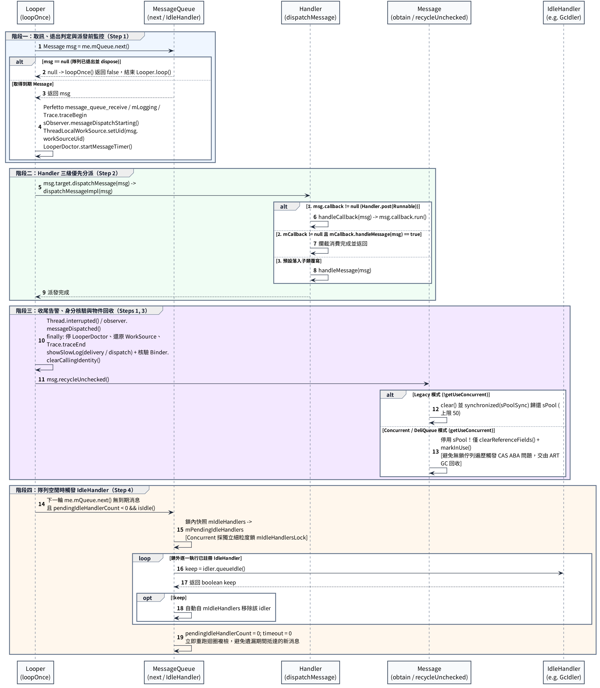

# 13.4 執行緒消息處理與空閒處理器（`Looper.loopOnce`、`Handler.dispatchMessage`、`Message` 池化演進與 `IdleHandler`）

- **情景說明**：目標執行緒在 13.2 節 `epoll_wait()` 被 13.3 節的 `eventfd` 喚醒並自 `MessageQueue.next()` 取得一筆到期 `Message` 後，接下來必須把消息精準分派給當初發送它的 `Handler` 執行業務邏輯，執行完畢再正確清理或回收這筆 `Message` 物件；同時，為了及早察覺主執行緒卡頓（Jank / ANR）與 Binder 身分洩漏，Android 17 在派發前後加入了完整的可觀測性與安全防護（Perfetto SDK 追蹤、`Observer`、`LooperDoctor`、`SlowDelivery`/`SlowDispatch` 與 `Binder.clearCallingIdentity()` 核驗）。此外，當佇列暫時沒有到期消息、執行緒即將再次休眠前，還會派發一次性的空閒通知給已註冊的 `IdleHandler`（例如 `ActivityThread` 的 `GcIdler` 趁空閒執行 GC）。本節完整追蹤這條收尾鏈路，特別點出 Android 17 中 **`msg.target == null` 語意反轉**與 **Concurrent 模式下 `Message` 停用物件池以避免 CAS ABA 問題** 兩項極關鍵的現代演進。
- **對應原書**：13.4 節〈线程消息处理过程〉（p.668–674）
- **涉及專案與版本基準**：
  - `platform/frameworks/base` 〔`android-17.0.0_r1`，commit `94b4c163b`〕

---

## 13.4.1 總呼叫樹

```text
Looper.loopOnce(me, ident, thresholdOverride)              ## Step 1、取 me.mQueue.next()；回 null 即退出（不再用 target==null 判退出）
  PerfettoTrace / mLogging / sObserver / LooperDoctor      ## Step 1、追蹤、工作來源歸因與卡頓計時啟動
  msg.target.dispatchMessage(msg)                          ## Step 2、轉交目標 Handler 派發
    Handler.dispatchMessageImpl(msg)                       ## Step 2、三級優先順序分派
      ├─1. msg.callback != null -> handleCallback(msg)     ## Step 2、執行 Handler.post(Runnable) 綁定的 Runnable.run()
      ├─2. mCallback != null -> mCallback.handleMessage()  ## Step 2、回傳 true 則攔截結束
      └─3. handleMessage(msg)                              ## Step 2、執行 Handler 子類覆寫的處理邏輯
  showSlowLog() + Binder.clearCallingIdentity() 核驗       ## Step 1、慢投遞/慢處理告警 + 校驗身分未被汙染
  msg.recycleUnchecked()                                   ## Step 3、Legacy 歸還 sPool(<=50)；Concurrent/DeliQueue 停用池化防 ABA
==================== 當隊列空或隊頭未到期、休眠前 ====================
MessageQueue.addIdleHandler() / removeIdleHandler()        ## Step 4、註冊/註銷 IdleHandler
MessageQueue.nextLegacy() / nextConcurrent()               ## Step 4、快照至 mPendingIdleHandlers -> 鎖外呼叫 idler.queueIdle()
  keep == false -> 自動自 mIdleHandlers 移除                ## Step 4、跑完歸零 timeout=0 立即再掃一次隊列
```

---

## 13.4.2 逐步驟原始碼分析

### Step 1：`Looper.loopOnce` 派發前後監控、身分核驗與回收
**位置**：`platform/frameworks/base/core/java/android/os/Looper.java` 〔`android-17.0.0_r1`，lines 230–364〕

```java
// Looper.java:230-364（主幹）
    private static boolean loopOnce(final Looper me,
            final long ident, final int thresholdOverride) {
        Message msg = me.mQueue.next(); // might block
        if (msg == null) {
            // No message indicates that the message queue is quitting.
            return false;
        }
        ...
        final Printer logging = me.mLogging;
        if (logging != null) {
            logging.println(">>>>> Dispatching to " + msg.target + " "
                    + msg.callback + ": " + msg.what);
        }
        final Observer observer = sObserver;

        final long traceTag = me.mTraceTag;
        long slowDispatchThresholdMs = me.mSlowDispatchThresholdMs;
        long slowDeliveryThresholdMs = me.mSlowDeliveryThresholdMs;
        ...
        if (traceTag != 0 && Trace.isTagEnabled(traceTag)) {
            Trace.traceBegin(traceTag, msg.target.getTraceName(msg));
        }

        final long dispatchStart = needStartTime ? SystemClock.uptimeMillis() : 0;
        final long dispatchEnd;
        Object token = null;
        if (observer != null) {
            token = observer.messageDispatchStarting();
        }
        long origWorkSource = ThreadLocalWorkSource.setUid(msg.workSourceUid);

        final LooperDoctor doctor = Flags.messageQueueMonitoringEnabled() ? me.mLooperDoctor : null;
        if (doctor != null) {
            doctor.startMessageTimer(me.mAlarm);
        }
        try {
            msg.target.dispatchMessage(msg);
            if (isLooperClearsThreadInterruptedEnabled()) {
                Thread.interrupted();
            }
            if (observer != null) {
                observer.messageDispatched(token, msg);
            }
            dispatchEnd = needEndTime ? SystemClock.uptimeMillis() : 0;
        } catch (Exception exception) {
            if (observer != null) {
                observer.dispatchingThrewException(token, msg, exception);
            }
            throw exception;
        } finally {
            if (doctor != null) {
                doctor.stopMessageTimer(me.mAlarm);
            }
            ThreadLocalWorkSource.restore(origWorkSource);
            if (traceTag != 0) {
                Trace.traceEnd(traceTag);
            }
        }
        if (logSlowDelivery) {
            ...
                slow = showSlowLog(slowDeliveryThresholdMs, msg.when, dispatchStart,
                        "delivery", msg);
            ...
        }
        if (logSlowDispatch) {
            showSlowLog(slowDispatchThresholdMs, dispatchStart, dispatchEnd, "dispatch", msg);
        }

        if (logging != null) {
            logging.println("<<<<< Finished to " + msg.target + " " + msg.callback);
        }

        final long newIdent = Binder.clearCallingIdentity();
        if (ident != newIdent) {
            Log.wtf(TAG, "Thread identity changed from 0x"
                    + Long.toHexString(ident) + " to 0x"
                    + Long.toHexString(newIdent) + " while dispatching to "
                    + msg.target.getClass().getName() + " "
                    + msg.callback + " what=" + msg.what);
        }
        ...
        msg.recycleUnchecked();

        return true;
    }
```

1. **退出語意徹底翻轉**：原書 2.3 中 `Looper.loop()` 會檢查 `if (msg.target == null) return;` 來退出迴圈；Android 17 已把 `msg.target == null` 改作 Sync Barrier 標記，退出改由 `me.mQueue.next()` 在 `dispose()` 後直接回傳 **`null`**，故 `loopOnce()` 只需 `if (msg == null) return false;`。
2. **完整的生產級可觀測性與防禦鏈**：
   - **效能追蹤**：Perfetto SDK `message_queue_receive` 流程連線（對接 13.3 節入隊時的 `message_queue_send` `msg.eventId`）、`Trace.traceBegin()`、`me.mLogging`（常見於 `BlockCanary` 等主執行緒卡頓監控）、`LooperDoctor` 計時器，以及分開量測排隊等待耗時（`Slow delivery`：`dispatchStart - msg.when`）與實際執行耗時（`Slow dispatch`：`dispatchEnd - dispatchStart`）。
   - **執行緒狀態衛生**：派發前切換 `ThreadLocalWorkSource.setUid(msg.workSourceUid)` 並在 `finally` 還原；派發後依旗標呼叫 `Thread.interrupted()` 清除意外殘留的中斷旗標，最後比對 `Binder.clearCallingIdentity()` 是否仍等於迴圈入口的基準 `ident`（防止某個 Handler 覆寫了呼叫身分卻忘了還原，導致後續所有消息冒用錯誤 UID/PID）。
   - **收尾回收**：最後統一呼叫 `msg.recycleUnchecked()`（Step 3）。

> 〔與 2.3 差異〕語意反轉 + 邏輯大幅擴充：原書 13.4 Step 1（p.668–669）僅以 `msg.target == null` 判退出並直接呼 `msg.target.dispatchMessage(msg)`；Android 17 改以 `msg == null` 判退出，並整合 Perfetto 追蹤、`Observer`、`LooperDoctor`、`WorkSource`、慢消息告警、`Thread.interrupted()` 清理與 `Binder` 身分校驗。

---

### Step 2：`Handler.dispatchMessage`、`dispatchMessageImpl` 與三級優先分派
**位置**：`platform/frameworks/base/core/java/android/os/Handler.java` 〔`android-17.0.0_r1`，lines 106–144、480–482、1094–1096〕

```java
// Handler.java:106-144, 480-482, 1094-1096
    public interface Callback {
        boolean handleMessage(@NonNull Message msg);
    }

    public void handleMessage(@NonNull Message msg) {
    }

    @RavenwoodRedirect(comment = "Allow ravenwood to hook message dispatches.")
    public void dispatchMessage(@NonNull Message msg) {
        dispatchMessageImpl(msg);
    }

    public void dispatchMessageImpl(@NonNull Message msg) {
        if (msg.callback != null) {
            handleCallback(msg);
        } else {
            if (mCallback != null) {
                if (mCallback.handleMessage(msg)) {
                    return;
                }
            }
            handleMessage(msg);
        }
    }
    ...
    public final boolean post(@NonNull Runnable r) {
       return  sendMessageDelayed(getPostMessage(r), 0);
    }
    ...
    private static void handleCallback(Message message) {
        message.callback.run();
    }
```

1. **三級派發優先順序（從原書 2.3 延續至今的核心契約）**：
   - **第一順位：`msg.callback`**（`Runnable`）——當開發者透過 `Handler.post(Runnable)`（內部呼叫 `getPostMessage(r)` 設 `m.callback = r`）發送任務時，直接執行 `message.callback.run()` 並結束，不會觸及後續兩級。
   - **第二順位：`Handler.mCallback`**（`Handler.Callback` 介面）——透過 `new Handler(looper, callback)` 注入的委託回呼；若其 `handleMessage(msg)` 回傳 **`true`**，代表已完全消費此消息，直接攔截返回；回傳 `false` 才放行給下一級。
   - **第三順位：`Handler.handleMessage(msg)`**——最常見的用法，由子類（例如 `ActivityThread.H`）覆寫實作 `switch (msg.what)` 分派。

> 〔與 2.3 差異〕基本不變（輕微結構抽離）：三級派發順序與原書 13.4 Step 2–3（p.669–671）完全一致；Android 17 僅將本體抽出為 `dispatchMessageImpl()` 以支援宿主測試框架 Ravenwood 攔截，並將 `handleCallback()` 改為 `static`。

---

### Step 3：`Message.obtain` 與 `Message.recycleUnchecked`（併發模式為何停用 `sPool` 物件池？）
**位置**：`platform/frameworks/base/core/java/android/os/Message.java` 〔`android-17.0.0_r1`，lines 215–238、388–428〕

```java
// Message.java:215-238, 388-406
    public static final Object sPoolSync = new Object();
    private static Message sPool;
    private static int sPoolSize = 0;

    private static final int MAX_POOL_SIZE = 50;

    public static Message obtain() {
        if (!MessageQueue.getUseConcurrent()) {
            synchronized (sPoolSync) {
                if (sPool != null) {
                    Message m = sPool;
                    sPool = m.next;
                    m.next = null;
                    m.flags = 0; // clear in-use flag
                    sPoolSize--;
                    return m;
                }
            }
        }
        return new Message();
    }
    ...
    @UnsupportedAppUsage
    void recycleUnchecked() {
        if (MessageQueue.getUseConcurrent()) {
            // Once a message has entered the queue, it may still be referenced by removing threads
            // forever and may not be recycled. As such, its flags field must not be cleared.
            clearReferenceFields();

            // However, we should still mark this as in-use.
            markInUse();
        } else {
            clear();
            synchronized (sPoolSync) {
                if (sPoolSize < MAX_POOL_SIZE) {
                    next = sPool;
                    sPool = this;
                    sPoolSize++;
                }
            }
        }
    }
```

1. **Legacy 模式（傳統物件池）**：延續經典設計，維護長度上限 `MAX_POOL_SIZE = 50` 的靜態單向鏈表 `sPool`；`recycleUnchecked()` 先呼叫 `clear()` 清空欄位並以 `synchronized (sPoolSync)` 頭插回池，下次 `Message.obtain()` 直接復用。
2. **Concurrent / DeliQueue 模式（刻意停用 `sPool`！）**：當 `MessageQueue.getUseConcurrent()` 為 `true` 時：
   - **`Message.obtain()` 直接跳過 `sPool` 改為 `return new Message()`**；
   - **`recycleUnchecked()` 不再把物件放回 `sPool`，也不清除 `flags`**，僅呼叫 `clearReferenceFields()` 釋放對外部 `obj` / `data` / `callback` / `target` 的強引用以防記憶體洩漏，並維持 `markInUse()`。
   - **深層原因（對照 `CombinedDeliMessageQueue/README.md` 與 `Message.java` 註解）**：在無鎖／併發佇列中，其他正在執行 `removeMessages()` 的執行緒仍可能持有該 `Message` 節點的參考並在走訪堆疊；若允許回收進全域 `sPool` 並立刻重新入隊，就會觸發經典的 **CAS ABA 問題**，甚至讓走訪中的移除執行緒誤刪一筆剛重用的全新消息；另一方面，現代 ART 併發複製 GC（CMC / CC）對短生命週期小物件的分配與回收成本極低，早已不需要靠全域鎖 `sPoolSync` 換取微小的配置節省！

> 〔與 2.3 差異〕邏輯重大改變：原書 2.3 與歷代 Android 皆強調一律用 `Message.obtain()` 復用 `sPool` 物件池；Android 17 在 Concurrent 與 DeliQueue 模式下徹底停用 `sPool` 改由 ART GC 直接回收，以根絕無鎖演算法的 ABA 風險並消除 `sPoolSync` 全域鎖競爭。

---

### Step 4：空閒消息處理器（`IdleHandler` 的註冊與執行閉環）
**位置**：`platform/frameworks/base/core/java/android/os/CombinedMessageQueue/MessageQueue.java` 〔`android-17.0.0_r1`，lines 368–404、911–956、1030–1072〕

```java
// MessageQueue.java:368-404 (CombinedMessageQueue)
    public void addIdleHandler(@NonNull IdleHandler handler) {
        if (handler == null) {
            throw new NullPointerException("Can't add a null IdleHandler");
        }
        if (sUseConcurrent) {
            addIdleHandlerConcurrent(handler);
        } else {
            addIdleHandlerLegacy(handler);
        }
    }
    ...
    public void removeIdleHandler(@NonNull IdleHandler handler) {
        if (sUseConcurrent) {
            removeIdleHandlerConcurrent(handler);
        } else {
            removeIdleHandlerLegacy(handler);
        }
    }
```

在 `nextConcurrent()`（與 `nextLegacy()` 邏輯對稱，差異僅在於前者改用獨立細粒度鎖 `mIdleHandlersLock` 保護 `mIdleHandlers` 而不再鎖整個 `MessageQueue`）中，當本次迴圈沒有到期消息可回傳、即將進入 `nativePollOnce()` 休眠前，執行空閒處理器：

```java
// MessageQueue.java:911-956 (CombinedMessageQueue)
            synchronized (mIdleHandlersLock) {
                // If first time idle, then get the number of idlers to run.
                // Idle handles only run if the queue is empty or if the first message
                // in the queue (possibly a barrier) is due to be handled in the future.
                if (pendingIdleHandlerCount < 0
                        && isIdle()) {
                    pendingIdleHandlerCount = mIdleHandlers.size();
                }
                if (pendingIdleHandlerCount <= 0) {
                    // No idle handlers to run.  Loop and wait some more.
                    continue;
                }

                if (mPendingIdleHandlers == null) {
                    mPendingIdleHandlers = new IdleHandler[Math.max(pendingIdleHandlerCount, 4)];
                }
                mPendingIdleHandlers = mIdleHandlers.toArray(mPendingIdleHandlers);
            }

            // Run the idle handlers.
            // We only ever reach this code block during the first iteration.
            for (int i = 0; i < pendingIdleHandlerCount; i++) {
                final IdleHandler idler = mPendingIdleHandlers[i];
                mPendingIdleHandlers[i] = null; // release the reference to the handler

                boolean keep = false;
                try {
                    keep = idler.queueIdle();
                } catch (Throwable t) {
                    Log.wtf(TAG_C, "IdleHandler threw exception", t);
                }

                if (!keep) {
                    synchronized (mIdleHandlersLock) {
                        mIdleHandlers.remove(idler);
                    }
                }
            }

            // Reset the idle handler count to 0 so we do not run them again.
            pendingIdleHandlerCount = 0;

            // While calling an idle handler, a new message could have been delivered
            // so go back and look again for a pending message without waiting.
            mNextPollTimeoutMillis = 0;
```

1. **只在「單次 `next()` 呼叫中首次發現空閒」時執行一次**：透過 `pendingIdleHandlerCount` 初始值為 `-1`、跑完立即重設為 `0` 的技巧，保證在 `for (;;)` 迴圈裡 `IdleHandler` 最多執行一輪，不會陷入無限空轉。
2. **快照鎖外執行 + 單次／常駐控制**：先在鎖內（Legacy 用 `this`、Concurrent 用獨立 `mIdleHandlersLock`）複製快照進 `mPendingIdleHandlers`，出鎖後才呼叫 `idler.queueIdle()`，防止回呼內再次呼叫 `addIdleHandler()` / `sendMessage()` 造成死鎖或 `ConcurrentModificationException`；回傳 `false` 表示「一次性任務」，自動移除，回傳 `true` 則保留待下次空閒再次觸發。
3. **重設超時為 `0` 立即覆檢**：跑完 `IdleHandler` 期間，可能有別的執行緒（或 `queueIdle()` 自己）送了新消息進來，因此把 `mNextPollTimeoutMillis` / `nextPollTimeoutMillis` 清為 `0`，立刻重跑一次迴圈確認，絕不帶著新消息睡過去。

> 〔與 2.3 差異〕邏輯微調：整體 `IdleHandler` 快照、鎖外執行、回傳 `keep` 控留存與清零超時的設計與原書 13.4（p.672–674）一致；Android 17 在 Concurrent / DeliQueue 模式下將其改由獨立細粒度鎖 `mIdleHandlersLock` 保護，進一步避免干擾入隊與出隊吞吐。

---

## 13.4.3 本節總結與時序圖



| 階段 | 核心類別與方法 | 關鍵行為與 Android 17 重點 |
|---|---|---|
| **迴圈派發與監控** | `Looper.loopOnce()` | `msg == null` 即結束迴圈；整合 Perfetto 追蹤、`Observer`、`LooperDoctor`、`SlowDelivery`/`SlowDispatch` 與 `Binder.clearCallingIdentity()` 校驗 |
| **三級分派** | `Handler.dispatchMessage()` → `dispatchMessageImpl()` | 依序檢查 `msg.callback.run()` → `mCallback.handleMessage(msg)` → 子類 `handleMessage(msg)` |
| **物件回收與池化** | `Message.recycleUnchecked()` / `Message.obtain()` | Legacy 歸還 `sPool`（上限 50）；Concurrent / DeliQueue 停用 `sPool` 僅清強引用並標記 `FLAG_IN_USE`，根絕 CAS ABA 問題與 `sPoolSync` 鎖競爭 |
| **空閒回呼** | `MessageQueue.addIdleHandler()` → `next()` 中 `queueIdle()` | 首次無到期消息時快照至 `mPendingIdleHandlers`、於鎖外執行（Concurrent 採獨立 `mIdleHandlersLock`），`keep == false` 自動移除並將超時歸 `0` 立即複檢 |
