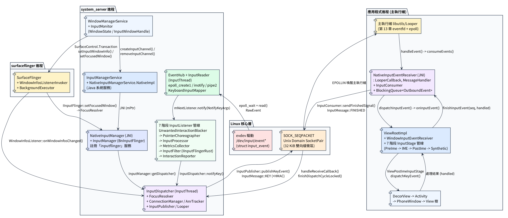
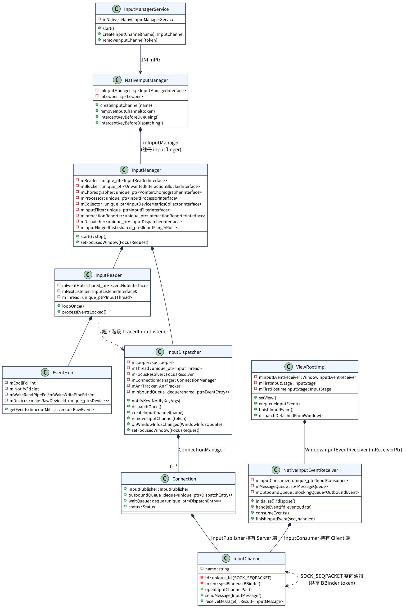

# 14.1 鍵盤消息處理模型（`InputManagerService`、7 階段 `InputListener` 管線、`SOCK_SEQPACKET` 與 `SurfaceFlinger` 焦點同步）

- **情景說明**：應用程式中一般由 `Handler.sendMessage()` 發出的消息屬於純軟體產生的內部工作（第 13 章）；而鍵盤按鍵（以及觸控、滑鼠等輸入事件）源自硬體中斷，必須由系統統一監控、解析裝置協定、篩選與判定前景焦點視窗，再安全、低延遲地跨越進程邊界派發給當前處於啟用狀態的應用程式視窗，並確認對方已處理完畢（否則觸發 ANR）。本節對照原書 14.1 節建立 Android 17 Input 系統的三進程全景架構與核心資料結構，作為後續 14.2–14.5 節追蹤啟動、註冊、分發與註銷的座標地圖。
- **對應原書**：第 14 章引言與 14.1 節〈键盘消息处理模型〉（p.675–678）
- **涉及專案與版本基準**：
  - `platform/frameworks/base` 〔`android-17.0.0_r1`，commit `94b4c163`〕
  - `platform/frameworks/native` 〔`android-17.0.0_r1`，commit `ae266dc`〕

---

## 14.1.1 三進程協作全景架構（2.3 → 17）

> 對應原書 14.1 節與圖 14-1、圖 14-2（p.675–678）。原書 2.3 的輸入系統橫跨兩個進程（`system_server` 與應用進程），且 `InputManager` 附屬於 `WindowManagerService`；Android 17 演進為 **`system_server`、`surfaceflinger` 與應用進程**三方協作架構，並徹底重寫了底層通道與事件處理管線。



整條輸入處理模型由五大核心支柱構成：

1. **獨立系統服務與 7 階段 `InputListener` 管線（`system_server`）**：
   - Java 層的 `InputManagerService` 不再是 `WindowManagerService` 的私有成員，而是由 `SystemServer` 透過 `InputManagerService.Lifecycle` 獨立啟動並註冊為 `"input"` Binder 服務，經由 `NativeInputManagerService.NativeImpl` 橋接至 C++ `NativeInputManager` 與 `InputManager`。
   - C++ `InputManager` 同時繼承 `BnInputFlinger` 註冊為原生 `"inputflinger"` 服務，啟動時經 `cxxbridge` 建立 Rust 元件 `IInputFlingerRust`，並將事件流串接成 **7 階段 `InputListener` 管線**（每階段由 `TracedInputListener` 包覆以支援輸入追蹤）：
     `InputReader` → `UnwantedInteractionBlocker` → `PointerChoreographer` → `InputProcessor` → `InputDeviceMetricsCollector` → `InputFilter`（Rust 後端）→ `InteractionReporter`（可選）→ `InputDispatcher`。
2. **`EventHub` + `InputReader` 硬體事件讀取**：
   - `EventHub` 透過 Linux `epoll_create1(EPOLL_CLOEXEC)` 同時監聽所有 `/dev/input/event*` 裝置檔案、`inotify_init1(IN_CLOEXEC)` 熱插拔目錄通知以及 `pipe2` 喚醒管道。
   - `InputReader` 執行緒循環讀取原始 `struct input_event`，交由 `InputDevice` 旗下對應的 `InputMapper`（鍵盤為 `KeyboardInputMapper`）查表翻譯為 Android `keyCode` 與修飾鍵狀態，產出 `NotifyKeyArgs` 沿 7 階段管線送入 `InputDispatcher`。
3. **`SurfaceFlinger` 作為視窗拓撲與焦點的單一真實來源**：
   - WMS 的 `InputMonitor` 不再直接透過 JNI 呼叫 `InputManager.setInputWindows()`，而是把每個視窗的 `WindowInfo`（幾何座標、Z-order、遮擋旗標、綁定的 `InputChannel` token）與焦點請求寫入 `SurfaceControl.Transaction` 提交給 `SurfaceFlinger`。
   - `SurfaceFlinger` 合成事務後，於背景執行緒一方面透過 `WindowInfosListenerInvoker` 回呼 `InputDispatcher::DispatcherWindowListener::onWindowInfosChanged()`，另一方面透過 `"inputflinger"` Binder 介面呼叫 `InputManager::setFocusedWindow()`，交由 `InputDispatcher` 內部的多螢幕 **`FocusResolver`** 裁決最終焦點並向新舊視窗派發 `InputMessage::Type::FOCUS`。
4. **雙向 `SOCK_SEQPACKET` `InputChannel` 與 `InputMessage` 協定**：
   - 每個需要接收輸入的視窗都對應一對由 `InputDispatcher::createInputChannel()` 原子建立的 `InputChannel`：底層為一對 Unix Domain **`socketpair(AF_UNIX, SOCK_SEQPACKET, 0, sockets)`**（收發緩衝區各 `32 KiB`）與一枚共享的 `BBinder` `token`。
   - Server 端留在 `InputDispatcher` 內部由 `Connection`（持有 `InputPublisher`）註冊至 `InputDispatcher` 的 `Looper`；Client 端經由 Binder `InputChannelCore` 傳回應用進程，交給 `ViewRootImpl.WindowInputEventReceiver`（JNI 層 `NativeInputEventReceiver` 持有 `InputConsumer`）註冊至應用主執行緒的 `Looper`（即第 13 章分析的 `libutils/Looper`）。
5. **應用端 `InputStage` 責任鏈與 `Finish` / `Timeline` 雙向回執**：
   - 應用主執行緒 `Looper` 被 Client socket 的 `EPOLLIN` 喚醒後，`NativeInputEventReceiver` 透過 `InputConsumer` 讀出 `InputMessage::Type::KEY` 轉為 Java `KeyEvent`，送入 `ViewRootImpl` 的 7 階段 **`InputStage`** 管線（`NativePreIme` → `ViewPreIme` → `Ime` → `EarlyPostIme` → `NativePostIme` → `ViewPostIme` → `Synthetic`），最終抵達 `DecorView`、`Activity` 與焦點 `View`。
   - 處理完畢後呼叫 `finishInputEvent()` 透過同一個雙向 socket 送回 `InputMessage::Type::FINISHED`（附帶 `seq`、`handled` 與 `consumeTime`），喚醒 `InputDispatcher` 移除 `waitQueue`、重置 ANR 計時器並派發下一筆事件；渲染完成後還可額外回報 `InputMessage::Type::TIMELINE` 進行端到端圖形延遲統計。

---

## 14.1.2 核心類別關係與 `InputMessage` 傳輸協定



### Step 1：C++ `InputManager` 7 階段 `InputListener` 管線定義
**位置**：`platform/frameworks/native/services/inputflinger/InputManager.h` 〔`android-17.0.0_r1`，lines 121–171〕

```cpp
// InputManager.h:121-171
class InputManager : public InputManagerInterface, public BnInputFlinger {
protected:
    ~InputManager() override;

public:
    InputManager(const sp<InputReaderPolicyInterface>& readerPolicy,
                 InputDispatcherPolicyInterface& dispatcherPolicy,
                 PointerChoreographerPolicyInterface& choreographerPolicy,
                 InputFilterPolicyInterface& inputFilterPolicy, JavaVM* vm,
                 bool createInteractionReporter);

    status_t start() override;
    status_t stop() override;
...
    binder::Status createInputChannel(const std::string& name,
                                      android::os::InputChannelCore* outChannel) override;
    binder::Status removeInputChannel(const sp<IBinder>& connectionToken) override;
    binder::Status setFocusedWindow(const gui::FocusRequest&) override;

private:
    std::unique_ptr<InputReaderInterface> mReader;

    std::unique_ptr<UnwantedInteractionBlockerInterface> mBlocker;

    std::unique_ptr<InputFilterInterface> mInputFilter;

    std::unique_ptr<PointerChoreographerInterface> mChoreographer;

    std::unique_ptr<InputProcessorInterface> mProcessor;

    std::unique_ptr<InputDeviceMetricsCollectorInterface> mCollector;

    std::unique_ptr<InteractionReporterInterface> mInteractionReporter;

    std::unique_ptr<InputDispatcherInterface> mDispatcher;

    std::shared_ptr<IInputFlingerRust> mInputFlingerRust;

    std::vector<std::unique_ptr<TracedInputListener>> mTracingStages;
};
```

1. **雙重身分**：`InputManager` 既實作給 `NativeInputManager` 同進程呼叫的 `InputManagerInterface`，又繼承 `BnInputFlinger` 成為跨進程 Binder 服務端（主要供 `SurfaceFlinger` 呼叫 `setFocusedWindow()` 以及測試工具建立/移除通道）。
2. **單向責任鏈解耦**：`InputReader` 到 `InputDispatcher` 之間的所有中間階段（誤觸攔截、指標游標協調、HAL 處理器、裝置指標收集、Rust `InputFilter`、注意力互動回報）都統一實作 `InputListenerInterface`，嚴格維持「只由上游往下游單向推送 `NotifyArgs`」的無共享狀態設計，避免循環鎖依賴。

> 〔與 2.3 差異〕搬家 + 架構重構：原書 14.1（p.676–677）中 `frameworks/base/libs/ui/InputManager.h` 僅持有 `mReader`、`mDispatcher` 與兩條 `Thread`；Android 17 搬遷至 `platform/frameworks/native/services/inputflinger/InputManager.h`，引入 7 階段管線、Rust `IInputFlingerRust` 與 `BnInputFlinger` 介面。

---

### Step 2：`InputMessage` 8 位元組對齊跨進程傳輸結構
**位置**：`platform/frameworks/native/include/input/InputTransport.h` 〔`android-17.0.0_r1`，lines 64–112、170–186、205–226〕

```cpp
// InputTransport.h:64-112, 170-186, 205-226
struct InputMessage {
    enum class Type : uint32_t {
        KEY,
        MOTION,
        FINISHED,
        FOCUS,
        CAPTURE,
        DRAG,
        TIMELINE,
        TOUCH_MODE,

        ftl_last = TOUCH_MODE
    };

    struct Header {
        Type type; // 4 bytes
        uint32_t seq;
    } header;
...
    // Body *must* be 8 byte aligned.
    union Body {
        struct Key {
            int32_t eventId;
            uint32_t empty1;
            nsecs_t eventTime __attribute__((aligned(8)));
            int32_t deviceId;
            int32_t source;
            int32_t displayId;
            std::array<uint8_t, 32> hmac;
            int32_t action;
            int32_t flags;
            int32_t keyCode;
            int32_t scanCode;
            int32_t metaState;
            int32_t repeatCount;
            uint32_t empty2;
            nsecs_t downTime __attribute__((aligned(8)));

            inline size_t size() const { return sizeof(Key); }
        } key;
...
        struct Finished {
            bool handled;
            uint8_t empty[7];
            nsecs_t consumeTime; // The time when the event was consumed by the receiving end

            inline size_t size() const { return sizeof(Finished); }
        } finished;

        struct Focus {
            int32_t eventId;
            // The following 2 fields take up 4 bytes total
            bool hasFocus;
            uint8_t empty[3];

            inline size_t size() const { return sizeof(Focus); }
        } focus;
...
        struct Timeline {
            int32_t eventId;
            uint32_t empty;
            std::array<nsecs_t, GraphicsTimeline::SIZE> graphicsTimeline;

            inline size_t size() const { return sizeof(Timeline); }
        } timeline;

        struct TouchMode {
            int32_t eventId;
            // The following 2 fields take up 4 bytes total
            bool isInTouchMode;
            uint8_t empty[3];

            inline size_t size() const { return sizeof(TouchMode); }
        } touchMode;
    } __attribute__((aligned(8))) body;

    bool isValid(size_t actualSize) const;
    size_t size() const;
    void getSanitizedCopy(InputMessage* msg) const;
};
```

1. **跨 32/64 位元 ABI 精確對齊**：`InputDispatcher`（64 位元 `system_server`）可能派發事件給 32 位元或 64 位元應用進程，因此 `InputMessage` 強制 8 位元組對齊，並用顯式的 `empty` / `empty1` / `empty2` 欄位填滿對齊空隙；發送前 `InputChannel::sendMessage()` 會呼叫 `getSanitizedCopy()` 先 `memset` 清零再逐欄複製，徹底杜絕堆疊未初始化記憶體經由 socket 洩漏給不可信應用。
2. **`SOCK_SEQPACKET` 的訊息邊界與可變長度**：`SOCK_SEQPACKET` 結合了 TCP 的可靠有序性與 UDP 的訊息邊界特性——一次 `send(fd, &cleanMsg, msg.size())` 恰好對應一次 `recv(fd, &msg, sizeof(InputMessage))`，不需要額外設計拆包／黏包協定，且對 `KEY` 或 `FINISHED` 只需傳送實際 `sizeof(Header) + body.key.size()` 位元組。
3. **HMAC 事件驗證與豐富控制訊息**：`Key` 與 `Motion` 內嵌 32 位元組 `hmac`（`VerifiedInputEvent` 防偽簽章），供特權介面驗證按鍵是否真正來自系統輸入管線；此外，焦點變更（`FOCUS`）、指標擷取（`CAPTURE`）、拖放（`DRAG`）、觸控模式（`TOUCH_MODE`）與繪製延遲（`TIMELINE`）也都複用同一條 `InputChannel` 依序傳輸，保證焦點切換與按鍵事件之間的嚴格因果順序。

> 〔與 2.3 差異〕徹底重寫：原書 14.1（p.677–678）中 `InputChannel` 由一塊 Ashmem 匿名共享記憶體（`SharedBuffer` 存放事件欄位）加上兩條單向管道（`mReceivePipeFd` 與 `mSendPipeFd` 傳遞 1 位元組 `'D'`/`'F'` 訊號）構成，每次只能傳遞單一進行中的事件且無防偽簽章；Android 17 改用單一雙向 `SOCK_SEQPACKET` socket 直接傳輸 `InputMessage` 並支援多筆事件流水線（`waitQueue`）、HMAC 驗證與 8 種訊息類型。
