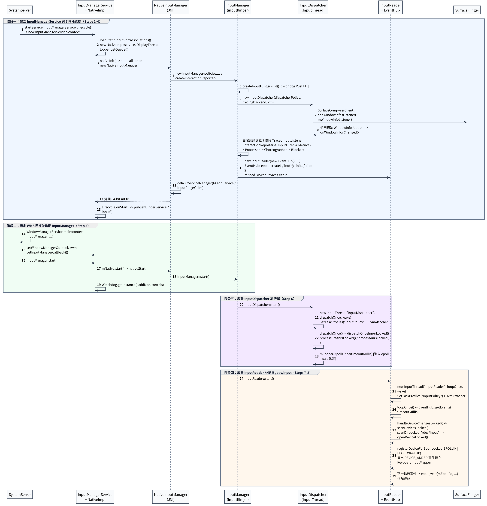

# 14.2 `InputManagerService` 的啟動過程（建立管線、註冊 `inputflinger`、啟動 `InputDispatcher` 與 `InputReader` / `EventHub`）

- **情景說明**：承接第 11 章 `11.3` 節的 `SystemServer.startOtherServices()`，系統服務在開機期間必須先把輸入管理子系統啟動起來，才能在任何應用程式視窗顯示前就監聽硬體輸入裝置並準備接收來自 `SurfaceFlinger` 的視窗拓撲資訊。Android 17 將輸入系統獨立為 `InputManagerService`，由 `SystemServer` 先初始化並註冊 Java/Native 兩端服務（包含 Rust `IInputFlingerRust` 與 7 階段 `InputListener` 管線），在 `WindowManagerService` 建立並綁定回呼後，再呼叫 `inputManager.start()` 正式拉起 `InputDispatcher` 與 `InputReader` 兩條即時輸入執行緒。本節依原書 14.2.1–14.2.4 的四個階段完整追蹤啟動流程。
- **對應原書**：14.2 節〈InputManager的启动过程〉（14.2.1–14.2.4，p.678–696）
- **涉及專案與版本基準**：
  - `platform/frameworks/base` 〔`android-17.0.0_r1`，commit `94b4c163`〕
  - `platform/frameworks/native` 〔`android-17.0.0_r1`，commit `ae266dc`〕

---

## 14.2.1 建立 `InputManagerService` 與 7 階段管線

> 對應原書 14.2.1〈创建InputManager〉（p.678–681）。

整條建立與啟動呼叫鏈如下：

```text
SystemServer.startOtherServices()                            ## Step 1、獨立啟動 InputManagerService，再建 WMS 並綁定回呼
  InputManagerService.Lifecycle -> new InputManagerService() ## Step 2、建立 NativeImpl 並發佈 "input" Binder 服務
    NativeImpl.<init>() -> nativeInit()                      ## Step 3、JNI call_once 建構 NativeInputManager
      new NativeInputManager()                               ## Step 3、建立 InputManager 並向 ServiceManager 註冊 "inputflinger"
        new InputManager(...)                                ## Step 4、啟動 Rust IInputFlingerRust，由尾到頭組裝 7 階段管線
          new InputDispatcher(...)                           ## Step 6、向 SurfaceFlinger 訂閱 WindowInfosListener
          new InputReader(new EventHub(), ...)               ## Step 7、建立 EventHub (epoll_create1 / inotify_init1 / pipe2)
  inputManager.start() -> nativeStart()                      ## Step 5、啟動 InputManager 並註冊 Watchdog 監控
    InputManager::start()                                    ## Step 5、先啟動 InputDispatcher，再啟動 InputReader
      InputDispatcher::start() -> InputThread::dispatchOnce  ## Step 6、進入 dispatchOnce() -> mLooper->pollOnce() 休眠
      InputReader::start() -> InputThread::loopOnce          ## Step 7–8、EventHub::getEvents() 掃描 /dev/input 並 epoll_wait
```

### Step 1：`SystemServer.startOtherServices` 啟動 `InputManagerService` 並銜接 WMS
**位置**：`platform/frameworks/base/services/java/com/android/server/SystemServer.java` 〔`android-17.0.0_r1`，lines 1738–1792〕

```java
// SystemServer.java:1738-1792
            t.traceBegin("StartInputManagerService");
            inputManager = mSystemServiceManager.startService(
                    InputManagerService.Lifecycle.class).getService();
            t.traceEnd();
...
            t.traceBegin("StartWindowManagerService");
            // WMS needs sensor service ready
            mSystemServiceManager.startBootPhase(t, SystemService.PHASE_WAIT_FOR_SENSOR_SERVICE);
            wm = WindowManagerService.main(context, inputManager, !mFirstBoot,
                    new PhoneWindowManager(), mActivityManagerService.mActivityTaskManager);
            ServiceManager.addService(Context.WINDOW_SERVICE, wm, /* allowIsolated= */ false,
                    DUMP_FLAG_PRIORITY_CRITICAL | DUMP_FLAG_PRIORITY_HIGH
                            | DUMP_FLAG_PROTO);
            t.traceEnd();
...
            t.traceBegin("StartInputManager");
            inputManager.setWindowManagerCallbacks(wm.getInputManagerCallback());
            inputManager.start();
            t.traceEnd();
```

1. **三段式依賴解耦**：`SystemServer` 先透過 `SystemServiceManager.startService(InputManagerService.Lifecycle.class)` 建立 `InputManagerService` 並註冊 `"input"` 服務；接著把 `inputManager` 注入 `WindowManagerService.main()`；待 WMS 初始化就緒後，再呼叫 `inputManager.setWindowManagerCallbacks(wm.getInputManagerCallback())` 綁定策略回呼（供按鍵攔截、ANR 通知等使用），最後才呼叫 `inputManager.start()` 啟動讀取與派發執行緒。
2. **避免初始化競態**：由於 `InputManagerService` 在 `start()` 前還不會開始讀取 `/dev/input`，確保了 WMS 與 `PhoneWindowManager` 策略回呼就位前不會有按鍵事件漏判或空指標呼叫。

> 〔與 2.3 差異〕獨立服務化：原書 14.2.1 Step 1（p.678–679）由 `WindowManagerService` 建構子在其內部 `WMThread.run()` 直接 `new InputManager(context, this)` 並立即呼叫 `mInputManager.start()`；Android 17 將其抽離為獨立的 `SystemService`（`InputManagerService`），由 `SystemServer` 顯式編排與 WMS 之間的雙向依賴順序。

---

### Step 2：`InputManagerService.Lifecycle` 與 `InputManagerService` 建構子
**位置**：`platform/frameworks/base/services/core/java/com/android/server/input/InputManagerService.java` 〔`android-17.0.0_r1`，lines 540–570、4021–4034〕

```java
// InputManagerService.java:540-570, 4021-4034
        NativeInputManagerService getNativeService(InputManagerService service) {
            return new NativeInputManagerService.NativeImpl(service, mLooper.getQueue(), mContext);
        }
...
    public InputManagerService(Context context) {
        this(new Injector(context, DisplayThread.get().getLooper(), IoThread.get().getLooper(),
                new UEventManager() {}), context.getSystemService(PermissionEnforcer.class));
    }

    @VisibleForTesting
    InputManagerService(Injector injector, PermissionEnforcer permissionEnforcer) {
        // The static association map is accessed by both java and native code, so it must be
        // initialized before initializing the native service.
        super(permissionEnforcer);

        mStaticAssociations = loadStaticInputPortAssociations();

        mContext = injector.getContext();
        mHandler = new InputManagerHandler(injector.getLooper());
        mNative = injector.getNativeService(this);
...
    public static final class Lifecycle extends SystemService {

        private final InputManagerService mService;

        public Lifecycle(@NonNull Context context) {
            super(context);
            mService = new InputManagerService(context);
        }

        @Override
        public void onStart() {
            publishBinderService(Context.INPUT_SERVICE, mService,
                    /* allowIsolated= */ false, DUMP_FLAG_PRIORITY_CRITICAL);
        }
```

1. **共用 `DisplayThread` Looper**：`InputManagerService` 透過 `Injector` 綁定 `DisplayThread.get().getLooper()`（不再像 2.3 那樣取用 WMS 的 `WMThread` Looper），並將該執行緒的 `MessageQueue` 傳給 `NativeInputManagerService.NativeImpl`。
2. **先載入靜態連接埠關聯再建 Native**：建構子明確在呼叫 `injector.getNativeService(this)` 之前完成 `loadStaticInputPortAssociations()`，因為原生層初始化讀取配置時就會回呼 Java 查詢埠位與顯示器綁定表。
3. **發佈 `"input"` 系統服務**：`Lifecycle.onStart()` 將 `InputManagerService` 發佈為 `Context.INPUT_SERVICE`（`"input"`），並於建構子尾端註冊 `InputManagerInternal` 本機服務供 WMS 同進程直呼。

> 〔與 2.3 差異〕改名搬家 + 擴充：原書 14.2.1 Step 2（p.680）為 `InputManager.init()` 直接呼叫 `nativeInit(mCallbacks)`；Android 17 透過 `Injector` 與 `NativeInputManagerService` 介面隔離 JNI 細節以利單元測試，並整合鍵盤佈局、背光、電池、按鍵手勢與虛擬裝置等子控制器。

---

### Step 3：`NativeImpl` 建構子、`nativeInit` 與 `NativeInputManager` 建立
**位置**：
- `platform/frameworks/base/services/core/java/com/android/server/input/NativeInputManagerService.java` 〔`android-17.0.0_r1`，lines 367–380〕
- `platform/frameworks/base/services/core/jni/com_android_server_input_InputManagerService.cpp` 〔`android-17.0.0_r1`，lines 648–660、2453–2471〕

```java
// NativeInputManagerService.java:367-380
    class NativeImpl implements NativeInputManagerService {
        /** Pointer to native input manager service object, used by native code. */
        @SuppressWarnings({"unused", "FieldCanBeLocal"})
        private final long mPtr;

        NativeImpl(InputManagerService service, MessageQueue messageQueue, Context context) {
            mPtr = init(service, messageQueue,
                    AttentionManagerService.isInteractionProviderServiceEnabled(context));
        }

        private native long init(InputManagerService service,
                MessageQueue messageQueue,
                boolean createInteractionReporter);
```

```cpp
// com_android_server_input_InputManagerService.cpp:648-660, 2453-2471
NativeInputManager::NativeInputManager(jobject serviceObj, const sp<Looper>& looper,
                                       bool createInteractionProvider)
      : mLooper(looper) {
    JNIEnv* env = jniEnv();

    mServiceObj = env->NewGlobalRef(serviceObj);

    JavaVM* vm;
    env->GetJavaVM(&vm);
    InputManager* im = new InputManager(this, *this, *this, *this, vm, createInteractionProvider);
    mInputManager = im;
    defaultServiceManager()->addService(String16("inputflinger"), im);
}
...
static jlong nativeInit(JNIEnv* env, jclass /* clazz */, jobject serviceObj,
                        jobject messageQueueObj, bool createInteractionReporter) {
    sp<MessageQueue> messageQueue = android_os_MessageQueue_getMessageQueue(env, messageQueueObj);
    if (messageQueue == nullptr) {
        jniThrowRuntimeException(env, "MessageQueue is not initialized.");
        return 0;
    }

    static std::once_flag nativeInitialize;
    NativeInputManager* im = nullptr;
    std::call_once(nativeInitialize, [&]() {
        // Create the NativeInputManager, which should not be destroyed or deallocated for the
        // lifetime of the process.
        im = new NativeInputManager(serviceObj, messageQueue->getLooper(),
                                    createInteractionReporter);
    });
    LOG_ALWAYS_FATAL_IF(im == nullptr, "NativeInputManager was already initialized.");
    return reinterpret_cast<jlong>(im);
}
```

1. **單例初始化與 64 位元 `mPtr`**：JNI 函式 `nativeInit()` 以 `std::call_once` 確保整個 `system_server` 進程生命週期內只會建立一次 `NativeInputManager`，並將原生指標以 64 位元 `jlong` 存回 `NativeImpl.mPtr`（後續 `nativeStart`、`createInputChannel` 等呼叫皆由 `getNativeInputManager()` 取回）。
2. **四重策略介面與 `"inputflinger"` 註冊**：`NativeInputManager` 同時實作四組策略介面（`InputReaderPolicyInterface`、`InputDispatcherPolicyInterface`、`PointerChoreographerPolicyInterface`、`InputFilterPolicyInterface`）傳入 `InputManager` 建構子；接著立即呼叫 `defaultServiceManager()->addService(String16("inputflinger"), im)` 將 `InputManager` 發佈為原生 Binder 服務，讓 `SurfaceFlinger` 得以跨進程呼叫 `setFocusedWindow()`。

> 〔與 2.3 差異〕改名搬家 + 擴充：原書 14.2.1 Step 3（p.680–681）的 `com_android_server_InputManager.cpp` 使用全域靜態變數 `gNativeInputManager` 保存 `sp<NativeInputManager>`，且未註冊 `"inputflinger"` Binder 服務；Android 17 改由 `NativeImpl.mPtr` 持有指標、`std::call_once` 保護單例，並額外發佈 `"inputflinger"` 服務與傳遞 `JavaVM*` 供原生執行緒附掛 JNI。

---

### Step 4：`InputManager` 建構子組裝 Rust FFI 與 7 階段 `InputListener` 管線
**位置**：`platform/frameworks/native/services/inputflinger/InputManager.cpp` 〔`android-17.0.0_r1`，lines 132–179〕

```cpp
// InputManager.cpp:132-179
InputManager::InputManager(const sp<InputReaderPolicyInterface>& readerPolicy,
                           InputDispatcherPolicyInterface& dispatcherPolicy,
                           PointerChoreographerPolicyInterface& choreographerPolicy,
                           InputFilterPolicyInterface& inputFilterPolicy, JavaVM* vm,
                           bool createInteractionReporter) {
    mInputFlingerRust = createInputFlingerRust();

    std::shared_ptr<input_trace::InputTracingBackendInterface> tracingBackend =
            input_trace::impl::createInputTracingBackendIfEnabled(vm);
    mDispatcher = std::make_unique<inputdispatcher::InputDispatcher>(dispatcherPolicy,
                                                                     tracingBackend, vm);
    mTracingStages.emplace_back(
            std::make_unique<TracedInputListener>("InputDispatcher", *mDispatcher));

    if (createInteractionReporter) {
        // On devices without the Attention service, we can skip the InteractionReporter stage.
        mInteractionReporter = std::make_unique<InteractionReporter>(*mTracingStages.back());
        mTracingStages.emplace_back(std::make_unique<TracedInputListener>("InteractionReporter",
                                                                          *mInteractionReporter));
    }

    mInputFilter = std::make_unique<InputFilter>(*mTracingStages.back(), *mInputFlingerRust,
                                                 inputFilterPolicy, vm);
    mTracingStages.emplace_back(
            std::make_unique<TracedInputListener>("InputFilter", *mInputFilter));

    if (ENABLE_INPUT_DEVICE_USAGE_METRICS) {
        mCollector = std::make_unique<InputDeviceMetricsCollector>(*mTracingStages.back());
        mTracingStages.emplace_back(
                std::make_unique<TracedInputListener>("MetricsCollector", *mCollector));
    }

    mProcessor = std::make_unique<InputProcessor>(*mTracingStages.back());
    mTracingStages.emplace_back(
            std::make_unique<TracedInputListener>("InputProcessor", *mProcessor));

    mChoreographer =
            std::make_unique<PointerChoreographer>(*mTracingStages.back(), choreographerPolicy);
    mTracingStages.emplace_back(
            std::make_unique<TracedInputListener>("PointerChoreographer", *mChoreographer));

    mBlocker = std::make_unique<UnwantedInteractionBlocker>(*mTracingStages.back());
    mTracingStages.emplace_back(
            std::make_unique<TracedInputListener>("UnwantedInteractionBlocker", *mBlocker));

    mReader = std::make_unique<InputReader>(std::make_unique<EventHub>(), readerPolicy,
                                            *mTracingStages.back(), vm, tracingBackend);
}
```

1. **Rust FFI 啟動**：`createInputFlingerRust()` 透過 `cxxbridge` 呼叫 Rust 函式 `create_inputflinger_rust()` 並以 NDK Binder callback 取回 `std::shared_ptr<IInputFlingerRust>`，交由 `InputFilter` 承載無障礙按鍵濾波（如防抖鍵、慢速鍵、黏滯鍵）等記憶體安全關鍵邏輯。
2. **由尾到頭組裝單向管線**：建構子從最末端 `mDispatcher` 開始反向建立每一層，每一層都持有下一層 `TracedInputListener` 的參照（`*mTracingStages.back()`），最後由 `mReader` 掛接 `std::make_unique<EventHub>()` 並指向 `UnwantedInteractionBlocker`。因此實際執行期的事件流向依序為：**`InputReader` → `UnwantedInteractionBlocker` → `PointerChoreographer` → `InputProcessor` → `InputDeviceMetricsCollector` → `InputFilter` → `InteractionReporter`（可選）→ `InputDispatcher`**（註：檔案上方 122–130 行的註解順序略為過時，實際流向以建構程式碼 141–178 行為準）。

> 〔與 2.3 差異〕搬家 + 架構重構：原書 14.2.1 Step 4（p.681）的 `InputManager::initialize()` 僅建立 `EventHub`、`InputDispatcher`、`InputReader` 及兩條 `Thread` 子類；Android 17 取消獨立的 `initialize()`，改在建構子直接串接 7 階段管線與 Rust FFI，執行緒本身延後至 `start()` 才建立。

---

## 14.2.2 啟動 `InputManagerService`

> 對應原書 14.2.2〈启动InputManager〉（p.681–683）。

### Step 5：`InputManagerService.start` → `nativeStart` → `InputManager::start`
**位置**：
- `platform/frameworks/base/services/core/java/com/android/server/input/InputManagerService.java` 〔`android-17.0.0_r1`，lines 646–652〕
- `platform/frameworks/base/services/core/jni/com_android_server_input_InputManagerService.cpp` 〔`android-17.0.0_r1`，lines 2473–2480〕
- `platform/frameworks/native/services/inputflinger/InputManager.cpp` 〔`android-17.0.0_r1`，lines 185–201〕

```java
// InputManagerService.java:646-652
    public void start() {
        Slog.i(TAG, "Starting input manager");
        mNative.start();

        // Add ourselves to the Watchdog monitors.
        Watchdog.getInstance().addMonitor(this);
    }
```

```cpp
// com_android_server_input_InputManagerService.cpp:2473-2480
static void nativeStart(JNIEnv* env, jobject nativeImplObj) {
    NativeInputManager* im = getNativeInputManager(env, nativeImplObj);

    status_t result = im->getInputManager()->start();
    if (result) {
        jniThrowRuntimeException(env, "Input manager could not be started.");
    }
}
```

```cpp
// InputManager.cpp:185-201
status_t InputManager::start() {
    status_t result = mDispatcher->start();
    if (result) {
        ALOGE("Could not start InputDispatcher thread due to error %d.", result);
        return result;
    }

    result = mReader->start();
    if (result) {
        ALOGE("Could not start InputReader due to error %d.", result);

        mDispatcher->stop();
        return result;
    }

    return OK;
}
```

1. **先派發後讀取**：`InputManager::start()` 嚴格先啟動下游 `mDispatcher->start()`，確認就緒後再啟動上游 `mReader->start()`；若 `mReader->start()` 失敗則立刻停止 `mDispatcher` 回滾。
2. **納入 Watchdog 死鎖監控**：`InputManagerService.start()` 隨即將自身註冊給 `Watchdog`——`Watchdog` 會定期呼叫 `monitor()` 依序嘗試取得 `InputReader`、`UnwantedInteractionBlocker`、`InputProcessor`、`MetricsCollector` 與 `InputDispatcher` 的鎖，若任一階段發生死鎖即觸發系統重啟。

> 〔與 2.3 差異〕邏輯微調：原書 14.2.2 Step 1–3（p.682–683）直接操作 `mDispatcherThread->run("InputDispatcher", PRIORITY_URGENT_DISPLAY)` 與 `mReaderThread->run(...)`；Android 17 將執行緒管理封裝進 `InputDispatcher::start()` / `InputReader::start()` 內部，並新增 `Watchdog.addMonitor(this)` 健康監控。

---

## 14.2.3 啟動 `InputDispatcher`

> 對應原書 14.2.3〈启动InputDispatcher〉（p.683–685）。

### Step 6：`InputDispatcher` 建構訂閱、`InputThread` 啟動與 `dispatchOnce` 主迴圈
**位置**：
- `platform/frameworks/native/services/inputflinger/InputThread.cpp` 〔`android-17.0.0_r1`，lines 29–32、63–79〕
- `platform/frameworks/native/services/inputflinger/dispatcher/InputDispatcher.cpp` 〔`android-17.0.0_r1`，lines 935–941、963–972、983–1026〕

```cpp
// InputThread.cpp:29-32, 63-79
bool applyInputEventProfile() {
    static constexpr pid_t CURRENT_THREAD = 0;
    return SetTaskProfiles(CURRENT_THREAD, {"InputPolicy"});
}
...
InputThread::InputThread(std::string name, std::function<void()> loop, std::function<void()> wake,
                         bool isInCriticalPath, JavaVM* vm)
      : mThreadWake(wake) {
    std::thread loopThread{[this, name, isInCriticalPath, loop, vm] {
        if (isInCriticalPath) {
            const bool applied = applyInputEventProfile();
            LOG_IF(ERROR, !applied) << "Couldn't apply input policy profile for " << name;
        }

        JvmAttacher jvmAttacher(vm, name);

        while (!mStopThread) {
            loop();
        }
    }};
    mThread = std::move(loopThread);
}
```

```cpp
// InputDispatcher.cpp:935-941, 963-972, 983-1026
    mWindowInfoListener = sp<DispatcherWindowListener>::make(*this);
#if defined(__ANDROID__)
    android::base::Result<gui::WindowInfosUpdate> result =
            SurfaceComposerClient::getDefault()->addWindowInfosListener(mWindowInfoListener);
    LOG_IF(FATAL, !result.ok()) << "Can't listen for window info. Input will not work";
    onWindowInfosChanged(*result);
#endif
...
status_t InputDispatcher::start() {
    if (mThread) {
        return ALREADY_EXISTS;
    }
    protolog::Initialize();
    mThread = std::make_unique<InputThread>(
            "InputDispatcher", [this]() { dispatchOnce(); }, [this]() { mLooper->wake(); },
            /*isInCriticalPath=*/true, mVm);
    return OK;
}
...
void InputDispatcher::dispatchOnce() {
    nsecs_t nextWakeupTime = LLONG_MAX;
    { // acquire lock
        std::scoped_lock _l(mLock);
        mDispatcherIsAlive.notify_all();

        // Run a dispatch loop if there are no pending commands.
        // The dispatch loop might enqueue commands to run afterwards.
        if (!haveCommandsLocked()) {
            dispatchOnceInnerLocked(/*byref*/ nextWakeupTime);
        }

        // Run all pending commands if there are any.
        // If any commands were run then force the next poll to wake up immediately.
        if (runCommandsLockedInterruptable()) {
            nextWakeupTime = LLONG_MIN;
        }

        // If we are still waiting for ack on some events,
        // we might have to wake up earlier to check if an app is ANRing.
        // This call is guarded by the enable_anr_warning_callback_input_dispatcher flag
        nextWakeupTime = std::min({nextWakeupTime,
                                   // Notify the process that an ANR is imminent (pre-ANR), a few
                                   // seconds before the actual ANR handling runs.
                                   processPreAnrsLocked(),
                                   // The ANRs are then processed.
                                   processAnrsLocked()});

        if (mPerDeviceInputLatencyMetricsFlag) {
            processLatencyStatisticsLocked();
        }

        // We are about to enter an infinitely long sleep, because we have no commands or
        // pending or queued events
        if (nextWakeupTime == LLONG_MAX) {
            mDispatcherEnteredIdle.notify_all();
        }
    } // release lock

    // Wait for callback or timeout or wake.  (make sure we round up, not down)
    nsecs_t currentTime = now();
    int timeoutMillis = toMillisecondTimeoutDelay(currentTime, nextWakeupTime);
    mLooper->pollOnce(timeoutMillis);
}
```

1. **建構即訂閱 `SurfaceFlinger` 視窗快照**：`InputDispatcher` 建構時立即呼叫 `SurfaceComposerClient::getDefault()->addWindowInfosListener(mWindowInfoListener)`，並馬上用返回的初始 `WindowInfosUpdate` 執行第一次 `onWindowInfosChanged(*result)`，從啟動那一刻就與 `SurfaceFlinger` 建立同步管道。
2. **`InputThread` 統一排程與 JNI 附掛**：Android 17 廢除 `utils/Thread` 子類 `InputDispatcherThread`，改由 `InputThread` 以 `std::thread` 啟動執行緒，對關鍵路徑套用 `"InputPolicy"` TaskProfile（取代早期單純的 `PRIORITY_URGENT_DISPLAY`）並以 RAII `JvmAttacher` 預先附掛至 `JavaVM`，確保派發執行緒回呼 Java 策略時不會反覆附掛／卸載。
3. **`dispatchOnce()` 四件事**：在鎖內依序執行——① 若沒有待執行命令則呼叫 `dispatchOnceInnerLocked()` 分發入站事件；② 執行累積的延遲命令（例如策略攔截、通知焦點變化）；③ 檢查 `processPreAnrsLocked()` 與 `processAnrsLocked()` 更新最早 ANR 逾時喚醒時間；④ 釋放鎖後呼叫 `mLooper->pollOnce(timeoutMillis)`（底層正是第 13 章分析的 `libutils/Looper` `eventfd` + `epoll_wait`）。開機初期佇列為空，因此 `nextWakeupTime == LLONG_MAX`，`InputDispatcher` 進入無限期休眠等待新事件或已註冊 `InputChannel` socket 的完成回執。

> 〔與 2.3 差異〕重構 + 擴充：原書 14.2.3 Step 1–3（p.684–685）使用 `InputDispatcherThread::threadLoop()` 呼叫 `dispatchOnce()`，且尚未引入 `SurfaceFlinger` 視窗訂閱與獨立的 `processPreAnrsLocked()` / `processAnrsLocked()` 檢查；Android 17 改用 `InputThread` + `"InputPolicy"` 任務組態，並在每次迴圈統一計算 ANR 與 pre-ANR 逾時。

---

## 14.2.4 啟動 `InputReader` 與 `EventHub` 掃描裝置

> 對應原書 14.2.4〈启动InputReader〉（p.685–696）。

### Step 7：`InputReader::start`、`loopOnce` 與 `EventHub` 建構子
**位置**：
- `platform/frameworks/native/services/inputflinger/reader/InputReader.cpp` 〔`android-17.0.0_r1`，lines 153–161、172–204〕
- `platform/frameworks/native/services/inputflinger/reader/EventHub.cpp` 〔`android-17.0.0_r1`，lines 1009–1070〕

```cpp
// InputReader.cpp:153-161, 172-204
status_t InputReader::start() {
    if (mThread) {
        return ALREADY_EXISTS;
    }
    mThread = std::make_unique<InputThread>(
            "InputReader", [this]() { loopOnce(); }, [this]() { mEventHub->wake(); },
            /*isInCriticalPath=*/true, mVm);
    return OK;
}
...
void InputReader::loopOnce() {
    int32_t oldGeneration;
    int32_t timeoutMillis;
    // Copy some state so that we can access it outside the lock later.
    bool inputDevicesChanged = false;
    std::vector<InputDeviceInfo> inputDevices;
    std::list<NotifyArgs> notifyArgs;
    { // acquire lock
        std::scoped_lock _l(mLock);

        oldGeneration = mGeneration;
        timeoutMillis = -1;

        auto changes = mConfigurationChangesToRefresh;
        if (changes.any()) {
            mConfigurationChangesToRefresh.clear();
            timeoutMillis = 0;
            refreshConfigurationLocked(changes);
        } else if (mNextTimeout != LLONG_MAX) {
            nsecs_t now = systemTime(SYSTEM_TIME_MONOTONIC);
            timeoutMillis = toMillisecondTimeoutDelay(now, mNextTimeout);
        }
    } // release lock

    std::vector<RawEvent> events = mEventHub->getEvents(timeoutMillis);

    { // acquire lock
        std::scoped_lock _l(mLock);
        mReaderIsAliveCondition.notify_all();

        if (!events.empty()) {
            mPendingArgs += processEventsLocked(events.data(), events.size());
        }
```

```cpp
// EventHub.cpp:1009-1070
EventHub::EventHub(void)
      : mBuiltInKeyboardId(NO_BUILT_IN_KEYBOARD),
        mNextDeviceId(1),
        mControllerNumbers(),
        mNeedToReopenDevices(false),
        mNeedToScanDevices(true),
        mPendingEventCount(0),
        mPendingEventIndex(0),
        mPendingINotify(false) {
    ensureProcessCanBlockSuspend();

    mEpollFd = epoll_create1(EPOLL_CLOEXEC);
    LOG_ALWAYS_FATAL_IF(mEpollFd < 0, "Could not create epoll instance: %s", strerror(errno));

    mINotifyFd = inotify_init1(IN_CLOEXEC);
    LOG_ALWAYS_FATAL_IF(mINotifyFd < 0, "Could not create inotify instance: %s", strerror(errno));

    std::error_code errorCode;
    bool isDeviceInotifyAdded = false;
    if (std::filesystem::exists(DEVICE_INPUT_PATH, errorCode)) {
        addDeviceInputInotify();
    } else {
        addDeviceInotify();
        isDeviceInotifyAdded = true;
...
    }
...
    struct epoll_event eventItem = {};
    eventItem.events = EPOLLIN | EPOLLWAKEUP;
    eventItem.data.fd = mINotifyFd;
    int result = epoll_ctl(mEpollFd, EPOLL_CTL_ADD, mINotifyFd, &eventItem);
    LOG_ALWAYS_FATAL_IF(result != 0, "Could not add INotify to epoll instance.  errno=%d", errno);

    int wakeFds[2];
    result = pipe2(wakeFds, O_CLOEXEC);
    LOG_ALWAYS_FATAL_IF(result != 0, "Could not create wake pipe.  errno=%d", errno);

    mWakeReadPipeFd = wakeFds[0];
    mWakeWritePipeFd = wakeFds[1];
...
    eventItem.data.fd = mWakeReadPipeFd;
    result = epoll_ctl(mEpollFd, EPOLL_CTL_ADD, mWakeReadPipeFd, &eventItem);
    LOG_ALWAYS_FATAL_IF(result != 0, "Could not add wake read pipe to epoll instance.  errno=%d",
                        errno);
}
```

1. **`EventHub` 三路 `epoll` 監聽基礎**：`EventHub` 在建構時即建立 `mEpollFd`（`epoll_create1(EPOLL_CLOEXEC)`）、`mINotifyFd`（監看 `/dev/input` 裝置熱插拔）以及 `mWakeReadPipeFd` / `mWakeWritePipeFd`（供 `mEventHub->wake()` 隨時中斷 `epoll_wait` 以處理配置變更或執行緒停止）。
2. **`EPOLLWAKEUP` 與核心喚醒鎖銜接**：`EventHub` 呼叫 `ensureProcessCanBlockSuspend()` 並在所有加入 `mEpollFd` 的描述符上掛載 `EPOLLWAKEUP`——當核心 `evdev` 驅動有未讀事件時持有核心喚醒鎖，事件被 `read()` 讀出後由 `epoll` 接手維持喚醒鎖，直到下一次 `epoll_wait()` 呼叫才釋放，防止裝置在系統還沒處理完按鍵前意外進入深睡。
3. **延遲掃描旗標 `mNeedToScanDevices = true`**：建構子不直接掃描 `/dev/input`，而是設 `mNeedToScanDevices = true`，留到 `InputReader` 執行緒第一次進入 `mEventHub->getEvents()` 時才掃描，避免拖慢 `SystemServer` 主啟動執行緒。

> 〔與 2.3 差異〕搬家 + 邏輯重寫：原書 14.2.4 Step 1–4（p.686–691）中 `EventHub` 使用 `poll()` 輪詢動態陣列 `mFDs`，而且沒有喚醒管道與 `EPOLLWAKEUP`；Android 17 改用 `epoll_create1(EPOLL_CLOEXEC)` + `inotify_init1(IN_CLOEXEC)` + `pipe2(O_CLOEXEC)` + `EPOLLWAKEUP`，`InputReader` 亦由 `getEvent()` 單筆讀取升級為 `getEvents()` 批次讀取 `std::vector<RawEvent>`。

---

### Step 8：`EventHub::getEvents` 首次掃描 `/dev/input`、`openDeviceLocked` 與進入 `epoll_wait`
**位置**：`platform/frameworks/native/services/inputflinger/reader/EventHub.cpp` 〔`android-17.0.0_r1`，lines 2016–2043、2198–2210、2271–2285、2334–2358、2445–2505、2760–2789、3125–3130〕

```cpp
// EventHub.cpp:2016-2043, 2198-2210
std::vector<RawEvent> EventHub::getEvents(int timeoutMillis) {
    std::scoped_lock _l(mLock);

    std::array<input_event, EVENT_BUFFER_SIZE> readBuffer;

    std::vector<RawEvent> events;
    bool awoken = false;
    for (;;) {
        nsecs_t now = systemTime(SYSTEM_TIME_MONOTONIC);
...
        handleDeviceChangesLocked(events, now);

        if (events.size() == EVENT_BUFFER_SIZE) {
            break;
        }
...
        mPendingEventIndex = 0;

        mLock.unlock(); // release lock before poll

        int pollResult = epoll_wait(mEpollFd, mPendingEventItems, EPOLL_MAX_EVENTS, timeoutMillis);

        mLock.lock(); // reacquire lock after poll
```

```cpp
// EventHub.cpp:2271-2285, 2334-2358, 3125-3130
        if (mNeedToScanDevices) {
            mNeedToScanDevices = false;
            scanDevicesLocked();
        }

        while (!mOpeningDevices.empty()) {
            std::unique_ptr<Device> device = std::move(*mOpeningDevices.rbegin());
            mOpeningDevices.pop_back();
            ALOGV("Reporting device opened: id=%d, name=%s\n", device->id, device->path.c_str());
            const RawDeviceId deviceId = device->id == mBuiltInKeyboardId ? 0 : device->id;
            events.push_back({
                    .when = now,
                    .deviceId = deviceId,
                    .type = DEVICE_ADDED,
            });
...
void EventHub::scanDevicesLocked() {
    status_t result;
    std::error_code errorCode;

    if (std::filesystem::exists(DEVICE_INPUT_PATH, errorCode)) {
        result = scanDirLocked(DEVICE_INPUT_PATH);
        if (result < 0) {
            ALOGE("scan dir failed for %s", DEVICE_INPUT_PATH);
        }
    }
...
    if (mDevices.find(ReservedInputDeviceId::VIRTUAL_KEYBOARD_ID) == mDevices.end()) {
        createVirtualKeyboardLocked();
    }
}
...
status_t EventHub::scanDirLocked(const std::string& dirname) {
    for (const auto& entry : std::filesystem::directory_iterator(dirname)) {
        openDeviceLocked(entry.path());
    }
    return 0;
}
```

```cpp
// EventHub.cpp:2460-2505, 2760-2789
    int fd = open(devicePath.c_str(), O_RDWR | O_CLOEXEC | O_NONBLOCK);
    if (fd < 0) {
        ALOGE("could not open %s, %s\n", devicePath.c_str(), strerror(errno));
        return;
    }

    InputDeviceIdentifier identifier;

    // Get device name.
    if (ioctl(fd, EVIOCGNAME(sizeof(buffer) - 1), &buffer) < 1) {
        ALOGE("Could not get device name for %s: %s", devicePath.c_str(), strerror(errno));
    } else {
        buffer[sizeof(buffer) - 1] = '\0';
        identifier.name = buffer;
    }
...
    // Get device driver version.
    int driverVersion;
    if (ioctl(fd, EVIOCGVERSION, &driverVersion)) {
        ALOGE("could not get driver version for %s, %s\n", devicePath.c_str(), strerror(errno));
        close(fd);
        return;
    }

    // Get device identifier.
    struct input_id inputId;
    if (ioctl(fd, EVIOCGID, &inputId)) {
        ALOGE("could not get device input id for %s, %s\n", devicePath.c_str(), strerror(errno));
        close(fd);
        return;
    }
    identifier.bus = inputId.bustype;
    identifier.product = inputId.product;
    identifier.vendor = inputId.vendor;
    identifier.version = inputId.version;
...
    if (registerDeviceForEpollLocked(*device) != OK) {
        return;
    }

    if (!device->configureFd()) {
        ALOGE("Device '%s' (%s) was removed while opening. Dropping it.",
              device->identifier.name.c_str(), devicePath.c_str());
        return;
    }
...
    addDeviceLocked(std::move(device));
}
```

1. **首次掃描產出 `DEVICE_ADDED` 合成事件**：`InputReader` 首次進入 `getEvents()` 時，`handleDeviceChangesLocked()` 看到 `mNeedToScanDevices == true`，便呼叫 `scanDevicesLocked()` → `scanDirLocked("/dev/input")` 逐一打開 `/dev/input/event*` 並額外建立虛擬鍵盤 `VIRTUAL_KEYBOARD_ID`；打開的裝置先放入 `mOpeningDevices`，隨後轉成 `RawEvent::type = DEVICE_ADDED` 並移入 `mDevices` 雜湊表。
2. **裝置識別、分類與註冊 `epoll`**：`openDeviceLocked()` 以 `O_RDWR | O_CLOEXEC | O_NONBLOCK` 開啟裝置節點（須可寫才能控制鍵盤 LED 與震動），透過 `EVIOCGNAME` / `EVIOCGVERSION` / `EVIOCGID` / `EVIOCGBIT` 查詢能力並載入 `.idc` / `.kl` / `.kcm` 鍵盤映射檔，最後由 `registerDeviceForEpollLocked()` 把裝置 `fd` 以 `EPOLLIN | EPOLLWAKEUP` 加入 `mEpollFd`。
3. **釋鎖睡眠等待硬體事件**：首輪 `DEVICE_ADDED` 事件返回 `InputReader::processEventsLocked()` 建立各裝置的 `InputDevice` 與 `KeyboardInputMapper`；下一輪迴圈再進 `getEvents()` 時若無新事件，便釋放 `mLock` 並阻塞在 `epoll_wait(mEpollFd, ...)` 上，至此整個 `InputManagerService` 啟動完成並進入就緒待命狀態。

> 〔與 2.3 差異〕邏輯改變：原書 14.2.4 Step 4–6（p.690–695）透過 `openPlatformInput()` → `scanDir()`（`opendir`/`readdir`）→ `openDevice()` 把新裝置直接追加到 `pollfd` 陣列 `mFDs` 中並用單向鏈表維護 `mOpeningDevices`；Android 17 改用 `std::filesystem::directory_iterator`、`std::unordered_map`（`mDevices`）與 `epoll_ctl(EPOLL_CTL_ADD)`，加入 `device->configureFd()` 防止開啟瞬間裝置拔除引發軸資料缺失崩潰，並支援多裝置子節點合併（`isSubDevice`）與 sysfs 電池／背光偵測。

---

## 14.2.5 本節時序圖總結


