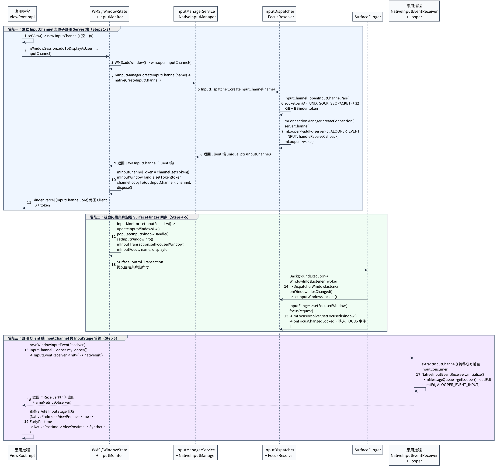

# 14.3 `InputChannel` 的建立、註冊與焦點窗口同步（`createInputChannel`、`SurfaceFlinger` 視窗同步與 `WindowInputEventReceiver`）

- **情景說明**：一個 Activity 啟動完成並透過 `WindowManagerImpl.addView()` 首次顯示其 `DecorView` 時，對應的 `ViewRootImpl.setView()` 會向 `WindowManagerService` 請求新增應用程式視窗。為了讓系統的 `InputDispatcher` 能夠把鍵盤消息送進這個新視窗，必須依序完成三件關鍵工作：① 在 `system_server` 端原子建立一對 `SOCK_SEQPACKET` `InputChannel`，立即將 Server 端註冊至 `InputDispatcher` 並把 Client 端經 Binder 傳回應用進程；② WMS 的 `InputMonitor` 將新視窗的幾何資訊與焦點請求透過 `SurfaceControl.Transaction` 交給 `SurfaceFlinger`，由 `SurfaceFlinger` 統一同步給 `InputDispatcher` 與 `FocusResolver`；③ 應用進程建立 `WindowInputEventReceiver` 將 Client 端 socket 掛載至主執行緒 `Looper`（第 13 章），並組裝 7 階段 `InputStage` 責任鏈。本節完整追蹤 Android 17 的這三條鏈路。
- **對應原書**：14.3 節〈InputChannel的注册过程〉（14.3.1–14.3.4，p.696–717）
- **涉及專案與版本基準**：
  - `platform/frameworks/base` 〔`android-17.0.0_r1`，commit `94b4c163`〕
  - `platform/frameworks/native` 〔`android-17.0.0_r1`，commit `ae266dc`〕

---

## 14.3.1 建立 `InputChannel` 並原子註冊 Server 端

> 對應原書 14.3.1〈创建InputChannel〉與 14.3.2〈注册Server端InputChannel〉（p.697–709）。原書 2.3 先在 WMS 呼叫 `InputChannel.openInputChannelPair()` 取得兩端，再把 Server 端傳給 `InputManager.registerInputChannel()`；Android 17 將兩步合併為單一原子操作 `InputDispatcher::createInputChannel()`，Server 端永不暴露至 Java 層。

整條建立、同步與註冊呼叫鏈如下：

```text
ViewRootImpl.setView()                                    ## Step 1、建立空 InputChannel，呼叫 mWindowSession.addToDisplayAsUser()
  Session.addToDisplayAsUser() -> WMS.addWindow()         ## Step 1、建立 WindowState 並呼叫 win.openInputChannel()
    WindowState.openInputChannel()                        ## Step 2、呼叫 mInputManager.createInputChannel() 並綁定 mInputChannelToken
      InputManagerService -> NativeInputManager           ## Step 2、JNI 轉呼叫 InputDispatcher::createInputChannel(name)
        InputDispatcher::createInputChannel()             ## Step 3、openInputChannelPair(SOCK_SEQPACKET) + ConnectionManager::createConnection()
          mLooper->addFd(serverFd, ALOOPER_EVENT_INPUT)   ## Step 3、Server 端註冊至 InputDispatcher Looper 監聽回執
    channel.copyTo(outInputChannel)                       ## Step 1、經 InputChannelCore Parcel 跨 Binder 傳回 Client 端 FD
InputMonitor.setInputFocusLw() / updateInputWindowsLw()   ## Step 4、寫入 SurfaceControl.Transaction (setInputWindowInfo / setFocusedWindow)
  SurfaceFlinger::BackgroundExecutor                      ## Step 5、推送 WindowInfosUpdate 與 IInputFlinger::setFocusedWindow()
    InputDispatcher::onWindowInfosChanged()               ## Step 5、更新多螢幕視窗清單 mWindowInfos
    InputDispatcher::setFocusedWindow() -> FocusResolver  ## Step 5、裁決焦點並排入 InputMessage::Type::FOCUS
ViewRootImpl.setView() [返回後]                            ## Step 6、建立 WindowInputEventReceiver + 組裝 7 階段 InputStage 管線
  InputEventReceiver.<init>() -> nativeInit()             ## Step 6、轉移 InputChannel 所有權至 NativeInputEventReceiver
    NativeInputEventReceiver::initialize()                ## Step 6、mMessageQueue->getLooper()->addFd(clientFd, ALOOPER_EVENT_INPUT)
```

### Step 1：`ViewRootImpl.setView`、`Session.addToDisplayAsUser` 與 `WindowManagerService.addWindow`
**位置**：
- `platform/frameworks/base/core/java/android/view/ViewRootImpl.java` 〔`android-17.0.0_r1`，lines 1744–1749、1784–1786〕
- `platform/frameworks/base/services/core/java/com/android/server/wm/Session.java` 〔`android-17.0.0_r1`，lines 272–277〕
- `platform/frameworks/base/services/core/java/com/android/server/wm/WindowManagerService.java` 〔`android-17.0.0_r1`，lines 1907–1913〕

```java
// ViewRootImpl.java:1744-1749, 1784-1786
                requestLayout();
                InputChannel inputChannel = null;
                if ((mWindowAttributes.inputFeatures
                        & WindowManager.LayoutParams.INPUT_FEATURE_NO_INPUT_CHANNEL) == 0) {
                    inputChannel = new InputChannel();
                }
...
                    res = mWindowSession.addToDisplayAsUser(mWindow, mWindowAttributes,
                            getHostVisibility(), mDisplay.getDisplayId(), userId,
                            mInsetsController.getRequestedVisibleTypes(), inputChannel, addResult);
```

```java
// Session.java:272-277
    public int addToDisplayAsUser(IWindow window, WindowManager.LayoutParams attrs,
            int viewVisibility, int displayId, int userId, @InsetsType int requestedVisibleTypes,
            InputChannel outInputChannel, WindowRelayoutResult result) {
        return mService.addWindow(this, window, attrs, viewVisibility, displayId, userId,
                requestedVisibleTypes, outInputChannel, result);
    }
```

```java
// WindowManagerService.java:1907-1913
            final boolean openInputChannels = (outInputChannel != null
                    && (attrs.inputFeatures & INPUT_FEATURE_NO_INPUT_CHANNEL) == 0);
            if  (openInputChannels) {
                final InputChannel channel = win.openInputChannel();
                channel.copyTo(outInputChannel);
                channel.dispose();
            }
```

1. **空 `InputChannel` 作為 Binder `out` 參數**：只要視窗屬性未設定 `INPUT_FEATURE_NO_INPUT_CHANNEL`，`ViewRootImpl.setView()` 就會先建一個空的 `InputChannel`（此時 `mPtr == 0`），隨 `mWindowSession.addToDisplayAsUser()` 透過 Binder 傳給 `WindowManagerService.addWindow()`。
2. **`copyTo` 轉移後立即 `dispose` 暫存物件**：`addWindow()` 呼叫 `win.openInputChannel()` 取得 Client 端 `InputChannel`，透過 `channel.copyTo(outInputChannel)` 把原生指標移交給 Binder `out` 參數（Binder 序列化時透過 `android_view_InputChannel_nativeWriteToParcel()` 封裝為 `android::os::InputChannelCore` 連同 `ParcelFileDescriptor` 與 `token` 一起跨進程傳回應用進程），接著立即 `channel.dispose()` 清理 WMS 端的暫存包裝。

> 〔與 2.3 差異〕改名 + 邏輯合併：原書 14.3.1 Step 1–3（p.697–702）為 `ViewRoot.setView()` → `Session.add()` → `WMS.addWindow()`，在 `addWindow()` 內分別呼叫 `InputChannel.openInputChannelPair()` 與 `mInputManager.registerInputChannel()`；Android 17 改由 `ViewRootImpl` 呼叫多螢幕／多使用者版本的 `addToDisplayAsUser()`，且 `win.openInputChannel()` 一次完成建立與 Server 註冊。

---

### Step 2：`WindowState.openInputChannel`、`InputManagerService.createInputChannel` 與 JNI 橋接
**位置**：
- `platform/frameworks/base/services/core/java/com/android/server/wm/WindowState.java` 〔`android-17.0.0_r1`，lines 2680–2690〕
- `platform/frameworks/base/services/core/java/com/android/server/input/InputManagerService.java` 〔`android-17.0.0_r1`，lines 949–951〕
- `platform/frameworks/base/services/core/jni/com_android_server_input_InputManagerService.cpp` 〔`android-17.0.0_r1`，lines 2614–2636〕

```java
// WindowState.java:2680-2690
    InputChannel openInputChannel() {
        if (mInputChannelToken != null) {
            throw new IllegalStateException("Window already has an input channel token.");
        }
        String name = getName();
        final InputChannel channel = mWmService.mInputManager.createInputChannel(name);
        mInputChannelToken = channel.getToken();
        mInputWindowHandle.setToken(mInputChannelToken);
        mWmService.mInputToWindowMap.put(mInputChannelToken, this);
        return channel;
    }
```

```java
// InputManagerService.java:949-951
    public InputChannel createInputChannel(String name) {
        return mNative.createInputChannel(name);
    }
```

```cpp
// com_android_server_input_InputManagerService.cpp:2614-2636
static jobject nativeCreateInputChannel(JNIEnv* env, jobject nativeImplObj, jstring nameObj) {
    NativeInputManager* im = getNativeInputManager(env, nativeImplObj);

    ScopedUtfChars nameChars(env, nameObj);
    std::string name = nameChars.c_str();

    base::Result<std::unique_ptr<InputChannel>> inputChannel = im->createInputChannel(name);

    if (!inputChannel.ok()) {
        std::string message = inputChannel.error().message();
        message += StringPrintf(" Status=%d", static_cast<int>(inputChannel.error().code()));
        jniThrowRuntimeException(env, message.c_str());
        return nullptr;
    }

    jobject inputChannelObj =
            android_view_InputChannel_createJavaObject(env, std::move(*inputChannel));
    if (!inputChannelObj) {
        return nullptr;
    }

    return inputChannelObj;
}
```

1. **以 `IBinder` Token 串聯 WMS、SurfaceFlinger 與 InputDispatcher**：`WindowState` 不再持有 Server 端 `InputChannel` 物件本身，只保存 `mInputChannelToken = channel.getToken()`，同時寫入 `mInputWindowHandle.setToken(mInputChannelToken)` 並存入 `mWmService.mInputToWindowMap`。往後焦點設定、視窗命中、ANR 回報與通道移除全部以這枚不可偽造的 `BBinder` token 作為唯一鍵值。
2. **JNI 僅包裝 Client 端**：`nativeCreateInputChannel()` 呼叫 `im->createInputChannel(name)`（直轉 `mInputManager->getDispatcher().createInputChannel(name)`），只取回 Client 端 `std::unique_ptr<InputChannel>` 並透過 `android_view_InputChannel_createJavaObject()` 封裝為 Java `InputChannel`。

> 〔與 2.3 差異〕邏輯合併 + 安全強化：原書 14.3.2 Step 1–3（p.705–706）由 `WindowState` 持有 Server 端 `mInputChannel` 並手動傳入 `registerInputChannel(serverChannel, inputWindowHandle)`；Android 17 改由 `BBinder` token 識別通道，徹底切斷 Java 層直接存取 Server socket fd 的可能。

---

### Step 3：`InputDispatcher::createInputChannel`、`InputChannel::openInputChannelPair` 與 `ConnectionManager::createConnection`
**位置**：
- `platform/frameworks/native/services/inputflinger/dispatcher/InputDispatcher.cpp` 〔`android-17.0.0_r1`，lines 6431–6454、7646–7660〕
- `platform/frameworks/native/libs/input/InputTransport.cpp` 〔`android-17.0.0_r1`，lines 359–386〕

```cpp
// InputDispatcher.cpp:6431-6454, 7646-7660
Result<std::unique_ptr<InputChannel>> InputDispatcher::createInputChannel(const std::string& name) {
    LOG_IF(INFO, DEBUG_CHANNEL_CREATION) << "channel '" << name << "' ~ createInputChannel";

    std::unique_ptr<InputChannel> serverChannel;
    std::unique_ptr<InputChannel> clientChannel;
    status_t result = InputChannel::openInputChannelPair(name, serverChannel, clientChannel);

    if (result) {
        return base::Error(result) << "Failed to open input channel pair with name " << name;
    }

    { // acquire lock
        std::scoped_lock _l(mLock);
        const sp<IBinder>& token = serverChannel->getConnectionToken();
        std::function<int(int events)> callback = std::bind(&InputDispatcher::handleReceiveCallback,
                                                            this, std::placeholders::_1, token);

        mConnectionManager.createConnection(std::move(serverChannel), mIdGenerator, callback);
    } // release lock

    // Wake the looper because some connections have changed.
    mLooper->wake();
    return clientChannel;
}
...
void InputDispatcher::ConnectionManager::createConnection(
        std::unique_ptr<InputChannel>&& inputChannel, const android::IdGenerator& idGenerator,
        std::function<int(int)> callback) {
    const int fd = inputChannel->getFd();
    std::shared_ptr<Connection> connection =
            std::make_shared<Connection>(std::move(inputChannel), /*isFocusMonitor=*/false,
                                         idGenerator);
    sp<IBinder> token = connection->getToken();
    auto [_, inserted] = mConnectionsByToken.try_emplace(token, connection);
    if (!inserted) {
        ALOGE("Created a new connection, but the token %p is already known", token.get());
    }

    mLooper->addFd(fd, 0, ALOOPER_EVENT_INPUT, sp<LooperEventCallback>::make(callback), nullptr);
}
```

```cpp
// InputTransport.cpp:359-386
status_t InputChannel::openInputChannelPair(const std::string& name,
                                            std::unique_ptr<InputChannel>& outServerChannel,
                                            std::unique_ptr<InputChannel>& outClientChannel) {
    int sockets[2];
    if (socketpair(AF_UNIX, SOCK_SEQPACKET, 0, sockets)) {
        status_t result = -errno;
        ALOGE("channel '%s' ~ Could not create socket pair.  errno=%s(%d)", name.c_str(),
              strerror(errno), errno);
        outServerChannel.reset();
        outClientChannel.reset();
        return result;
    }

    int bufferSize = SOCKET_BUFFER_SIZE;
    setsockopt(sockets[0], SOL_SOCKET, SO_SNDBUF, &bufferSize, sizeof(bufferSize));
    setsockopt(sockets[0], SOL_SOCKET, SO_RCVBUF, &bufferSize, sizeof(bufferSize));
    setsockopt(sockets[1], SOL_SOCKET, SO_SNDBUF, &bufferSize, sizeof(bufferSize));
    setsockopt(sockets[1], SOL_SOCKET, SO_RCVBUF, &bufferSize, sizeof(bufferSize));

    sp<IBinder> token = sp<BBinder>::make();

    android::base::unique_fd serverFd(sockets[0]);
    outServerChannel = InputChannel::create(name, std::move(serverFd), token);

    android::base::unique_fd clientFd(sockets[1]);
    outClientChannel = InputChannel::create(name, std::move(clientFd), token);
    return OK;
}
```

1. **`socketpair(AF_UNIX, SOCK_SEQPACKET)` + 32 KiB 緩衝區 + `O_NONBLOCK`**：`openInputChannelPair()` 建立一對全雙工、保留訊息邊界的 `SOCK_SEQPACKET` Unix Domain Socket，將雙端收發緩衝區統一縮減為 `SOCKET_BUFFER_SIZE`（`32 * 1024`，避免預設 128 KiB 浪費核心記憶體），產出共用 `sp<BBinder>` token，並在 `InputChannel::create()` 內將雙端皆設為 `O_NONBLOCK`。
2. **`ConnectionManager` 以 token 索引並註冊 `LooperEventCallback`**：`createConnection()` 建立持有 `InputPublisher` 的 `Connection` 存入 `mConnectionsByToken`，再呼叫 `mLooper->addFd(fd, 0, ALOOPER_EVENT_INPUT, sp<LooperEventCallback>::make(callback), nullptr)`——每當應用端在 Client socket 寫入 `FINISHED` 或 `TIMELINE` 回執，`InputDispatcher` 的 `Looper` 就會觸發 `InputDispatcher::handleReceiveCallback(events, token)`。最後呼叫 `mLooper->wake()` 讓阻塞中的派發迴圈感知新連線。

> 〔與 2.3 差異〕徹底重寫：原書 14.3.1 Step 6（p.703–704）與 14.3.2 Step 4（p.706–708）建立 8 KiB `ashmem_create_region()` + 兩次 `pipe()` 並以 Server `receivePipeFd` 為鍵值存入 `mConnectionsByReceiveFd`；Android 17 改為單一 `socketpair(AF_UNIX, SOCK_SEQPACKET)`、以 `BBinder token` 為鍵值存入 `mConnectionsByToken`，且將建立與註冊合二為一。

---

## 14.3.2 視窗拓撲與焦點窗口同步（WMS → `SurfaceFlinger` → `InputDispatcher`）

> 對應原書 14.3.3〈注册系统当前激活的应用程序窗口〉（p.709–713）。這是 Android 17 相較 2.3 變化最大的架構重構之一：輸入視窗清單與焦點不再由 WMS 經 JNI 直塞給 `InputDispatcher`，而是統一併入 `SurfaceControl.Transaction` 交給 `SurfaceFlinger` 隨圖層一起提交，再由 `SurfaceFlinger` 同步給 `InputDispatcher`。

### Step 4：WMS `InputMonitor` 透過 `SurfaceControl.Transaction` 寫入視窗與焦點
**位置**：`platform/frameworks/base/services/core/java/com/android/server/wm/InputMonitor.java` 〔`android-17.0.0_r1`，lines 378–398、517–528、607–614、670–687〕

```java
// InputMonitor.java:378-398, 517-528, 607-614, 670-687
    void setInputFocusLw(WindowState newWindow, boolean updateInputWindows) {
        ProtoLog.v(WM_DEBUG_FOCUS_LIGHT, "Input focus has changed to %s display=%d",
                newWindow, mDisplayId);
        final IBinder focus = newWindow != null ? newWindow.mInputChannelToken : null;
        if (focus == mInputFocus) {
            return;
        }

        if (newWindow != null && newWindow.canReceiveKeys()) {
            newWindow.mToken.paused = false;
        }

        setUpdateInputWindowsNeededLw();

        if (updateInputWindows) {
            updateInputWindowsLw(false /*force*/);
        }
    }
...
    private void requestFocus(IBinder focusToken, String windowName) {
        if (focusToken == mInputFocus) {
            return;
        }

        mInputFocus = focusToken;
        mInputFocusRequestTimeMillis = SystemClock.uptimeMillis();
        mInputTransaction.setFocusedWindow(mInputFocus, windowName, mDisplayId);
        EventLog.writeEvent(LOGTAG_INPUT_FOCUS, "Focus request " + windowName,
                "reason=UpdateInputWindows");
        ProtoLog.v(WM_DEBUG_FOCUS_LIGHT, "Focus requested for window=%s", windowName);
    }
...
            mDisplayContent.forAllWindows(this, true /* traverseTopToBottom */);
            updateInputFocusRequest(mRecentsAnimationInputConsumer);

            if (!mUpdateInputWindowsImmediately) {
                mDisplayContent.getPendingTransaction().merge(mInputTransaction);
                mDisplayContent.scheduleAnimation();
            }
...
            if (w.mWinAnimator.hasSurface()) {
                populateInputWindowHandle(inputWindowHandle, w);
                setInputWindowInfoIfNeeded(mInputTransaction,
                        w.mWinAnimator.mSurfaceControl, inputWindowHandle);
            }
...
    static void setInputWindowInfoIfNeeded(SurfaceControl.Transaction t, SurfaceControl sc,
            InputWindowHandleWrapper inputWindowHandle) {
        if (DEBUG_INPUT) {
            Slog.d(TAG_WM, "Update InputWindowHandle: " + inputWindowHandle);
        }
        if (inputWindowHandle.isChanged()) {
            inputWindowHandle.applyChangesToSurface(t, sc);
        }
    }
```

1. **將 `InputWindowHandle` 附掛至圖層事務**：當焦點變更（`setInputFocusLw()`）或視窗佈局變動時，`InputMonitor` 透過 `mDisplayContent.forAllWindows()` 由上而下遍歷視窗，把每個具 Surface 視窗的 `InputWindowHandleWrapper`（含 `token`、可觸控區域、視窗旗標等）經 `applyChangesToSurface(t, sc)`（底層呼叫 `SurfaceControl.Transaction.setInputWindowInfo()`）寫入 `mInputTransaction`。
2. **原子提交焦點請求**：`updateInputFocusRequest()` 呼叫 `requestFocus()`，在同一個 `mInputTransaction` 上記錄 `setFocusedWindow(mInputFocus, windowName, mDisplayId)`，再合併到 `mDisplayContent.getPendingTransaction()` 隨下一幀圖層事務一併送往 `SurfaceFlinger`。如此一來，視窗尚未在 `SurfaceFlinger` 真正建立出可見圖層前，輸入焦點絕不會提早落空。

> 〔與 2.3 差異〕架構重構：原書 14.3.3 Step 1–6（p.709–713）由 `InputMonitor.updateInputWindowsLw()` 打包 `InputWindow[]` 陣列直接呼叫 `InputManager.setInputWindows()` → JNI `NativeInputManager::setInputWindows()`；Android 17 徹底廢除該 JNI 通道，改由 `SurfaceControl.Transaction` 隨圖層統一交付 `SurfaceFlinger`。

---

### Step 5：`SurfaceFlinger` 推送 `WindowInfosUpdate` 與 `setFocusedWindow` 至 `InputDispatcher` 與 `FocusResolver`
**位置**：
- `platform/frameworks/native/services/surfaceflinger/SurfaceFlinger.cpp` 〔`android-17.0.0_r1`，lines 4856–4884〕
- `platform/frameworks/native/services/inputflinger/InputManager.cpp` 〔`android-17.0.0_r1`，lines 314–317〕
- `platform/frameworks/native/services/inputflinger/dispatcher/InputDispatcher.cpp` 〔`android-17.0.0_r1`，lines 7247–7261、7373–7408〕
- `platform/frameworks/native/services/inputflinger/dispatcher/FocusResolver.cpp` 〔`android-17.0.0_r1`，lines 101–125〕

```cpp
// SurfaceFlinger.cpp:4856-4884
    BackgroundExecutor::getInstance().sendCallbacks(
            {[updateWindowInfo, windowInfos = std::move(windowInfos),
              displayInfos = std::move(displayInfos),
              inputWindowCommands = std::move(mInputWindowCommands), inputFlinger = mInputFlinger,
              this, visibleWindowsChanged, vsyncId, frameTime]() mutable {
                SFTRACE_NAME("BackgroundExecutor::updateInputFlinger");
                if (updateWindowInfo) {
                    mWindowInfosListenerInvoker
                            ->windowInfosChanged(gui::WindowInfosUpdate{std::move(windowInfos),
                                                                        std::move(displayInfos),
                                                                        ftl::to_underlying(vsyncId),
                                                                        frameTime.ns()},
                                                 inputWindowCommands.releaseListeners(),
                                                 /* forceImmediateCall= */ visibleWindowsChanged ||
                                                         !inputWindowCommands.getFocusRequests()
                                                                  .empty());
                } else {
...
                }
                for (const auto& focusRequest : inputWindowCommands.getFocusRequests()) {
                    inputFlinger->setFocusedWindow(focusRequest);
                }
            }});
```

```cpp
// InputManager.cpp:314-317
binder::Status InputManager::setFocusedWindow(const gui::FocusRequest& request) {
    mDispatcher->setFocusedWindow(request);
    return binder::Status::ok();
}
```

```cpp
// InputDispatcher.cpp:7247-7261, 7373-7408
void InputDispatcher::setFocusedWindow(const FocusRequest& request) {
    { // acquire lock
        std::scoped_lock _l(mLock);
        std::optional<FocusResolver::FocusChanges> changes =
                mFocusResolver.setFocusedWindow(request,
                                                mWindowInfos.getWindowHandlesForDisplay(
                                                        ui::LogicalDisplayId{request.displayId}));
        ScopedSyntheticEventTracer traceContext(mTracer);
        if (changes) {
            onFocusChangedLocked(*changes, traceContext.getTracker());
        }
    } // release lock
    // Wake up poll loop since it may need to make new input dispatching choices.
    mLooper->wake();
}
...
void InputDispatcher::onWindowInfosChanged(const gui::WindowInfosUpdate& update) {
...
    std::map<ui::LogicalDisplayId, std::vector<sp<WindowInfoHandle>>> handlesPerDisplay;
    for (const auto& info : update.windowInfos) {
        handlesPerDisplay[info.displayId].push_back(sp<WindowInfoHandle>::make(info));
    }

    { // acquire lock
        std::scoped_lock _l(mLock);

        mWindowInfos.forEachDisplayId(
                [&](ui::LogicalDisplayId displayId) { handlesPerDisplay[displayId]; });

        mWindowInfos.setDisplayInfos(update.displayInfos);

        for (const auto& [displayId, handles] : handlesPerDisplay) {
            setInputWindowsLocked(handles, displayId);
        }

        mWindowInfosVsyncId = update.vsyncId;
    }
    // Wake up poll loop since it may need to make new input dispatching choices.
    mLooper->wake();
}
```

```cpp
// FocusResolver.cpp:101-125
std::optional<FocusResolver::FocusChanges> FocusResolver::setFocusedWindow(
        const FocusRequest& request, const std::vector<sp<WindowInfoHandle>>& windows) {
    const ui::LogicalDisplayId displayId = ui::LogicalDisplayId{request.displayId};
    const sp<IBinder> currentFocus = getFocusedWindowToken(displayId);
    if (currentFocus == request.token) {
        ALOGD_IF(DEBUG_FOCUS, "setFocusedWindow %s on display %s ignored, reason: already focused",
                 request.windowName.c_str(), displayId.toString().c_str());
        return std::nullopt;
    }

    ftl::Expected<sp<WindowInfoHandle>, Focusability> result =
            getResolvedFocusWindow(request.token, windows);
    // Update focus request. The focus resolver will always try to handle this request if there is
    // no focused window on the display.
    mFocusRequestByDisplay[displayId] = request;
    mLastFocusResultByDisplay[displayId] = result.has_value() ? Focusability::OK : result.error();

    if (result.has_value()) {
        const sp<WindowInfoHandle>& window = result.value();
        LOG_ALWAYS_FATAL_IF(window == nullptr,
                            "Focused window should be non-null when result is OK!");
        return updateFocusedWindow(displayId, "setFocusedWindow", window->getToken(),
                                   window->getName());
    }
```

1. **先視窗清單、後焦點請求的嚴格次序**：`SurfaceFlinger` 在背景執行緒先透過 `mWindowInfosListenerInvoker->windowInfosChanged()` 呼叫 14.2 節訂閱好的 `DispatcherWindowListener::onWindowInfosChanged()`，依 `displayId` 拆分更新 `mWindowInfos`；緊接著才對 `mInputFlinger`（即 `system_server` 註冊的 `"inputflinger"` 服務）發起 Binder 呼叫 `inputFlinger->setFocusedWindow(focusRequest)`。
2. **`FocusResolver` 裁決與 `FOCUS` 事件派發**：`FocusResolver::setFocusedWindow()` 會先在該螢幕的 `windows` 中驗證請求的 `request.token` 是否可見且可聚焦（`getResolvedFocusWindow()`）；驗證通過便更新該螢幕的焦點 token 並回傳 `FocusChanges`。`InputDispatcher::onFocusChangedLocked()` 隨即對舊視窗取消非指標事件並排入 `hasFocus = false`，對新視窗重置無焦點視窗 ANR 計時器並排入 `hasFocus = true`（`InputMessage::Type::FOCUS`），透過同一條 `InputChannel` 通知雙方視窗。

> 〔與 2.3 差異〕架構重構：原書 14.3.3 Step 7（p.713）的 `InputDispatcher::setInputWindows()` 僅單純掃描傳入陣列把 `hasFocus` 的那個視窗設到單一成員 `mFocusedWindow`；Android 17 改由 `SurfaceFlinger` 推送多螢幕 `WindowInfosUpdate`，並由獨立的 `FocusResolver` 依螢幕管理焦點請求與可見性驗證。

---

## 14.3.3 註冊 Client 端 `InputChannel` 與組裝 `InputStage` 管線

> 對應原書 14.3.4〈注册Client端InputChannel〉（p.714–717）。

### Step 6：`ViewRootImpl.setView` 建立 `WindowInputEventReceiver`、`NativeInputEventReceiver::initialize` 與 7 階段 `InputStage`
**位置**：
- `platform/frameworks/base/core/java/android/view/ViewRootImpl.java` 〔`android-17.0.0_r1`，lines 1893–1903、1918–1934〕
- `platform/frameworks/base/core/java/android/view/InputEventReceiver.java` 〔`android-17.0.0_r1`，lines 72–85〕
- `platform/frameworks/base/core/jni/android_view_InputEventReceiver.cpp` 〔`android-17.0.0_r1`，lines 230–253、317–342、746–775〕

```java
// ViewRootImpl.java:1893-1903, 1918-1934
                if (inputChannel != null) {
                    if (mInputQueueCallback != null) {
                        mInputQueue = new InputQueue();
                        mInputQueueCallback.onInputQueueCreated(mInputQueue);
                    }
                    mInputEventReceiver = new WindowInputEventReceiver(inputChannel,
                            Looper.myLooper(), mAttachInfo.mThreadedRenderer);

                    // Update unbuffered request when set the root view.
                    mUnbufferedInputSource = mView.mUnbufferedInputSource;
                }
...
                // Set up the input pipeline.
                CharSequence counterSuffix = attrs.getTitle();
                mSyntheticInputStage = new SyntheticInputStage();
                InputStage viewPostImeStage = new ViewPostImeInputStage(mSyntheticInputStage);
                InputStage nativePostImeStage = new NativePostImeInputStage(viewPostImeStage,
                        "aq:native-post-ime:" + counterSuffix);
                InputStage earlyPostImeStage = new EarlyPostImeInputStage(nativePostImeStage);
                InputStage imeStage = new ImeInputStage(earlyPostImeStage,
                        "aq:ime:" + counterSuffix);
                InputStage viewPreImeStage = new ViewPreImeInputStage(imeStage);
                InputStage nativePreImeStage = new NativePreImeInputStage(viewPreImeStage,
                        "aq:native-pre-ime:" + counterSuffix);

                mFirstInputStage = nativePreImeStage;
                mFirstPostImeInputStage = earlyPostImeStage;
                mPendingInputEventQueueLengthCounterName = "aq:pending:" + counterSuffix;
                mAdded = true;
```

```java
// InputEventReceiver.java:72-85
    public InputEventReceiver(InputChannel inputChannel, Looper looper) {
        if (inputChannel == null) {
            throw new IllegalArgumentException("inputChannel must not be null");
        }
        if (looper == null) {
            throw new IllegalArgumentException("looper must not be null");
        }

        mLooper = looper;
        mReceiverPtr = nativeInit(new WeakReference<InputEventReceiver>(this),
                inputChannel, mLooper.getQueue());

        mCloseGuard.open("InputEventReceiver.dispose");
    }
```

```cpp
// android_view_InputEventReceiver.cpp:250-253, 317-342, 746-775
status_t NativeInputEventReceiver::initialize() {
    setFdEvents(ALOOPER_EVENT_INPUT);
    return OK;
}
...
void NativeInputEventReceiver::setFdEvents(int events) {
    if (mInputConsumer == nullptr) {
        return;
    }
    if (events == mFdEvents) {
        return;
    }
    const int fd = mInputConsumer->getChannel()->getFd();
    int res = 0;
    if (events) {
        res = mMessageQueue->getLooper()->addFd(fd, 0, events, this, nullptr);
    } else {
        res = mMessageQueue->getLooper()->removeFd(fd);
    }
    if (res != -1) {
        mFdEvents = events;
    } else {
        ALOGE("channel '%s' ~ Failed to %s fd for channel", mName.c_str(),
              events ? "add" : "remove");
    }
}
...
static jlong nativeInit(JNIEnv* env, jclass clazz, jobject receiverWeak,
        jobject inputChannelObj, jobject messageQueueObj) {
    std::unique_ptr<InputChannel> inputChannel =
            android_view_InputChannel_extractInputChannel(env, inputChannelObj);
    if (inputChannel == nullptr) {
        jniThrowRuntimeException(env, "InputChannel is not initialized.");
        return 0;
    }

    sp<MessageQueue> messageQueue = android_os_MessageQueue_getMessageQueue(env, messageQueueObj);
    if (messageQueue == nullptr) {
        jniThrowRuntimeException(env, "MessageQueue is not initialized.");
        return 0;
    }

    sp<NativeInputEventReceiver> receiver =
            sp<NativeInputEventReceiver>::make(env, receiverWeak, std::move(inputChannel),
                                               messageQueue);
    status_t status = receiver->initialize();
    if (status) {
        std::string message = android::base::
                StringPrintf("Failed to initialize input event receiver.  status=%s(%d)",
                             statusToString(status).c_str(), status);
        jniThrowRuntimeException(env, message.c_str());
        return 0;
    }

    receiver->incStrong(gInputEventReceiverClassInfo.clazz); // retain a reference for the object
    return reinterpret_cast<jlong>(receiver.get());
}
```

1. **所有權轉移與弱參考防洩漏**：`nativeInit()` 透過 `android_view_InputChannel_extractInputChannel()` 把 Client 端 `InputChannel` 的原生所有權**直接搬進** `NativeInputEventReceiver`（包裝成 `std::unique_ptr<InputConsumer>`），因此 Java 端的 `inputChannel` 隨後即被消費；同時以 `WeakReference<InputEventReceiver>` 讓原生層弱參考 Java 接收器，避免 GC 環狀參照。
2. **將 Client socket 掛進應用主執行緒 `Looper`**：`NativeInputEventReceiver` 同時繼承 `LooperCallback` 與 `MessageHandler`；`initialize()` 呼叫 `setFdEvents(ALOOPER_EVENT_INPUT)`，把 Client socket fd 透過第 13 章介紹的 `libutils/Looper::addFd()` 加入應用主執行緒的 `epoll` 實例。同時 `WindowInputEventReceiver` 建構子也向 `HardwareRenderer` 註冊 `FrameMetricsObserver`，以便後續將渲染時間軸透過 `Timeline` 訊息回報給 `InputDispatcher`。
3. **組裝 7 階段 `InputStage` 責任鏈**：`ViewRootImpl.setView()` 最後由尾到頭串接 7 個階段——`NativePreImeInputStage` → `ViewPreImeInputStage` → `ImeInputStage` → `EarlyPostImeInputStage` → `NativePostImeInputStage` → `ViewPostImeInputStage` → `SyntheticInputStage`，並記下兩個入口：`mFirstInputStage`（按鍵等需要經過輸入法的事件）與 `mFirstPostImeInputStage`（觸控等可跳過 IME 的事件）。至此，應用視窗已完全就緒等待鍵盤事件。

> 〔與 2.3 差異〕改名 + 架構重構：原書 14.3.4 Step 1–3（p.714–717）透過靜態工具類 `InputQueue.registerInputChannel(mInputChannel, mInputHandler, Looper.myQueue())` 在單例 `NativeInputQueue` 內維護全域 `mConnectionsByReceiveFd` 雜湊表；Android 17 改由每個視窗獨立持有 `WindowInputEventReceiver`（對應一個 `NativeInputEventReceiver` 強引用 `mReceiverPtr`），並引入可處理非同步 IME 與回退按鍵的 7 階段 `InputStage` 責任鏈。

---

## 14.3.4 本節時序圖總結


