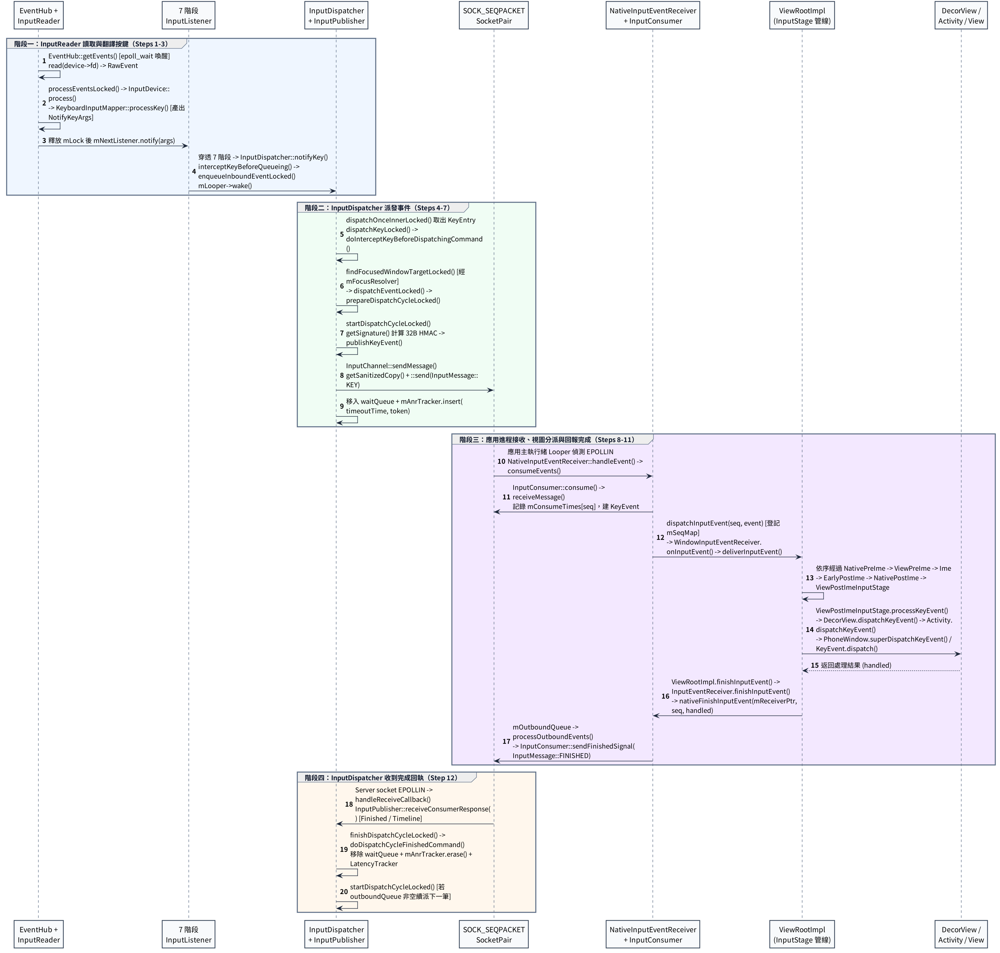

# 14.4 鍵盤消息的分發過程（`EventHub` → `KeyboardInputMapper` → `InputDispatcher` → `InputStage` / `Activity` → 完成回執）

- **情景說明**：完成 14.2 節的啟動與 14.3 節的 `InputChannel` 註冊與焦點同步後，使用者按下實體鍵盤上的一枚按鍵。Linux 核心 `evdev` 驅動將 `struct input_event` 寫入對應的 `/dev/input/event*` 緩衝區並喚醒阻塞在 `epoll_wait()` 的 `EventHub`；隨後事件依序經歷四個完整階段——① `InputReader` 與 `KeyboardInputMapper` 讀取並翻譯為 `NotifyKeyArgs`，沿 7 階段管線送達 `InputDispatcher::notifyKey()`；② `InputDispatcher` 執行政策攔截、經 `FocusResolver` 找到前景焦點視窗並附加 HMAC 簽章，透過 `SOCK_SEQPACKET` 發出 `InputMessage::Type::KEY`；③ 焦點應用主執行緒的 `Looper` 喚醒 `NativeInputEventReceiver` → `ViewRootImpl.WindowInputEventReceiver` → 7 階段 `InputStage` → `DecorView` / `Activity` / `KeyEvent.dispatch()`，處理完畢後透過 `finishInputEvent()` 送回 `InputMessage::Type::FINISHED`；④ `InputDispatcher` 收到完成回執，解除 `waitQueue` 與 ANR 計時器並派發下一筆事件。本節完整追蹤這條端到端閉環。
- **對應原書**：14.4 節〈键盘消息的分发过程〉（14.4.1–14.4.4，p.717–754）
- **涉及專案與版本基準**：
  - `platform/frameworks/native` 〔`android-17.0.0_r1`，commit `ae266dc`〕
  - `platform/frameworks/base` 〔`android-17.0.0_r1`，commit `94b4c163`〕

---

## 14.4.1 `InputReader` 取得鍵盤事件並推送至 `InputDispatcher`

> 對應原書 14.4.1〈InputReader获得键盘事件〉（p.718–725）。

整條鍵盤事件分發與完成確認閉環如下：

```text
[14.4.1 InputReader 讀取與翻譯]
EventHub::getEvents() -> read(device->fd)                 ## Step 1、epoll_wait 喚醒，批次讀取 struct input_event 轉 RawEvent
  InputReader::loopOnce() -> processEventsLocked()        ## Step 1、按 deviceId 切分批次交給 InputDevice::process()
    InputDevice::process() -> KeyboardInputMapper::process() ## Step 2、過濾 EV_KEY value==2，呼叫 processKey() 查表翻譯 keyCode
      KeyboardInputMapper::processKey()                   ## Step 2、更新 mKeyDowns / mMetaState，產出 NotifyKeyArgs
  mNextListener.notify(args) [鎖外 7 階段管線]             ## Step 3、穿透 Blocker -> ... -> InputFilter -> InputDispatcher::notifyKey()
    InputDispatcher::notifyKey()                          ## Step 3、interceptKeyBeforeQueueing() -> 入隊 mInboundQueue -> mLooper->wake()

[14.4.2 InputDispatcher 派發事件]
InputDispatcher::dispatchOnceInnerLocked()                ## Step 4、自 mInboundQueue 取出 KeyEntry
  InputDispatcher::dispatchKeyLocked()                    ## Step 5、長按重複處理、interceptKeyBeforeDispatching、找焦點視窗
    findFocusedWindowTargetLocked()                       ## Step 5、經 mFocusResolver 查詢前景焦點 WindowInfoHandle
    dispatchEventLocked() -> prepareDispatchCycleLocked() ## Step 6、加入 outboundQueue 並啟動 startDispatchCycleLocked()
      startDispatchCycleLocked()                          ## Step 7、計算 HMAC 簽章 -> publishKeyEvent() -> 移入 waitQueue + mAnrTracker
        InputPublisher::publishKeyEvent() -> sendMessage()## Step 7、getSanitizedCopy() 清零填充位元組後 ::send() 寫入 SOCK_SEQPACKET

[14.4.3 應用進程接收、分派與回覆完成]
Looper::pollInner() -> NativeInputEventReceiver::handleEvent() ## Step 8、主執行緒偵測 clientFd EPOLLIN
  consumeEvents() -> InputConsumer::consume()             ## Step 8、mChannel->receiveMessage() 讀 InputMessage::KEY 建 KeyEvent
    InputEventReceiver.dispatchInputEvent()               ## Step 9、登記 mSeqMap，呼叫 WindowInputEventReceiver.onInputEvent()
      ViewRootImpl.enqueueInputEvent() -> deliverInputEvent() ## Step 9、送入 mFirstInputStage (7 階段 InputStage 責任鏈)
        ViewPostImeInputStage.processKeyEvent()           ## Step 10、呼叫 mView.dispatchKeyEvent(event)
          DecorView.dispatchKeyEvent() -> Activity.dispatchKeyEvent() ## Step 10、PhoneWindow.superDispatchKeyEvent() -> KeyEvent.dispatch()
        ViewRootImpl.finishInputEvent()                   ## Step 11、經 InputEventReceiver -> NativeInputEventReceiver::finishInputEvent()
          mOutboundQueue -> InputConsumer::sendFinishedSignal() ## Step 11、sendUnchainedFinishedSignal() 送出 InputMessage::FINISHED

[14.4.4 InputDispatcher 收到完成回執]
InputDispatcher::handleReceiveCallback()                  ## Step 12、Server socket EPOLLIN -> receiveConsumerResponse()
  finishDispatchCycleLocked() -> doDispatchCycleFinishedCommand() ## Step 12、移除 waitQueue 與 mAnrTracker，續派下一筆
    startDispatchCycleLocked()                            ## Step 12、若 outboundQueue 非空立即開啟下一週期
```

### Step 1：`EventHub::getEvents` 讀取原始事件與 `InputReader::processEventsLocked` 批次派給裝置
**位置**：
- `platform/frameworks/native/services/inputflinger/reader/EventHub.cpp` 〔`android-17.0.0_r1`，lines 2102–2135〕
- `platform/frameworks/native/services/inputflinger/reader/InputReader.cpp` 〔`android-17.0.0_r1`，lines 261–294〕
- `platform/frameworks/native/services/inputflinger/reader/InputDevice.cpp` 〔`android-17.0.0_r1`，lines 497–534〕

```cpp
// EventHub.cpp:2102-2135
            if (eventItem.events & EPOLLIN) {
                int32_t readSize =
                        read(device->fd, readBuffer.data(),
                             sizeof(decltype(readBuffer)::value_type) * readBuffer.size());
...
                    const RawDeviceId deviceId = device->id == mBuiltInKeyboardId ? 0 : device->id;

                    const size_t count = size_t(readSize) / sizeof(struct input_event);
                    for (size_t i = 0; i < count; i++) {
                        struct input_event& iev = readBuffer[i];
                        device->trackInputEvent(iev);
                        RawEvent& ev = events.emplace_back(RawEvent{
                                .when = processEventTimestamp(iev),
                                .readTime = systemTime(SYSTEM_TIME_MONOTONIC),
                                .deviceId = deviceId,
                                .type = iev.type,
                                .code = iev.code,
                                .value = iev.value,
                        });
```

```cpp
// InputReader.cpp:261-294
std::list<NotifyArgs> InputReader::processEventsLocked(const RawEvent* rawEvents, size_t count) {
    std::list<NotifyArgs> out;
    for (const RawEvent* rawEvent = rawEvents; count;) {
        int32_t type = rawEvent->type;
        size_t batchSize = 1;
        if (type < EventHubInterface::FIRST_SYNTHETIC_EVENT) {
            RawDeviceId deviceId = rawEvent->deviceId;
            while (batchSize < count) {
                if (rawEvent[batchSize].type >= EventHubInterface::FIRST_SYNTHETIC_EVENT ||
                    rawEvent[batchSize].deviceId != deviceId) {
                    break;
                }
                batchSize += 1;
            }
            ALOGD_IF(debugRawEvents(), "BatchSize: %zu Count: %zu", batchSize, count);
            out += processEventsForDeviceLocked(deviceId, rawEvent, batchSize);
        } else {
            switch (rawEvent->type) {
                case EventHubInterface::DEVICE_ADDED:
                    addDeviceLocked(rawEvent->when, rawEvent->deviceId);
                    break;
                case EventHubInterface::DEVICE_REMOVED:
                    removeDeviceLocked(rawEvent->when, rawEvent->deviceId);
                    break;
                default:
                    ALOG_ASSERT(false); // can't happen
                    break;
            }
        }
        count -= batchSize;
        rawEvent += batchSize;
    }
    return out;
}
```

```cpp
// InputDevice.cpp:497-534
std::list<NotifyArgs> InputDevice::process(const RawEvent* rawEvents, size_t count) {
    std::list<NotifyArgs> out;
    for (const RawEvent* rawEvent = rawEvents; count != 0; rawEvent++) {
...
        if (mDropUntilNextSync) {
            if (rawEvent->type == EV_SYN && rawEvent->code == SYN_REPORT) {
                out += reset(rawEvent->when);
                mDropUntilNextSync = false;
            }
        } else if (rawEvent->type == EV_SYN && rawEvent->code == SYN_DROPPED) {
            ALOGI("Detected input event buffer overrun for device %s.", getName().c_str());
            mDropUntilNextSync = true;
        } else {
            for_each_mapper_in_subdevice(rawEvent->deviceId, [&](InputMapper& mapper) {
                out += mapper.process(*rawEvent);
            });
        }
        --count;
    }
    postProcess(out);
    return out;
}
```

1. **雙時間戳記與 `SYN_DROPPED` 溢位恢復**：`EventHub::getEvents()` 一次最多讀出 `EVENT_BUFFER_SIZE`（256）筆 `struct input_event`，同時記錄核心事件時間 `when`（經 `processEventTimestamp()` 轉換）與使用者空間讀取時間 `readTime`（供延遲監控）；`InputDevice::process()` 遇到核心 ring buffer 溢位訊號 `SYN_DROPPED` 時會主動丟棄殘缺封包直到下一個 `SYN_REPORT` 並重置裝置狀態。
2. **純函式式 `std::list<NotifyArgs>` 回傳取代鎖內直接回呼**：所有 `InputMapper::process()` 都不再於 `InputReader::mLock` 保護下直接呼叫下游監聽器，而是把產出的 `NotifyArgs` 收集成 `std::list<NotifyArgs>` 層層返回至 `InputReader::loopOnce()`，直到**釋放 `mLock` 之後**才統一呼叫 `mNextListener.notify(args)`，徹底杜絕與 `InputDispatcher` / WMS 之間的交叉死鎖。

> 〔與 2.3 差異〕邏輯改變：原書 14.4.1 Step 1–3（p.718–719）逐筆執行 `InputReader::consumeEvent()` 並在鎖內呼叫 `InputDevice::process()` 與 `mDispatcher->notifyKey()`；Android 17 改為批次分組處理、回傳 `std::list<NotifyArgs>` 並嚴格在釋鎖後才往 7 階段管線推送。

---

### Step 2：`KeyboardInputMapper::process` 與 `KeyboardInputMapper::processKey`
**位置**：`platform/frameworks/native/services/inputflinger/reader/mapper/KeyboardInputMapper.cpp` 〔`android-17.0.0_r1`，lines 241–284、357–372〕

```cpp
// KeyboardInputMapper.cpp:241-284, 357-372
std::list<NotifyArgs> KeyboardInputMapper::process(const RawEvent& rawEvent) {
    std::list<NotifyArgs> out;
    mHidUsageAccumulator.process(rawEvent);
    switch (rawEvent.type) {
        case EV_KEY: {
            // Skip processing repeated keys (value == 2) since auto repeat is handled by Android
            // internally.
            if (rawEvent.value == 2) {
                break;
            }

            const int32_t scanCode = rawEvent.code;
            if (isSupportedScanCode(scanCode)) {
                out += processKey(rawEvent.when, rawEvent.readTime, rawEvent.value != 0, scanCode,
                                  mHidUsageAccumulator.consumeCurrentHidUsage());
            }
            break;
        }
    }
    return out;
}

std::list<NotifyArgs> KeyboardInputMapper::processKey(nsecs_t when, nsecs_t readTime, bool down,
                                                      int32_t scanCode, int32_t usageCode) {
    std::list<NotifyArgs> out;
    int32_t keyCode;
    int32_t keyMetaState;
    uint32_t policyFlags;
    int32_t flags = AKEY_EVENT_FLAG_FROM_SYSTEM;

    std::optional<MappedKey> mappedKey = getDeviceContext().mapKey(scanCode, usageCode, mMetaState);
    if (mappedKey) {
        keyCode = mappedKey->keyCode;
        keyMetaState = mappedKey->metaState;
        policyFlags = mappedKey->flags;
    } else {
        keyCode = AKEYCODE_UNKNOWN;
        keyMetaState = mMetaState;
        policyFlags = 0;
    }
...
    if (down && !mParameters.doNotWakeByDefault &&
        (getDeviceContext().isExternal() || wakeOnAlphabeticKeyboard(keyboardType)) &&
        !(keyboardType != KeyboardType::ALPHABETIC && isMediaKey(keyCode))) {
        policyFlags |= POLICY_FLAG_WAKE;
    }

    if (mParameters.handlesKeyRepeat) {
        policyFlags |= POLICY_FLAG_DISABLE_KEY_REPEAT;
    }

    out.emplace_back(NotifyKeyArgs(getContext()->getNextId(), when, readTime, deviceId,
                                   getEventSource(), getDisplayId(), policyFlags,
                                   down ? AKEY_EVENT_ACTION_DOWN : AKEY_EVENT_ACTION_UP, flags,
                                   keyCode, scanCode, keyMetaState, downTime));
    return out;
}
```

1. **過濾核心長按重複（`value == 2`）與 HID Usage 支援**：Linux `evdev` 的 `EV_KEY` 以 `value=1` 表按下、`value=0` 表放開、`value=2` 表核心自動重複；Android 17 在 `KeyboardInputMapper::process()` 明確忽略 `value == 2`，交由 `InputDispatcher` 統一管理按鍵重複週期。同時透過 `mHidUsageAccumulator` 支援依 HID Usage Code 與 `.kl` 鍵盤佈局檔精準翻譯 `keyCode` 與 `policyFlags`。
2. **維護按下表與全域修飾鍵狀態**：`processKey()` 在 `mKeyDowns` 記錄每枚按下鍵的 `keyCode` 與原始 `downTime`（即使按下期間螢幕旋轉，放開時仍保證送出成對的 `keyCode` 與 `downTime`），更新 `mMetaState`（如 `Shift`/`Ctrl`/`CapsLock` 並同步鍵盤 LED）與 `KeyboardClassifier`，最後封裝 `NotifyKeyArgs`（含單調遞增事件 `id`）回傳。

> 〔與 2.3 差異〕搬家 + 擴充：原書 14.4.1 Step 4–5（p.720–722）將 `KeyboardInputMapper` 寫在 `InputReader.cpp` 內並直接呼叫 `getDispatcher()->notifyKey(...)`；Android 17 獨立為 `mapper/KeyboardInputMapper.cpp`，新增 HID Usage 映射、`KeyboardClassifier`、外接鍵盤喚醒判定，並改為回傳 `NotifyKeyArgs` 交給 7 階段管線。

---

### Step 3：`InputReader::loopOnce` 釋鎖推送管線與 `InputDispatcher::notifyKey`
**位置**：
- `platform/frameworks/native/services/inputflinger/reader/InputReader.cpp` 〔`android-17.0.0_r1`，lines 241–243〕
- `platform/frameworks/native/services/inputflinger/dispatcher/InputDispatcher.cpp` 〔`android-17.0.0_r1`，lines 4576–4673〕

```cpp
// InputReader.cpp:241-243
    for (const NotifyArgs& args : notifyArgs) {
        mNextListener.notify(args);
    }
```

```cpp
// InputDispatcher.cpp:4606-4673
    policyFlags |= POLICY_FLAG_TRUSTED;

    int32_t keyCode = args.keyCode;
    KeyEvent event;

    // Figure out the intended display to send the event to.
    // If the event is not targeted to a specific display, send it to the focused display.
    ui::LogicalDisplayId intendedDisplayId = ui::LogicalDisplayId::INVALID;
    {
        std::scoped_lock _l(mLock);
        intendedDisplayId = calculateIntendedDisplayIdLocked(args);
    }

    event.initialize(args.id, args.deviceId, args.source, intendedDisplayId, INVALID_HMAC,
                     args.action, flags, keyCode, args.scanCode, metaState, repeatCount,
                     args.downTime, args.eventTime);

    android::base::Timer t;
    mPolicy.interceptKeyBeforeQueueing(event, /*byref*/ policyFlags);
...
    bool needWake = false;
    { // acquire lock
        mLock.lock();
...
        if (shouldSendKeyToInputFilterLocked(args)) {
            mLock.unlock();

            policyFlags |= POLICY_FLAG_FILTERED;
            if (!mPolicy.filterInputEvent(event, policyFlags)) {
                return; // event was consumed by the filter
            }

            mLock.lock();
        }

        std::unique_ptr<KeyEntry> newEntry =
                std::make_unique<KeyEntry>(args.id, /*injectionState=*/nullptr, args.eventTime,
                                           args.deviceId, args.source, args.displayId, policyFlags,
                                           args.action, flags, keyCode, args.scanCode, metaState,
                                           repeatCount, args.downTime);
...
        needWake = enqueueInboundEventLocked(std::move(newEntry));
        mLock.unlock();
    } // release lock

    if (needWake) {
        mLooper->wake();
    }
```

1. **穿透 7 階段管線與兩道前置攔截**：`NotifyKeyArgs` 自 `InputReader::loopOnce()` 釋鎖後流經 `UnwantedInteractionBlocker` → `PointerChoreographer` → `InputProcessor` → `MetricsCollector` → `InputFilter`（Rust 無障礙濾波）→ `InteractionReporter` 抵達 `InputDispatcher::notifyKey()`。在真正入隊前，先無鎖呼叫 **`mPolicy.interceptKeyBeforeQueueing()`**（回呼 Java `PhoneWindowManager.interceptKeyBeforeQueueing()` 處理電源鍵喚醒、音量鍵等系統級即時動作並決定是否標上 `POLICY_FLAG_PASS_TO_USER`）；若啟用無障礙服務 `IInputFilter` 則再經 `mPolicy.filterInputEvent()` 篩選。
2. **入隊 `mInboundQueue` 並喚醒 `InputDispatcher` 執行緒**：未被攔截的按鍵包裝為 `KeyEntry` 推入 `mInboundQueue`；若佇列原先為空或迫切需要喚醒，立即呼叫 `mLooper->wake()`（寫入 `eventfd` 喚醒阻塞於 `pollOnce()` 的 `InputDispatcher` 執行緒）。

> 〔與 2.3 差異〕邏輯擴充：原書 14.4.1 Step 6（p.722–725）的 `notifyKey()` 尚未引入多螢幕 `calculateIntendedDisplayIdLocked()`、`InputFilter` 過濾、`InputTracer` 追蹤與 `LatencyTracker` 延遲記錄，但「先 `interceptKeyBeforeQueueing` 再加鎖入隊 `mInboundQueue` 最後 `mLooper->wake()`」的核心雙執行緒生產者／消費者模型完整保留。

---

## 14.4.2 `InputDispatcher` 分發鍵盤事件

> 對應原書 14.4.2〈InputDispatcher分发键盘事件〉（p.725–735）。

### Step 4：`InputDispatcher::dispatchOnceInnerLocked` 取出 `KeyEntry`
**位置**：`platform/frameworks/native/services/inputflinger/dispatcher/InputDispatcher.cpp` 〔`android-17.0.0_r1`，lines 1225–1257、1305–1316〕

```cpp
// InputDispatcher.cpp:1225-1257, 1305-1316
    if (!mPendingEvent) {
        if (mInboundQueue.empty()) {
            nextWakeupTime = std::min(nextWakeupTime, processKeyRepeatLocked(currentTime));
        }
        if (mInboundQueue.empty()) {
            return;
        }

        // Inbound queue has at least one entry.
        mPendingEvent = mInboundQueue.front();
        mInboundQueue.pop_front();
        traceInboundQueueLengthLocked();

        // Poke user activity for this event.
        if (mPendingEvent->policyFlags & POLICY_FLAG_PASS_TO_USER) {
            pokeUserActivityLocked(*mPendingEvent);
        }
    }
...
    bool done = false;
    DropReason dropReason = DropReason::NOT_DROPPED;
    if (!(mPendingEvent->policyFlags & POLICY_FLAG_PASS_TO_USER)) {
        dropReason = DropReason::POLICY;
    } else if (!mDispatchEnabled) {
        dropReason = DropReason::DISABLED;
    }
...
        case EventEntry::Type::KEY: {
            std::shared_ptr<const KeyEntry> keyEntry =
                    std::static_pointer_cast<const KeyEntry>(mPendingEvent);
            if (dropReason == DropReason::NOT_DROPPED && isStaleEvent(currentTime, *keyEntry)) {
                dropReason = DropReason::STALE;
            }
            done = dispatchKeyLocked(currentTime, keyEntry, &dropReason, nextWakeupTime);
            break;
        }
```

1. **按鍵重複合成與活躍度續命**：若 `mPendingEvent` 為空且 `mInboundQueue` 也為空，先檢查 `processKeyRepeatLocked()` 是否到達長按重複時間點以合成重複按鍵；取到 `mPendingEvent` 後，若帶有 `POLICY_FLAG_PASS_TO_USER` 則呼叫 `pokeUserActivityLocked()` 重置螢幕休眠計時器。
2. **過期事件判定（`isStaleEvent`）**：派發 `KEY` 前檢查事件是否已在佇列滯留過久（`STALE`）或因政策／休眠需丟棄，再交給 `dispatchKeyLocked()` 決定是否分發完成（`done == true` 才會清除 `mPendingEvent`）。

> 〔與 2.3 差異〕邏輯微調：原書 14.4.2 Step 1（p.726–727）的 `dispatchOnceInnerLocked()` 僅處理 `CONFIGURATION_CHANGED`、`KEY`、`MOTION` 三類事件；Android 17 擴充了 `FOCUS`、`TOUCH_MODE_CHANGED`、`POINTER_CAPTURE_CHANGED`、`DRAG` 等控制事件，並加入 `isStaleEvent()` 過期事件保護。

---

### Step 5：`InputDispatcher::dispatchKeyLocked` 與 `findFocusedWindowTargetLocked`
**位置**：`platform/frameworks/native/services/inputflinger/dispatcher/InputDispatcher.cpp` 〔`android-17.0.0_r1`，lines 1994–2067、2441–2477〕

```cpp
// InputDispatcher.cpp:1994-2067
    const ui::LogicalDisplayId displayId = getTargetDisplayId(*entry);
    // Give the policy a chance to intercept the key.
    if (entry->interceptKeyResult == KeyEntry::InterceptKeyResult::UNKNOWN) {
        if (entry->policyFlags & POLICY_FLAG_PASS_TO_USER) {
            sp<IBinder> focusedWindowToken = mFocusResolver.getFocusedWindowToken(displayId);

            auto command = [this, focusedWindowToken, displayId, entry]() REQUIRES(mLock) {
                doInterceptKeyBeforeDispatchingCommand(focusedWindowToken, displayId, *entry);
            };
            postCommandLocked(std::move(command));
            return false; // wait for the command to run
        } else {
            entry->interceptKeyResult = KeyEntry::InterceptKeyResult::CONTINUE;
        }
    } else if (entry->interceptKeyResult == KeyEntry::InterceptKeyResult::SKIP) {
        if (*dropReason == DropReason::NOT_DROPPED) {
            *dropReason = DropReason::POLICY;
        }
    }
...
    // Identify targets.
    Result<sp<WindowInfoHandle>, InputEventInjectionResult> result =
            findFocusedWindowTargetLocked(currentTime, *entry, nextWakeupTime);

    if (!result.ok()) {
        if (result.error().code() == InputEventInjectionResult::PENDING) {
            return false;
        }
        setInjectionResult(*entry, result.error().code());
        return true;
    }
    sp<WindowInfoHandle>& focusedWindow = *result;
    LOG_ALWAYS_FATAL_IF(focusedWindow == nullptr);

    setInjectionResult(*entry, InputEventInjectionResult::SUCCEEDED);

    std::vector<InputTarget> inputTargets;
    addWindowTargetLocked(focusedWindow, InputTarget::DispatchMode::AS_IS,
                          InputTarget::Flags::FOREGROUND, getDownTime(*entry), inputTargets);

    // Add monitor channels from event's or focused display.
    addFocusInputMonitoringTargetsLocked(inputTargets, displayId);
...
    // Dispatch the key.
    dispatchEventLocked(currentTime, entry, inputTargets);
    return true;
}
```

```cpp
// InputDispatcher.cpp:2441-2477
Result<sp<WindowInfoHandle>, InputEventInjectionResult>
InputDispatcher::findFocusedWindowTargetLocked(nsecs_t currentTime, const EventEntry& entry,
                                               nsecs_t& nextWakeupTime) {
    ui::LogicalDisplayId displayId = getTargetDisplayId(entry);
    sp<WindowInfoHandle> focusedWindowHandle = getFocusedWindowHandleLocked(displayId);
    std::shared_ptr<InputApplicationHandle> focusedApplicationHandle =
            getValueByKey(mFocusedApplicationHandlesByDisplay, displayId);

    if (focusedWindowHandle == nullptr && focusedApplicationHandle == nullptr) {
        return injectionError(InputEventInjectionResult::FAILED);
    }

    if (focusedWindowHandle != nullptr &&
        shouldDropInput(entry, focusedWindowHandle, mWindowInfos)) {
        return injectionError(InputEventInjectionResult::FAILED);
    }

    if (focusedWindowHandle == nullptr && focusedApplicationHandle != nullptr) {
        if (!mNoFocusedWindowAnrState.has_value()) {
            std::chrono::nanoseconds timeout = focusedApplicationHandle->getDispatchingTimeout(
                    DEFAULT_INPUT_DISPATCHING_TIMEOUT);
            const nsecs_t noFocusedWindowEndTime = currentTime + timeout.count();
            mNoFocusedWindowAnrState =
                    NoFocusedWindowAnrState(entry.eventTime, noFocusedWindowEndTime,
                                            focusedApplicationHandle, entry.id,
```

1. **第二道非同步政策攔截（`interceptKeyBeforeDispatching`）**：首次進入 `dispatchKeyLocked()` 時，透過 `postCommandLocked()` 排入 `doInterceptKeyBeforeDispatchingCommand()` 並先返回 `false`；待 `dispatchOnce()` 在釋鎖安全區回呼 Java `PhoneWindowManager.interceptKeyBeforeDispatching()`（例如處理 Home、Recents、全域快速鍵）並設下 `entry->interceptKeyResult = CONTINUE` 後，下一輪迴圈才真正進入派發目標查找。
2. **多螢幕焦點查詢與「無焦點視窗 ANR」保護**：`findFocusedWindowTargetLocked()` 先由 `getFocusedWindowHandleLocked(displayId)` 透過 `mFocusResolver` 取得該螢幕的焦點 `WindowInfoHandle`；若已有焦點應用（`focusedApplicationHandle != nullptr`）卻遲遲沒有焦點視窗（例如新 Activity 卡住尚未呼叫 `addWindow`），則啟動 `mNoFocusedWindowAnrState` 倒數計時並在逾時後觸發 No-Focused-Window ANR。
3. **組裝 `inputTargets`**：找到 `focusedWindow` 後呼叫 `addWindowTargetLocked()` 將對應的 `Connection` 加入 `inputTargets`，並附加該螢幕的焦點監聽通道（`addFocusInputMonitoringTargetsLocked()`），再交由 `dispatchEventLocked()` 派發。

> 〔與 2.3 差異〕邏輯重構：原書 14.4.2 Step 2–3（p.728–731）直接檢查單一螢幕的 `mFocusedWindow` 並回傳 `int32_t` 注入結果碼；Android 17 支援多螢幕 `FocusResolver`、`shouldDropInput()` 安全防遮擋規則與 lambda `Command` 佇列執行 `doInterceptKeyBeforeDispatchingCommand()`。

---

### Step 6：`dispatchEventLocked` → `prepareDispatchCycleLocked` → `enqueueDispatchEntryAndStartDispatchCycleLocked`
**位置**：`platform/frameworks/native/services/inputflinger/dispatcher/InputDispatcher.cpp` 〔`android-17.0.0_r1`，lines 2328–2344、3446–3467、3507–3528〕

```cpp
// InputDispatcher.cpp:2328-2344, 3507-3528
void InputDispatcher::dispatchEventLocked(nsecs_t currentTime,
                                          std::shared_ptr<const EventEntry> eventEntry,
                                          const std::vector<InputTarget>& inputTargets) {
    ATRACE_CALL();
    LOG_IF(INFO, DEBUG_DISPATCH_CYCLE) << "dispatchEventToCurrentInputTargets";

    processInteractionsLocked(*eventEntry, inputTargets);

    ALOG_ASSERT(eventEntry->dispatchInProgress); // should already have been set to true

    pokeUserActivityLocked(*eventEntry);

    for (const InputTarget& inputTarget : inputTargets) {
        std::shared_ptr<Connection> connection = inputTarget.connection;
        prepareDispatchCycleLocked(currentTime, connection, eventEntry, inputTarget);
    }
}
...
    // Not splitting.  Enqueue dispatch entries for the event as is.
    enqueueDispatchEntryAndStartDispatchCycleLocked(currentTime, connection, eventEntry,
                                                    inputTarget);
}

void InputDispatcher::enqueueDispatchEntryAndStartDispatchCycleLocked(
        nsecs_t currentTime, const std::shared_ptr<Connection>& connection,
        std::shared_ptr<const EventEntry> eventEntry, const InputTarget& inputTarget) {
    const bool wasEmpty = connection->outboundQueue.empty();

    enqueueDispatchEntryLocked(connection, eventEntry, inputTarget);

    // If the outbound queue was previously empty, start the dispatch cycle going.
    if (wasEmpty && !connection->outboundQueue.empty()) {
        startDispatchCycleLocked(currentTime, connection);
    }
}
```

1. **逐目標入隊 `outboundQueue`**：`dispatchEventLocked()` 遍歷所有 `inputTargets`（一般情況就是前景焦點視窗的 `Connection`），在 `prepareDispatchCycleLocked()` 確認 `connection->status == Connection::Status::NORMAL` 後，於 `enqueueDispatchEntryLocked()` 建立帶有序號 `seq` 的 `DispatchEntry` 放入 `connection->outboundQueue`。
2. **立即觸發派發週期**：若該連線的 `outboundQueue` 原先為空，立即呼叫 `startDispatchCycleLocked()` 開始將事件寫入 socket；若非空（表示 socket 寫滿正等應用端消化），則排隊等待 14.4.4 節收到 `FINISHED` 後續派。

> 〔與 2.3 差異〕改名 + 邏輯微調：原書 14.4.2 Step 4–5（p.731）名為 `dispatchEventToCurrentInputTargetsLocked()` 並需透過 `getConnectionIndexLocked(inputTarget.inputChannel)` 反查連線；Android 17 更名為 `dispatchEventLocked()` 且 `InputTarget` 直接持有 `std::shared_ptr<Connection>`，省去重複查表。

---

### Step 7：`startDispatchCycleLocked`、HMAC 簽章、`InputPublisher::publishKeyEvent` 與 `InputChannel::sendMessage`
**位置**：
- `platform/frameworks/native/services/inputflinger/dispatcher/InputDispatcher.cpp` 〔`android-17.0.0_r1`，lines 3893–3933、4025–4035〕
- `platform/frameworks/native/libs/input/InputTransport.cpp` 〔`android-17.0.0_r1`，lines 388–425、546–586〕

```cpp
// InputDispatcher.cpp:3893-3933, 4025-4035
void InputDispatcher::startDispatchCycleLocked(nsecs_t currentTime,
                                               const std::shared_ptr<Connection>& connection) {
    while (connection->status == Connection::Status::NORMAL && !connection->outboundQueue.empty()) {
        std::unique_ptr<DispatchEntry>& dispatchEntry = connection->outboundQueue.front();
        dispatchEntry->deliveryTime = currentTime;
        const std::chrono::nanoseconds timeout = getDispatchingTimeoutLocked(connection);
        dispatchEntry->timeoutTime = currentTime + timeout.count();

        // Publish the event.
        status_t status;
        const EventEntry& eventEntry = *(dispatchEntry->eventEntry);
        switch (eventEntry.type) {
            case EventEntry::Type::KEY: {
                const KeyEntry& keyEntry = static_cast<const KeyEntry&>(eventEntry);
                std::array<uint8_t, 32> hmac = getSignature(keyEntry, *dispatchEntry);

                // Publish the key event.
                status =
                        connection->inputPublisher
                                .publishKeyEvent(dispatchEntry->seq, keyEntry.id, keyEntry.deviceId,
                                                 keyEntry.source, keyEntry.displayId,
                                                 std::move(hmac), keyEntry.action, keyEntry.flags,
                                                 keyEntry.keyCode, keyEntry.scanCode,
                                                 keyEntry.metaState, keyEntry.repeatCount,
                                                 keyEntry.downTime, keyEntry.eventTime);
                break;
            }
...
        // Re-enqueue the event on the wait queue.
        const nsecs_t timeoutTime = dispatchEntry->timeoutTime;
        connection->waitQueue.emplace_back(std::move(dispatchEntry));
        connection->outboundQueue.erase(connection->outboundQueue.begin());
        traceOutboundQueueLength(*connection);
        if (connection->responsive) {
            mAnrTracker.insert(timeoutTime, connection->getToken());
        }
        traceWaitQueueLength(*connection);
    }
}
```

```cpp
// InputTransport.cpp:388-425, 569-586
status_t InputChannel::sendMessage(const InputMessage* msg) {
    const size_t msgLength = msg->size();
    InputMessage cleanMsg;
    msg->getSanitizedCopy(&cleanMsg);
    ssize_t nWrite;
    do {
        nWrite = ::send(getFd(), &cleanMsg, msgLength, MSG_DONTWAIT | MSG_NOSIGNAL);
    } while (nWrite == -1 && errno == EINTR);
...
    return OK;
}
...
    InputMessage msg;
    msg.header.type = InputMessage::Type::KEY;
    msg.header.seq = seq;
    msg.body.key.eventId = eventId;
    msg.body.key.deviceId = deviceId;
    msg.body.key.source = source;
    msg.body.key.displayId = displayId.val();
    msg.body.key.hmac = std::move(hmac);
    msg.body.key.action = action;
    msg.body.key.flags = flags;
    msg.body.key.keyCode = keyCode;
    msg.body.key.scanCode = scanCode;
    msg.body.key.metaState = metaState;
    msg.body.key.repeatCount = repeatCount;
    msg.body.key.downTime = downTime;
    msg.body.key.eventTime = eventTime;
    return mChannel->sendMessage(&msg);
```

1. **HMAC 防偽簽章與無阻塞流水線發送**：`startDispatchCycleLocked()` 為每筆 `KeyEntry` 計算 `timeoutTime`（預設 5 秒）與 32 位元組 HMAC 簽章，呼叫 `InputPublisher::publishKeyEvent()` 填妥 `InputMessage::Type::KEY`，再經 `InputChannel::sendMessage()` 執行 `getSanitizedCopy()` 清零所有 padding 位元組後，以 `::send(fd, &cleanMsg, msgLength, MSG_DONTWAIT | MSG_NOSIGNAL)` 寫入 Server 端 `SOCK_SEQPACKET` socket。
2. **移入 `waitQueue` 與登記 `mAnrTracker`**：只要 socket 寫入成功（未滿），該 `DispatchEntry` 便自 `outboundQueue` 移至 `waitQueue` 並把 `(timeoutTime, connectionToken)` 登記進 `mAnrTracker`——`while` 迴圈可以持續把多筆待派發事件塞進 socket 緩衝區形成流水線，不再像 2.3 那樣受限於單一 Ashmem 區塊一次只能發一筆。

> 〔與 2.3 差異〕徹底重寫：原書 14.4.2 Step 6–9（p.732–735）呼叫 `InputPublisher::publishKeyEvent()` 把事件寫入 Ashmem `SharedBuffer` 後，還須再呼叫 `sendDispatchSignal()` 往 `mSendPipeFd` 寫入 `'D'` 位元組；Android 17 透過單一 `::send()` 原子傳送含 HMAC 的 `InputMessage`，並以 `waitQueue` + `mAnrTracker` 追蹤多筆在途事件的 ANR 逾時。

---

## 14.4.3 系統當前激活的應用程式視窗取得並處理鍵盤消息

> 對應原書 14.4.3〈系统当前激活的应用程序窗口获得键盘消息〉（p.735–751）。

### Step 8：`NativeInputEventReceiver::handleEvent`、`consumeEvents` 與 `InputConsumer::consume`
**位置**：
- `platform/frameworks/base/core/jni/android_view_InputEventReceiver.cpp` 〔`android-17.0.0_r1`，lines 418–453、472–489、550–559、625–640〕
- `platform/frameworks/native/libs/input/InputConsumer.cpp` 〔`android-17.0.0_r1`，lines 245–291〕

```cpp
// android_view_InputEventReceiver.cpp:434-439, 478-489, 550-558, 633-636
    if (events & ALOOPER_EVENT_INPUT) {
        JNIEnv* env = AndroidRuntime::getJNIEnv();
        status_t status = consumeEvents(env, /*consumeBatches=*/false, -1, nullptr);
        mMessageQueue->raiseAndClearException(env, "handleReceiveCallback");
        return status == OK || status == NO_MEMORY ? KEEP_CALLBACK : REMOVE_CALLBACK;
    }
...
        uint32_t seq;
        InputEvent* inputEvent;

        const auto& [result, unfinishedInputMessages] =
                mInputConsumer->consume(&mInputEventFactory, consumeBatches, frameTime, &seq,
                                        &inputEvent);
...
            switch (inputEvent->getType()) {
                case InputEventType::KEY:
                    inputEventObj =
                            android_view_KeyEvent_obtainAsCopy(env,
                                                               static_cast<KeyEvent&>(*inputEvent));
                    break;
...
                env->CallVoidMethod(receiverObj.get(),
                                    gInputEventReceiverClassInfo.dispatchInputEvent, seq,
                                    inputEventObj.get());
```

```cpp
// InputConsumer.cpp:251-291
            // Receive a fresh message.
            android::base::Result<InputMessage> result = mChannel->receiveMessage();
            if (result.ok()) {
                mMsg = std::move(result.value());
                const auto [_, inserted] =
                        mConsumeTimes.emplace(mMsg.header.seq, systemTime(SYSTEM_TIME_MONOTONIC));
                LOG_ALWAYS_FATAL_IF(!inserted, "Already have a consume time for seq=%" PRIu32,
                                    mMsg.header.seq);
...
        switch (mMsg.header.type) {
            case InputMessage::Type::KEY: {
                KeyEvent* keyEvent = factory->createKeyEvent();
                if (!keyEvent)
                    return ConsumeResult{android::base::Error(NO_MEMORY), unfinishedInputMessages};

                initializeKeyEvent(*keyEvent, mMsg);
                *outSeq = mMsg.header.seq;
                *outEvent = keyEvent;
                break;
            }
```

1. **主執行緒 `Looper` 觸發 `NativeInputEventReceiver::handleEvent()`**：第 13 章分析過的應用主執行緒 `libutils/Looper::pollInner()` 偵測到 Client socket 出現 `EPOLLIN`，立即回呼 `NativeInputEventReceiver::handleEvent()` → `consumeEvents()`。
2. **讀取 `InputMessage` 並登記消費時間**：`InputConsumer::consume()` 呼叫 `mChannel->receiveMessage()`（內部執行 `::recv(fd, &msg, sizeof(InputMessage), MSG_DONTWAIT)` 並驗證長度與型別），把系統單調時間記錄到 `mConsumeTimes[seq]`（供稍後回傳 `FINISHED` 計算應用端處理耗時），將 `InputMessage::Type::KEY` 填入預分配的 `KeyEvent`。
3. **跨 JNI 呼叫 `InputEventReceiver.dispatchInputEvent()`**：`consumeEvents()` 透過 `android_view_KeyEvent_obtainAsCopy()` 建立 Java `KeyEvent` 物件，呼叫 Java `InputEventReceiver.dispatchInputEvent(seq, event)`；並持續在 `for (;;)` 迴圈讀取直到 socket 回傳 `WOULD_BLOCK`。

> 〔與 2.3 差異〕改名 + 邏輯重寫：原書 14.4.3 Step 1–4（p.736–740）在 `NativeInputQueue::handleReceiveCallback()` 中先呼叫 `receiveDispatchSignal()` 自前向管道讀出 `'D'`，再呼叫 `InputConsumer::consume()` 自 Ashmem 讀取資料；Android 17 合併為單次 `::recv()` 讀取完整 `InputMessage`，並額外記錄 `mConsumeTimes` 供延遲指標分析，同時在 `consumeEvents()` 中直接分流處理 `FOCUS` / `CAPTURE` / `DRAG` / `TOUCH_MODE` 控制訊息。

---

### Step 9：`InputEventReceiver.dispatchInputEvent` → `ViewRootImpl.WindowInputEventReceiver` → 7 階段 `InputStage`
**位置**：
- `platform/frameworks/base/core/java/android/view/InputEventReceiver.java` 〔`android-17.0.0_r1`，lines 279–282〕
- `platform/frameworks/base/core/java/android/view/ViewRootImpl.java` 〔`android-17.0.0_r1`，lines 7908–7980、11215–11283、11313–11341、11464–11467、11681–11683〕

```java
// InputEventReceiver.java:279-282
    private void dispatchInputEvent(int seq, InputEvent event) {
        mSeqMap.put(event.getSequenceNumber(), seq);
        onInputEvent(event);
    }
```

```java
// ViewRootImpl.java:11464-11467, 11681-11683, 11249-11254, 11313-11341
        @Override
        public void onInputEvent(InputEvent event) {
            processRawInputEvent(event);
        }
...
        } else {
            enqueueInputEvent(event, mInputEventReceiver, 0, true);
        }
...
        if (processImmediately) {
            doProcessInputEvents();
        } else {
            scheduleProcessInputEvents();
        }
...
            InputStage stage;
            if (q.shouldSendToSynthesizer()) {
                stage = mSyntheticInputStage;
            } else {
                boolean canSkipToPostIme = q.shouldSkipIme()
                        && (q.mFlags & QueuedInputEvent.FLAG_SKIP_IME) == 0;
                stage = canSkipToPostIme ? mFirstPostImeInputStage : mFirstInputStage;
            }
...
            if (stage != null) {
                handleWindowFocusChanged();
                stage.deliver(q);
            } else {
                finishInputEvent(q);
            }
```

```java
// ViewRootImpl.java:7908-7980
        public final void deliver(QueuedInputEvent q) {
            if ((q.mFlags & QueuedInputEvent.FLAG_FINISHED) != 0) {
                forward(q);
            } else if (shouldDropInputEvent(q)) {
                finish(q, false);
            } else {
                traceEvent(q, Trace.TRACE_TAG_VIEW);
                final int result;
                try {
                    result = onProcess(q);
                } finally {
                    Trace.traceEnd(Trace.TRACE_TAG_VIEW);
                }
                apply(q, result);
            }
        }
...
        protected void onDeliverToNext(QueuedInputEvent q) {
            if (mNext != null) {
                mNext.deliver(q);
            } else {
                finishInputEvent(q);
            }
        }
```

1. **序號對映 `mSeqMap`**：`InputEventReceiver.dispatchInputEvent()` 先記下 `event.getSequenceNumber() → seq`（供稍後 `finishInputEvent()` 找回原生序號），隨即呼叫子類 `WindowInputEventReceiver.onInputEvent()` → `processRawInputEvent()` → `enqueueInputEvent(event, mInputEventReceiver, 0, true)`。由於 `processImmediately == true`，立刻同步執行 `doProcessInputEvents()` → `deliverInputEvent(q)`。
2. **走完整 7 階段 `InputStage` 責任鏈**：對於 `KeyEvent`，`q.shouldSkipIme()` 為 `false`，因此從 `mFirstInputStage`（`NativePreImeInputStage`）起跑，依序通過 `ViewPreImeInputStage`（讓焦點 View 可在輸入法之前攔截按鍵）、`ImeInputStage`（若輸入法活躍則非同步交給 IME 處理，未消費才回調續傳）、`EarlyPostImeInputStage`（切換觸控模式等）、`NativePostImeInputStage`，最終抵達 **`ViewPostImeInputStage`**。任一階段回傳 `FINISH_HANDLED` 時會標記 `FLAG_FINISHED | FLAG_FINISHED_HANDLED` 並快速穿透剩餘階段，直到尾端 `mNext == null` 呼叫 `ViewRootImpl.finishInputEvent(q)`。

> 〔與 2.3 差異〕架構重構：原書 14.4.3 Step 5–8（p.741–744）由 `InputQueue.dispatchKeyEvent()` → `ViewRoot.mInputHandler.handleKey()` → `ViewRoot.dispatchKey()` 透過 `Handler` 發送 `DISPATCH_KEY` 非同步消息再執行 `deliverKeyEvent()`；Android 17 取消這層多餘的 `Handler` 轉發，改在 `onInputEvent()` 中直接同步啟動 `doProcessInputEvents()` 與 7 階段 `InputStage` 責任鏈。

---

### Step 10：`ViewPostImeInputStage.processKeyEvent` → `DecorView` → `Activity` → `PhoneWindow` → `KeyEvent.dispatch`
**位置**：
- `platform/frameworks/base/core/java/android/view/ViewRootImpl.java` 〔`android-17.0.0_r1`，lines 8708–8719〕
- `platform/frameworks/base/core/java/com/android/internal/policy/DecorView.java` 〔`android-17.0.0_r1`，lines 343–378〕
- `platform/frameworks/base/core/java/android/app/Activity.java` 〔`android-17.0.0_r1`，lines 4620–4639〕
- `platform/frameworks/base/core/java/android/view/KeyEvent.java` 〔`android-17.0.0_r1`，lines 3845–3869〕

```java
// ViewRootImpl.java:8708-8719
        private int processKeyEvent(QueuedInputEvent q) {
            final KeyEvent event = (KeyEvent)q.mEvent;

            if (mUnhandledKeyManager.preViewDispatch(event)) {
                return FINISH_HANDLED;
            }

            // Deliver the key to the view hierarchy.
            if (mView.dispatchKeyEvent(event)) {
                return FINISH_HANDLED;
            }
```

```java
// DecorView.java:367-377
        if (!mWindow.isDestroyed()) {
            final Window.Callback cb = mWindow.getCallback();
            final boolean handled = cb != null && mFeatureId < 0 ? cb.dispatchKeyEvent(event)
                    : super.dispatchKeyEvent(event);
            if (handled) {
                return true;
            }
        }

        return isDown ? mWindow.onKeyDown(mFeatureId, event.getKeyCode(), event)
                : mWindow.onKeyUp(mFeatureId, event.getKeyCode(), event);
```

```java
// Activity.java:4620-4639
    public boolean dispatchKeyEvent(KeyEvent event) {
        onUserInteraction();

        final int keyCode = event.getKeyCode();
        if (keyCode == KeyEvent.KEYCODE_MENU &&
                mActionBar != null && mActionBar.onMenuKeyEvent(event)) {
            return true;
        }

        Window win = getWindow();
        if (win.superDispatchKeyEvent(event)) {
            return true;
        }
        View decor = mDecor;
        if (decor == null) decor = win.getDecorView();
        return event.dispatch(this, decor != null
                ? decor.getKeyDispatcherState() : null, this);
    }
```

```java
// KeyEvent.java:3845-3869
    public final boolean dispatch(Callback receiver, DispatcherState state,
            Object target) {
        switch (mAction) {
            case ACTION_DOWN: {
                mFlags &= ~FLAG_START_TRACKING;
                boolean res = receiver.onKeyDown(mKeyCode, this);
                if (state != null) {
                    if (res && mRepeatCount == 0 && (mFlags&FLAG_START_TRACKING) != 0) {
                        state.startTracking(this, target);
                    } else if (isLongPress() && state.isTracking(this)) {
                        try {
                            if (receiver.onKeyLongPress(mKeyCode, this)) {
                                state.performedLongPress(this);
                                res = true;
                            }
                        } catch (AbstractMethodError e) {
                        }
                    }
                }
                return res;
            }
```

1. **視圖樹與 Activity 的經典雙向分派**：`ViewPostImeInputStage.processKeyEvent()` 呼叫 `mView.dispatchKeyEvent(event)`（`mView` 即 `DecorView`）；`DecorView` 先把事件轉交給 `Window.Callback`（也就是 `Activity.dispatchKeyEvent()`）；`Activity` 呼叫 `onUserInteraction()` 後，再經由 `PhoneWindow.superDispatchKeyEvent()` → `DecorView.superDispatchKeyEvent()` → `ViewGroup.dispatchKeyEvent()` 往下分派給整個 View 樹中目前擁有焦點的子 `View`。
2. **回退至 `Activity.onKeyDown` / `onKeyUp` 與快捷鍵／焦點導航**：如果 View 樹中沒有任何子 View 消費該按鍵，控制權回到 `Activity.dispatchKeyEvent()` 呼叫 `event.dispatch(this, ...)` 觸發 `Activity.onKeyDown()` / `onKeyLongPress()` / `onKeyUp()`；若仍未消費，回到 `ViewPostImeInputStage.processKeyEvent()` 依序嘗試 `mUnhandledKeyManager`、修飾鍵快捷鍵（`dispatchKeyShortcutEvent`）、`mFallbackEventHandler` 與鍵盤焦點導航（`performFocusNavigation`）。

> 〔與 2.3 差異〕搬家 + 擴充：原書 14.4.3 Step 9–12（p.744–747）中 `DecorView` 是 `PhoneWindow` 的內部類，且由 `ViewRoot.deliverKeyEventToViewHierarchy()` 直接呼叫；Android 17 將 `DecorView` 獨立為 `com/android/internal/policy/DecorView.java`，並把視圖分派收斂進 `ViewPostImeInputStage.processKeyEvent()`，新增 `UnhandledKeyEventListener` 與 `Ctrl+Tab` 群組導航支援，而 `DecorView` ↔ `Activity` ↔ `PhoneWindow` ↔ `KeyEvent.dispatch()` 的核心分派順序保持不變。

---

### Step 11：`ViewRootImpl.finishInputEvent` → `NativeInputEventReceiver::finishInputEvent` → `InputConsumer::sendFinishedSignal`
**位置**：
- `platform/frameworks/base/core/java/android/view/ViewRootImpl.java` 〔`android-17.0.0_r1`，lines 11347–11377〕
- `platform/frameworks/base/core/java/android/view/InputEventReceiver.java` 〔`android-17.0.0_r1`，lines 220–238〕
- `platform/frameworks/base/core/jni/android_view_InputEventReceiver.cpp` 〔`android-17.0.0_r1`，lines 274–285、361–416、784–798〕
- `platform/frameworks/native/libs/input/InputConsumer.cpp` 〔`android-17.0.0_r1`，lines 746–755、790–792、824–830〕

```java
// ViewRootImpl.java:11347-11377
    private void finishInputEvent(QueuedInputEvent q) {
        Trace.asyncTraceEnd(Trace.TRACE_TAG_VIEW, "deliverInputEvent",
                q.mEvent.getId());

        if (q.mReceiver != null) {
            boolean handled = (q.mFlags & QueuedInputEvent.FLAG_FINISHED_HANDLED) != 0;
...
                q.mReceiver.finishInputEvent(q.mEvent, handled);
...
        } else {
            q.mEvent.recycleIfNeededAfterDispatch();
        }

        recycleQueuedInputEvent(q);
    }
```

```java
// InputEventReceiver.java:220-238
    public final void finishInputEvent(InputEvent event, boolean handled) {
        if (event == null) {
            throw new IllegalArgumentException("event must not be null");
        }
        if (mReceiverPtr == 0) {
            Log.w(TAG, "Attempted to finish an input event but the input event "
                    + "receiver has already been disposed.");
        } else {
            int index = mSeqMap.indexOfKey(event.getSequenceNumber());
            if (index < 0) {
                Log.w(TAG, "Attempted to finish an input event that is not in progress.");
            } else {
                int seq = mSeqMap.valueAt(index);
                mSeqMap.removeAt(index);
                nativeFinishInputEvent(mReceiverPtr, seq, handled);
            }
        }
        event.recycleIfNeededAfterDispatch();
    }
```

```cpp
// android_view_InputEventReceiver.cpp:274-285, 361-416
status_t NativeInputEventReceiver::finishInputEvent(uint32_t seq, bool handled) {
    Finish finish{
            .seq = seq,
            .handled = handled,
    };
    mOutboundQueue.emplace(finish);
    return processOutboundEvents();
}
...
status_t NativeInputEventReceiver::processOutboundEvents() {
    if (mInputConsumer == nullptr) {
        return DEAD_OBJECT;
    }

    while (true) {
        std::optional<OutboundEvent> outbound = mOutboundQueue.popWithTimeout(0ms);
        if (!outbound.has_value()) {
            break;
        }

        status_t status;
        if (std::holds_alternative<Finish>(*outbound)) {
            const Finish& finish = std::get<Finish>(*outbound);
            status = mInputConsumer->sendFinishedSignal(finish.seq, finish.handled);
        } else if (std::holds_alternative<Timeline>(*outbound)) {
            const Timeline& timeline = std::get<Timeline>(*outbound);
            status = mInputConsumer->sendTimeline(timeline.inputEventId, timeline.timeline);
        }
        if (status == OK) {
            continue;
        }

        if (status == WOULD_BLOCK) {
            mOutboundQueue.emplace(*outbound);
            setFdEvents(ALOOPER_EVENT_INPUT | ALOOPER_EVENT_OUTPUT);
            return WOULD_BLOCK; // try again later
        }
...
    }
    setFdEvents(ALOOPER_EVENT_INPUT);
    return OK;
}
```

```cpp
// InputConsumer.cpp:824-830
status_t InputConsumer::sendUnchainedFinishedSignal(uint32_t seq, bool handled) {
    InputMessage msg;
    msg.header.type = InputMessage::Type::FINISHED;
    msg.header.seq = seq;
    msg.body.finished.handled = handled;
    msg.body.finished.consumeTime = getConsumeTime(seq);
    status_t result = mChannel->sendMessage(&msg);
```

1. **非阻塞出站佇列 `mOutboundQueue` + `ALOOPER_EVENT_OUTPUT` 背壓重試**：`NativeInputEventReceiver::finishInputEvent()` 先把 `Finish{seq, handled}` 壓入無鎖 `mOutboundQueue` 再呼叫 `processOutboundEvents()` 透過 `InputConsumer::sendFinishedSignal()` → `sendUnchainedFinishedSignal()` 寫入 `InputMessage::Type::FINISHED`（附帶原先記錄的 `consumeTime`）。如果此時 socket 發送緩衝區剛好滿載回傳 `WOULD_BLOCK`，不會丟棄或忙等，而是把元素放回佇列並動態為 Client fd 開啟 `ALOOPER_EVENT_OUTPUT` 監聽，待核心緩衝區可寫時由 `Looper` 自動重試，送完即撤回 `ALOOPER_EVENT_OUTPUT` 避免空轉。
2. **附帶 `handled` 與 `consumeTime`**：與 2.3 只傳單一 `'F'` 位元組不同，Android 17 明確回報 `handled`（供 `InputDispatcher` 決定是否觸發系統級 fallback 按鍵，如未消費的媒體鍵）與 `consumeTime`（精確區分「IPC 排隊耗時」與「App 處理耗時」）。

> 〔與 2.3 差異〕徹底重寫：原書 14.4.3 Step 13–18（p.748–750）透過 `FinishedCallback.run()` → `InputQueue.nativeFinished()` → `InputConsumer::sendFinishedSignal()` 往反向管道寫入 1 位元組 `'F'`；Android 17 改由 `InputEventReceiver.finishInputEvent()` 經 `mOutboundQueue` 透過同一個 `SOCK_SEQPACKET` 回送結構化的 `InputMessage::Type::FINISHED`（並整合 RenderThread 回報的 `Timeline` 訊息）。

---

## 14.4.4 `InputDispatcher` 收到鍵盤事件處理完成通知

> 對應原書 14.4.4〈InputDispatcher获得键盘事件处理完成通知〉（p.751–754）。

### Step 12：`InputDispatcher::handleReceiveCallback`、`finishDispatchCycleLocked` 與 `doDispatchCycleFinishedCommand`
**位置**：
- `platform/frameworks/native/services/inputflinger/dispatcher/InputDispatcher.cpp` 〔`android-17.0.0_r1`，lines 4076–4092、4137–4187、6700–6772〕
- `platform/frameworks/native/libs/input/InputTransport.cpp` 〔`android-17.0.0_r1`，lines 748–783〕

```cpp
// InputDispatcher.cpp:4137-4187, 4076-4092
int InputDispatcher::handleReceiveCallback(int events, sp<IBinder> connectionToken) {
    std::scoped_lock _l(mLock);
    std::shared_ptr<Connection> connection = mConnectionManager.getConnection(connectionToken);
    if (connection == nullptr) {
        return 0; // remove the callback
    }

    bool notify;
    if (!(events & (ALOOPER_EVENT_ERROR | ALOOPER_EVENT_HANGUP))) {
...
        nsecs_t currentTime = now();
        bool gotOne = false;
        status_t status = OK;
        for (;;) {
            Result<InputPublisher::ConsumerResponse> result =
                    connection->inputPublisher.receiveConsumerResponse();
            if (!result.ok()) {
                status = result.error().code();
                break;
            }

            if (std::holds_alternative<InputPublisher::Finished>(*result)) {
                const InputPublisher::Finished& finish =
                        std::get<InputPublisher::Finished>(*result);
                finishDispatchCycleLocked(currentTime, connection, finish.seq, finish.handled,
                                          finish.consumeTime);
            } else if (std::holds_alternative<InputPublisher::Timeline>(*result)) {
                if (shouldReportMetricsForConnection(*connection)) {
                    const InputPublisher::Timeline& timeline =
                            std::get<InputPublisher::Timeline>(*result);
                    mLatencyTracker.trackGraphicsLatency(timeline.inputEventId,
                                                         connection->getToken(),
                                                         std::move(timeline.graphicsTimeline));
                }
            }
            gotOne = true;
        }
        if (gotOne) {
            runCommandsLockedInterruptable();
            if (status == WOULD_BLOCK) {
                return 1;
            }
        }
...
void InputDispatcher::finishDispatchCycleLocked(nsecs_t currentTime,
                                                const std::shared_ptr<Connection>& connection,
                                                uint32_t seq, bool handled, nsecs_t consumeTime) {
    if (connection->status != Connection::Status::NORMAL) {
        return;
    }

    // Notify other system components and prepare to start the next dispatch cycle.
    auto command = [this, currentTime, connection, seq, handled, consumeTime]() REQUIRES(mLock) {
        doDispatchCycleFinishedCommand(currentTime, connection, seq, handled, consumeTime);
    };
    postCommandLocked(std::move(command));
}
```

```cpp
// InputDispatcher.cpp:6700-6772
void InputDispatcher::doDispatchCycleFinishedCommand(nsecs_t finishTime,
                                                     const std::shared_ptr<Connection>& connection,
                                                     uint32_t seq, bool handled,
                                                     nsecs_t consumeTime) {
    std::unique_ptr<const KeyEntry> fallbackKeyEntry;

    { // Start critical section
        auto dispatchEntryIt =
                std::find_if(connection->waitQueue.begin(), connection->waitQueue.end(),
                             [seq](auto& e) { return e->seq == seq; });
        if (dispatchEntryIt == connection->waitQueue.end()) {
            return;
        }

        DispatchEntry& dispatchEntry = **dispatchEntryIt;

        const nsecs_t eventDuration = finishTime - dispatchEntry.deliveryTime;
        if (eventDuration > SLOW_EVENT_PROCESSING_WARNING_TIMEOUT) {
            ALOGI("%s spent %" PRId64 "ms processing %s", connection->getInputChannelName().c_str(),
                  ns2ms(eventDuration), dispatchEntry.eventEntry->getDescription().c_str());
        }
        if (shouldReportFinishedEvent(dispatchEntry, *connection)) {
            mLatencyTracker.trackFinishedEvent(dispatchEntry.eventEntry->id, connection->getToken(),
                                               dispatchEntry.deliveryTime, consumeTime, finishTime);
        }

        if (dispatchEntry.eventEntry->type == EventEntry::Type::KEY) {
            fallbackKeyEntry =
                    afterKeyEventLockedInterruptable(connection, &dispatchEntry, handled);
        }
    } // End critical section: The -LockedInterruptable methods may have released the lock.

    auto entryIt = std::find_if(connection->waitQueue.begin(), connection->waitQueue.end(),
                                [seq](auto& e) { return e->seq == seq; });
    if (entryIt != connection->waitQueue.end()) {
        std::unique_ptr<DispatchEntry> dispatchEntry = std::move(*entryIt);
        connection->waitQueue.erase(entryIt);

        const sp<IBinder>& connectionToken = connection->getToken();
        mAnrTracker.erase(dispatchEntry->timeoutTime, connectionToken);
        if (!connection->responsive) {
            connection->responsive = isConnectionResponsive(*connection);
            if (connection->responsive) {
                processConnectionResponsiveLocked(*connection);
            }
        }
...
        releaseDispatchEntry(std::move(dispatchEntry));
    }

    // Start the next dispatch cycle for this connection.
    startDispatchCycleLocked(now(), connection);
}
```

1. **一次迴圈榨乾所有回執與時間軸**：當 `InputDispatcher` 的 `mLooper->pollOnce()` 偵測到 Server socket `EPOLLIN` 時，`handleReceiveCallback()` 在 `for (;;)` 中反覆呼叫 `InputPublisher::receiveConsumerResponse()`（內含 `mChannel->receiveMessage()`），將每筆 `Finished` 送往 `finishDispatchCycleLocked()` 排入 `doDispatchCycleFinishedCommand()`，將每筆 `Timeline` 送往 `mLatencyTracker.trackGraphicsLatency()`，並在讀至 `WOULD_BLOCK` 後當場執行 `runCommandsLockedInterruptable()`。
2. **移除 `waitQueue`、解除 ANR 並續派下一筆**：`doDispatchCycleFinishedCommand()` 依 `seq` 找到對應的 `DispatchEntry`，記錄處理延遲並呼叫 `afterKeyEventLockedInterruptable()`（若 `handled == false` 可產生系統 fallback 按鍵）；隨後自 `connection->waitQueue` 移除該項目並執行 `mAnrTracker.erase(dispatchEntry->timeoutTime, connectionToken)` 解除 ANR 逾時（若先前曾進入無回應狀態且現在恢復，會通知系統取消 ANR 狀態），最後呼叫 `startDispatchCycleLocked(now(), connection)` 繼續派發 `outboundQueue` 中排隊的下一筆事件，完成整個鍵盤消息閉環。

> 〔與 2.3 差異〕邏輯擴充：原書 14.4.4 Step 1–5（p.751–754）直接於 `finishDispatchCycleLocked()` 內清空單一 `currentDispatchEntry` 並呼叫 `startNextDispatchCycleLocked()`；Android 17 支援多筆併發在途事件（依 `seq` 在 `waitQueue` 精準比對）、新增 `mAnrTracker` 追蹤與無回應恢復通知、`mLatencyTracker` 端到端耗時統計、未消費按鍵的 `fallbackKeyEntry` 機制以及 `Timeline` 圖形延遲回報。

---

## 14.4.5 本節時序圖總結


