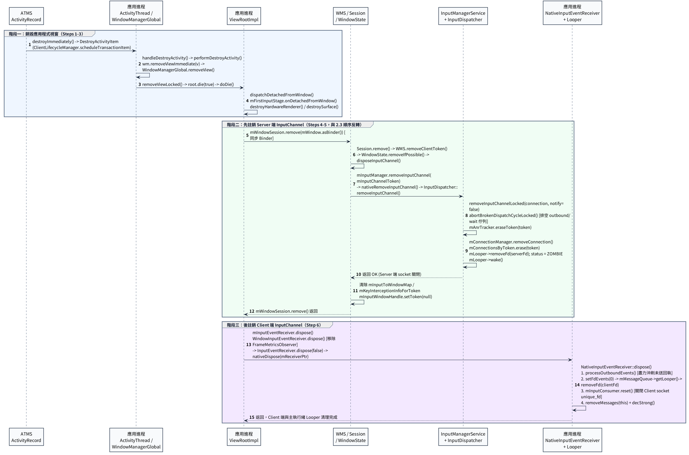

# 14.5 `InputChannel` 的註銷與視窗銷毀過程（`DestroyActivityItem`、先 Server 後 Client 的註銷反轉）

- **情景說明**：當前景 Activity 執行 `finish()` 或被系統回收而銷毀時，ATMS 透過 `DestroyActivityItem`（承接第 7 章 `ClientTransaction` 機制）通知應用進程清理該 Activity 及其視窗。由於每個應用程式視窗都佔用一對 `SOCK_SEQPACKET` 檔案描述符與 `InputDispatcher` / 應用主執行緒 `Looper` 上的 `epoll` 監聽項目，視窗銷毀時必須確實拆除雙端資源以防 FD 與記憶體洩漏。特別值得注意的是，Android 17 在 `ViewRootImpl.dispatchDetachedFromWindow()` 中**嚴格反轉了原書 2.3 的註銷順序**——**先**經由 `mWindowSession.remove()` 註銷 Server 端 `InputChannel`，**後**執行 `mInputEventReceiver.dispose()` 關閉 Client 端 socket，避免 Client 提早斷線引發 Server 端 `ALOOPER_EVENT_HANGUP` 斷線誤報。本節完整追蹤視窗銷毀與雙端註銷流程。
- **對應原書**：14.5 節〈InputChannel的注销过程〉（14.5.1–14.5.3，p.754–771）
- **涉及專案與版本基準**：
  - `platform/frameworks/base` 〔`android-17.0.0_r1`，commit `94b4c163`〕
  - `platform/frameworks/native` 〔`android-17.0.0_r1`，commit `ae266dc`〕

---

## 14.5.1 銷毀應用程式視窗

> 對應原書 14.5.1〈销毁应用程序窗口〉（p.755–764）。

整條銷毀與「先 Server 後 Client」註銷呼叫鏈如下：

```text
ActivityRecord.destroyImmediately()                       ## Step 1、建立 DestroyActivityItem 經 ClientLifecycleManager 派發
  ActivityThread.handleDestroyActivity()                  ## Step 2、執行 performDestroyActivity() 後呼叫 wm.removeViewImmediate(v)
    WindowManagerImpl.removeViewImmediate()               ## Step 2、轉呼叫 WindowManagerGlobal.removeView(view, true)
      WindowManagerGlobal.removeView() -> removeViewLocked() ## Step 2、呼叫 root.die(true)
        ViewRootImpl.die(true) -> doDie()                 ## Step 3、標記 mRemoved = true，呼叫 dispatchDetachedFromWindow()
          ViewRootImpl.dispatchDetachedFromWindow()       ## Step 3、先 Server 後 Client 拆除通道
            [14.5.2 先註銷 Server 端]
            mWindowSession.remove(mWindow.asBinder())     ## Step 4、Binder 呼叫 Session.remove() -> WMS.removeClientToken()
              WindowState.removeIfPossible()              ## Step 4、立即呼叫 disposeInputChannel() (removeImmediately() 亦兜底)
                WindowState.disposeInputChannel()         ## Step 5、呼叫 mInputManager.removeInputChannel(mInputChannelToken)
                  InputDispatcher::removeInputChannel()   ## Step 5、abortBrokenDispatchCycleLocked() + mAnrTracker.eraseToken()
                    ConnectionManager::removeConnection() ## Step 5、自 mConnectionsByToken 與 mLooper 移除 Server fd
            [14.5.3 後註銷 Client 端]
            mInputEventReceiver.dispose()                 ## Step 6、WindowInputEventReceiver.dispose() -> nativeDispose()
              NativeInputEventReceiver::dispose()         ## Step 6、先沖刷 mOutboundQueue，再 setFdEvents(0) 與釋放 mInputConsumer
```

### Step 1：`ActivityRecord.destroyImmediately` 派發 `DestroyActivityItem`
**位置**：`platform/frameworks/base/services/core/java/com/android/server/wm/ActivityRecord.java` 〔`android-17.0.0_r1`，lines 3975–4013〕

```java
// ActivityRecord.java:3975-4013
    boolean destroyImmediately(String reason) {
...
        if (isState(DESTROYING, DESTROYED)) {
            return false;
        }
...
        cleanUp(false /* cleanServices */, false /* setState */);
        setVisibleRequested(false);

        if (hasProcess()) {
            app.removeActivity(this, true /* keepAssociation */);
...
            final IApplicationThread client = app.getThread();
            if (client == null) {
                Slog.w(TAG_WM, "Failed to schedule DestroyActivityItem because client is inactive");
                isSuccessful = false;
            } else {
                final DestroyActivityItem item = new DestroyActivityItem(token, finishing);
                isSuccessful = mAtmService.getLifecycleManager().scheduleTransactionItem(
                        client, item);
            }
```

1. **事務化生命週期銷毀**：當 Activity 完成結束流程（如進入閒置清理或立即銷毀）時，`ActivityRecord.destroyImmediately()` 透過 `mAtmService.getLifecycleManager().scheduleTransactionItem(client, new DestroyActivityItem(token, finishing))` 把銷毀請求打包為 `ClientTransaction` 送往目標應用進程的 `ApplicationThread`，經主執行緒 `TransactionExecutor` 執行 `DestroyActivityItem.execute()` 回呼 `ActivityThread.handleDestroyActivity()`。

> 〔與 2.3 差異〕搬家 + 邏輯改變：原書 14.5.1 Step 1–7（p.756–761）由 `ActivityStack.activityIdleInternal()` → `destroyActivityLocked()` 直接呼叫 `IApplicationThread.scheduleDestroyActivity()` 透過 `ActivityThread.H` 發送 `DESTROY_ACTIVITY`；Android 17 承接第 7 章架構，改由 `wm/ActivityRecord.destroyImmediately()` 透過 `ClientLifecycleManager` 派發 `DestroyActivityItem`。

---

### Step 2：`ActivityThread.handleDestroyActivity` → `WindowManagerImpl.removeViewImmediate` → `WindowManagerGlobal.removeView`
**位置**：
- `platform/frameworks/base/core/java/android/app/ActivityThread.java` 〔`android-17.0.0_r1`，lines 6661–6691〕
- `platform/frameworks/base/core/java/android/view/WindowManagerGlobal.java` 〔`android-17.0.0_r1`，lines 555–571、615–627〕

```java
// ActivityThread.java:6661-6691
    @Override
    public void handleDestroyActivity(ActivityClientRecord r, boolean finishing,
            boolean getNonConfigInstance, String reason) {
        performDestroyActivity(r, finishing, getNonConfigInstance, reason);
        cleanUpPendingRemoveWindows(r, finishing);
        WindowManager wm = r.activity.getWindowManager();
        View v = r.activity.mDecor;
        if (v != null) {
            if (r.activity.mVisibleFromServer) {
                mNumVisibleActivities--;
            }
            IBinder wtoken = v.getWindowToken();
            if (r.activity.mWindowAdded) {
                if (r.mPreserveWindow) {
                    r.mPendingRemoveWindow = r.window;
                    r.mPendingRemoveWindowManager = wm;
                    r.window.clearContentView();
                } else {
                    final ViewRootImpl viewRoot = v.getViewRootImpl();
                    if (viewRoot != null) {
                        viewRoot.setActivityConfigCallback(null);
                    }
                    wm.removeViewImmediate(v);
                }
            }
```

```java
// WindowManagerGlobal.java:555-571, 615-627
    public void removeView(View view, boolean immediate) {
        if (view == null) {
            throw new IllegalArgumentException("view must not be null");
        }

        synchronized (mLock) {
            int index = findViewLocked(view, true);
            View curView = mRoots.get(index).getView();
            removeViewLocked(index, immediate);
            if (curView == view) {
                return;
            }

            throw new IllegalStateException("Calling with view " + view
                    + " but the ViewAncestor is attached to " + curView);
        }
    }
...
    private void removeViewLocked(int index, boolean immediate) {
        ViewRootImpl root = mRoots.get(index);
        View view = root.getView();

        root.getImeFocusController().onWindowDismissed();
        boolean deferred = root.die(immediate);
        if (view != null) {
            view.assignParent(null);
            if (deferred) {
                mDyingViews.add(view);
            }
        }
    }
```

1. **移除 `DecorView` 與對應 `ViewRootImpl`**：`handleDestroyActivity()` 在呼叫完 `Activity.onDestroy()`（`performDestroyActivity`）後，若非因重建而保留視窗（`!r.mPreserveWindow`），便呼叫 `wm.removeViewImmediate(v)` → `WindowManagerGlobal.removeView(view, true)` → `removeViewLocked(index, true)`，通知 IME 焦點控制器並呼叫 `root.die(true)`。

> 〔與 2.3 差異〕改名 + 邏輯微調：原書 14.5.1 Step 8–9（p.761–762）透過 `WindowManagerImpl` 單例直接持有 `mRoots` 呼叫 `ViewRoot.die(true)`；Android 17 將進程內所有視窗根節點抽離至單例 `WindowManagerGlobal`，並新增 `r.mPreserveWindow` 支援設定變更重建時無縫保留視窗。

---

### Step 3：`ViewRootImpl.die` → `doDie` → `dispatchDetachedFromWindow`（順序反轉關鍵點）
**位置**：`platform/frameworks/base/core/java/android/view/ViewRootImpl.java` 〔`android-17.0.0_r1`，lines 7064–7116、10907–10936〕

```java
// ViewRootImpl.java:10907-10936, 7064-7116
    boolean die(boolean immediate) {
        // Make sure we do execute immediately if we are in the middle of a traversal or the damage
        // done by dispatchDetachedFromWindow will cause havoc on return.
        if (immediate && !mIsInTraversal) {
            doDie();
            return false;
        }
        mHandler.sendEmptyMessage(MSG_DIE);
        return true;
    }

    void doDie() {
        checkThread();
        synchronized (this) {
            if (mRemoved) {
                return;
            }
            mRemoved = true;
            mOnBackInvokedDispatcher.detachFromWindow();
            removeVrrMessages();

            if (mCachedSurfaceControl != null) {
                mCachedSurfaceControl.release();
                mCachedSurfaceControl = null;
            }
            if (mAdded) {
                dispatchDetachedFromWindow();
            }
...
    void dispatchDetachedFromWindow() {
        mInsetsController.onWindowFocusLost();
        mFirstInputStage.onDetachedFromWindow();
        if (mView != null && mView.mAttachInfo != null) {
            mAttachInfo.mTreeObserver.dispatchOnWindowAttachedChange(false);
            mView.dispatchDetachedFromWindow();
        }
...
        destroyHardwareRenderer();
...
        destroySurface();

        if (mInputQueueCallback != null && mInputQueue != null) {
            mInputQueueCallback.onInputQueueDestroyed(mInputQueue);
            mInputQueue.dispose();
            mInputQueueCallback = null;
            mInputQueue = null;
        }
        try {
            mWindowSession.remove(mWindow.asBinder());
        } catch (RemoteException e) {
        }
        // Dispose receiver would dispose client InputChannel, too. That could send out a socket
        // broken event, so we need to unregister the server InputChannel when removing window to
        // prevent server side receive the event and prompt error.
        if (mInputEventReceiver != null) {
            mInputEventReceiver.dispose();
            mInputEventReceiver = null;
        }

        unregisterListeners();
        unscheduleTraversals();
    }
```

1. **刻意反轉「先 Server、後 Client」的註銷順序**：請特別留意 `dispatchDetachedFromWindow()` 第 7102–7112 行與官方註解——Android 17 先發起同步 Binder 呼叫 `mWindowSession.remove(mWindow.asBinder())` 讓 WMS 與 `InputDispatcher` **先撤除 Server 端 `InputChannel`**，返回後才執行 `mInputEventReceiver.dispose()` 關閉 Client 端 socket。原因非常直接：在 `SOCK_SEQPACKET` 雙向 socket 上，若 Client 端先 `close(fd)`，核心會立刻對 Server 端送出 `EPOLLHUP`，使 `InputDispatcher::handleReceiveCallback()` 誤判連線異常斷裂而列印錯誤並呼叫 `notifyInputChannelBroken()`。

> 〔與 2.3 差異〕順序反轉：原書 14.5.1 Step 11（p.763–764）中 `ViewRoot.dispatchDetachedFromWindow()` 是**先**執行 `InputQueue.unregisterInputChannel(mInputChannel)` 與 `mInputChannel.dispose()`（14.5.2），**後**執行 `sWindowSession.remove(mWindow)`（14.5.3）；Android 17 明確對調順序，先 Server 後 Client，並同步呼叫 `mFirstInputStage.onDetachedFromWindow()` 通知 7 階段管線清理掛起事件。

---

## 14.5.2 先註銷 Server 端 `InputChannel`

> 對應原書 14.5.3〈注销Server端InputChannel〉（p.766–771），依 Android 17 實際執行次序提前至 14.5.2 分析。

### Step 4：`Session.remove` → `WindowManagerService.removeClientToken` → `WindowState.removeIfPossible`
**位置**：
- `platform/frameworks/base/services/core/java/com/android/server/wm/Session.java` 〔`android-17.0.0_r1`，lines 279–282〕
- `platform/frameworks/base/services/core/java/com/android/server/wm/WindowManagerService.java` 〔`android-17.0.0_r1`，lines 2323–2335〕
- `platform/frameworks/base/services/core/java/com/android/server/wm/WindowState.java` 〔`android-17.0.0_r1`，lines 2395、2416–2457〕

```java
// Session.java:279-282
    @Override
    public void remove(IBinder clientToken) {
        mService.removeClientToken(this, clientToken);
    }
```

```java
// WindowManagerService.java:2323-2335
    void removeClientToken(Session session, IBinder client) {
        synchronized (mGlobalLock) {
            final WindowState win = windowForClient(session, client);
            if (win != null) {
                win.removeIfPossible();
                return;
            }

            // Remove embedded window map if the token belongs to an embedded window
            mEmbeddedWindowController.remove(client);
        }
    }
```

```java
// WindowState.java:2416-2457
    @Override
    void removeIfPossible() {
        mWindowRemovalAllowed = true;
...
        final long origId = Binder.clearCallingIdentity();

        try {
            disposeInputChannel();
            mOnBackInvokedCallbackInfo = null;
```

1. **不論是否仍在退場動畫中，一律立刻拆除 `InputChannel`**：`removeIfPossible()` 在最開頭（還未判斷視窗是否需等退場動畫跑完再 `removeImmediately()` 之前）就第一時間呼叫 `disposeInputChannel()`。這樣既保證退場中的視窗不再接收任何按鍵／觸控，也保證在同步 Binder `mWindowSession.remove()` 返回給應用進程之前，Server 端 `InputChannel` 就已經完成註銷。

> 〔與 2.3 差異〕改名 + 邏輯強化：原書 14.5.3 Step 1–3（p.767–768）為 `Session.remove(IWindow)` → `WMS.removeWindow()` → `removeWindowLocked()`；Android 17 改傳 `IBinder clientToken` 經 `removeClientToken()` 進 `WindowState.removeIfPossible()`（且 `removeImmediately()` 第 2395 行亦保留冪等的 `disposeInputChannel()` 兜底呼叫）。

---

### Step 5：`WindowState.disposeInputChannel` → `InputDispatcher::removeInputChannel` → `ConnectionManager::removeConnection`
**位置**：
- `platform/frameworks/base/services/core/java/com/android/server/wm/WindowState.java` 〔`android-17.0.0_r1`，lines 2703–2713〕
- `platform/frameworks/base/services/core/java/com/android/server/input/InputManagerService.java` 〔`android-17.0.0_r1`，lines 957–960〕
- `platform/frameworks/base/services/core/jni/com_android_server_input_InputManagerService.cpp` 〔`android-17.0.0_r1`，lines 2669–2679〕
- `platform/frameworks/native/services/inputflinger/dispatcher/InputDispatcher.cpp` 〔`android-17.0.0_r1`，lines 6486–6517、7662–7674〕

```java
// WindowState.java:2703-2713
    void disposeInputChannel() {
        if (mInputChannelToken != null) {
            // Unregister server channel first otherwise it complains about broken channel.
            mWmService.mInputManager.removeInputChannel(mInputChannelToken);
            mWmService.mKeyInterceptionInfoForToken.remove(mInputChannelToken);
            mWmService.mInputToWindowMap.remove(mInputChannelToken);
            mInputChannelToken = null;
        }

        mInputWindowHandle.setToken(null);
    }
```

```cpp
// com_android_server_input_InputManagerService.cpp:2669-2679
static void nativeRemoveInputChannel(JNIEnv* env, jobject nativeImplObj, jobject tokenObj) {
    NativeInputManager* im = getNativeInputManager(env, nativeImplObj);
    sp<IBinder> token = ibinderForJavaObject(env, tokenObj);

    status_t status = im->removeInputChannel(token);
    if (status && status != BAD_VALUE) { // ignore already removed channel
        std::string message;
        message += StringPrintf("Failed to remove input channel.  status=%d", status);
        jniThrowRuntimeException(env, message.c_str());
    }
}
```

```cpp
// InputDispatcher.cpp:6486-6517, 7662-7674
status_t InputDispatcher::removeInputChannel(const sp<IBinder>& connectionToken) {
    { // acquire lock
        std::scoped_lock _l(mLock);
        std::shared_ptr<Connection> connection = mConnectionManager.getConnection(connectionToken);
        if (connection == nullptr) {
            return BAD_VALUE;
        }

        status_t status = removeInputChannelLocked(connection, /*notify=*/false);
        if (status) {
            return status;
        }
    } // release lock

    mLooper->wake();
    return OK;
}

status_t InputDispatcher::removeInputChannelLocked(const std::shared_ptr<Connection>& connection,
                                                   bool notify) {
    LOG_ALWAYS_FATAL_IF(connection == nullptr);
    abortBrokenDispatchCycleLocked(connection, notify);

    mAnrTracker.eraseToken(connection->getToken());
    mConnectionManager.removeConnection(connection);

    return OK;
}
...
status_t InputDispatcher::ConnectionManager::removeConnection(
        const std::shared_ptr<Connection>& connection) {
    mConnectionsByToken.erase(connection->getToken());

    if (connection->isFocusMonitor) {
        removeMonitorChannel(connection->getToken());
    }

    mLooper->removeFd(connection->inputPublisher.getChannel().getFd());

    connection->status = Connection::Status::ZOMBIE;
    return OK;
}
```

1. **三步徹底清理 Server 端狀態**：`removeInputChannelLocked()` 依序執行——① `abortBrokenDispatchCycleLocked(connection, /*notify=*/false)` 排空 `outboundQueue` 與 `waitQueue` 且因屬於正常移除（`notify = false`）不觸發異常回報；② `mAnrTracker.eraseToken()` 清除該視窗任何殘留的 ANR 逾時計時；③ `mConnectionManager.removeConnection()` 自 `mConnectionsByToken` 刪除連線、呼叫 `mLooper->removeFd()` 自 `InputDispatcher` 的 `epoll` 移除 Server socket fd，並標記 `Connection::Status::ZOMBIE`。當 `shared_ptr<Connection>` 引用計數歸零時，Server 端 `unique_fd` 隨即自動關閉。
2. **清除 WMS 側索引**：回到 `WindowState.disposeInputChannel()`，一併移除 `mKeyInterceptionInfoForToken`、`mInputToWindowMap` 並將 `mInputWindowHandle.setToken(null)`，確保後續 `SurfaceFlinger` 視窗更新不會再將事件導向此視窗。

> 〔與 2.3 差異〕改名 + 邏輯強化：原書 14.5.3 Step 4–8（p.769–771）傳遞整個 Server `InputChannel` 物件給 `unregisterInputChannel()`，且無 `mAnrTracker` 清理；Android 17 改以 `IBinder connectionToken` 呼叫 `removeInputChannel()`，同步撤銷 `mAnrTracker` 計時器，並對已因對端斷線先行移除的通道容忍 `BAD_VALUE` 避免誤拋例外。

---

## 14.5.3 後註銷 Client 端 `InputChannel`

> 對應原書 14.5.2〈注销Client端InputChannel〉（p.764–766），於 `mWindowSession.remove()` 返回後執行。

### Step 6：`WindowInputEventReceiver.dispose` → `InputEventReceiver.dispose` → `NativeInputEventReceiver::dispose`
**位置**：
- `platform/frameworks/base/core/java/android/view/ViewRootImpl.java` 〔`android-17.0.0_r1`，lines 11512–11519〕
- `platform/frameworks/base/core/java/android/view/InputEventReceiver.java` 〔`android-17.0.0_r1`，lines 111–140〕
- `platform/frameworks/base/core/jni/android_view_InputEventReceiver.cpp` 〔`android-17.0.0_r1`，lines 255–272、777–782〕

```java
// ViewRootImpl.java:11512-11519
        @Override
        public void dispose() {
            unscheduleConsumeBatchedInput();
            if (mRenderer != null) {
                mRenderer.removeObserver(getNativeFrameMetricsObserver());
            }
            super.dispose();
        }
```

```java
// InputEventReceiver.java:125-140
    private void dispose(boolean finalized) {
        if (mCloseGuard != null) {
            if (finalized) {
                mCloseGuard.warnIfOpen();
            }
            mCloseGuard.close();
        }

        if (mReceiverPtr != 0) {
            nativeDispose(mReceiverPtr);
            mReceiverPtr = 0;
        }

        mLooper = null;
        Reference.reachabilityFence(this);
    }
```

```cpp
// android_view_InputEventReceiver.cpp:255-272, 777-782
void NativeInputEventReceiver::dispose() {
    const status_t result = processOutboundEvents();
    if (result != OK) {
        LOG(WARNING) << "channel '" << mName << "' ~ Could not send " << mOutboundQueue.size()
                     << " outbound event(s), status:" << statusToString(result);
    }
    setFdEvents(0);
    // Do not process any more events after the receiver has been disposed.
    mInputConsumer.reset();

    mMessageQueue->getLooper()->removeMessages(this);
}
...
static void nativeDispose(JNIEnv* env, jclass clazz, jlong receiverPtr) {
    sp<NativeInputEventReceiver> receiver =
            reinterpret_cast<NativeInputEventReceiver*>(receiverPtr);
    receiver->dispose();
    receiver->decStrong(gInputEventReceiverClassInfo.clazz); // drop reference held by the object
}
```

1. **先卸載渲染觀察者與批次排程**：`WindowInputEventReceiver.dispose()` 先取消排定的 VSync 批次消費（`unscheduleConsumeBatchedInput()`）並自 `HardwareRenderer` 移除 `FrameMetricsObserver`，避免 RenderThread 在接收器銷毀後仍呼叫 `enqueueTimeline()`。
2. **原生層四步收尾並釋放 Client socket**：`NativeInputEventReceiver::dispose()` 依序執行——① 呼叫 `processOutboundEvents()` 盡力沖刷 `mOutboundQueue` 中未送出的回執；② 呼叫 `setFdEvents(0)` 經由 `mMessageQueue->getLooper()->removeFd(fd)` 將 Client socket 自應用主執行緒 `epoll` 移除；③ `mInputConsumer.reset()` 銷毀 `InputConsumer` 並關閉最後一份持有 Client socket 的 `unique_fd`（回顧 14.3 節 Step 6，所有權在 `nativeInit()` 時已移入 `InputConsumer`）；④ `removeMessages(this)` 清除主執行緒原生 `Looper` 中殘留的 `OUTBOUND_EVENTS_AVAILABLE` 消息。最後 `nativeDispose()` 執行 `decStrong()` 釋放 Java 物件持有的強參考，完成整個視窗與 `InputChannel` 生命週期的乾淨收尾。

> 〔與 2.3 差異〕改名 + 邏輯強化：原書 14.5.2 Step 1–3（p.764–766）呼叫靜態方法 `InputQueue.unregisterInputChannel()` 自單例 `NativeInputQueue` 雜湊表移除 `Connection` 再單獨 `mInputChannel.dispose()`；Android 17 改由 `WindowInputEventReceiver.dispose()` 統一負責移除 `FrameMetricsObserver`、沖刷 `mOutboundQueue`、解除主執行緒 `Looper` 監聽、釋放 `InputConsumer` 與關閉 Client socket fd，並以 `CloseGuard` 偵測遺漏銷毀。

---

## 14.5.4 本節時序圖總結


