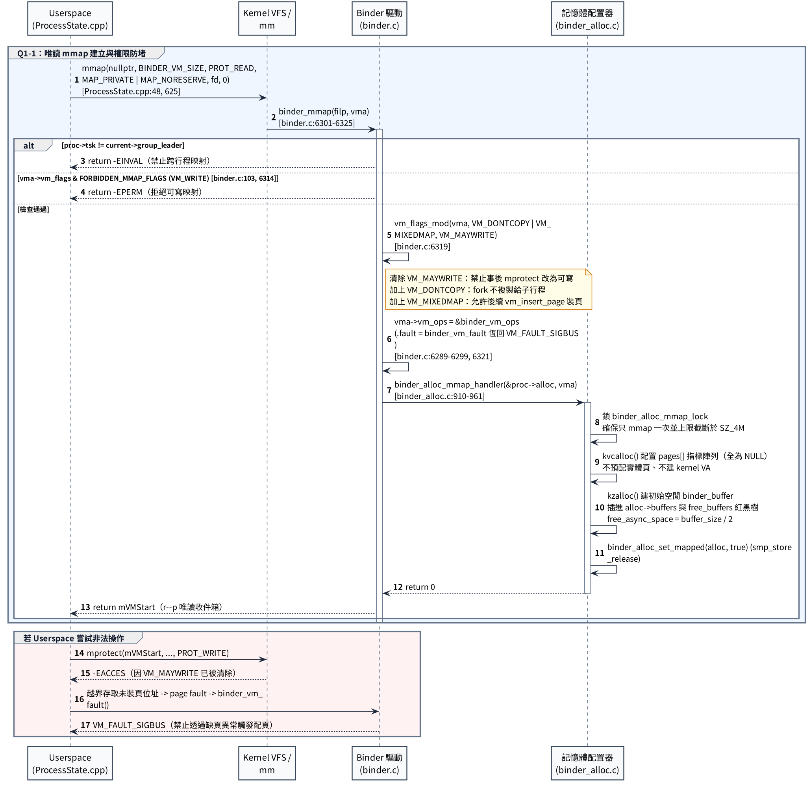
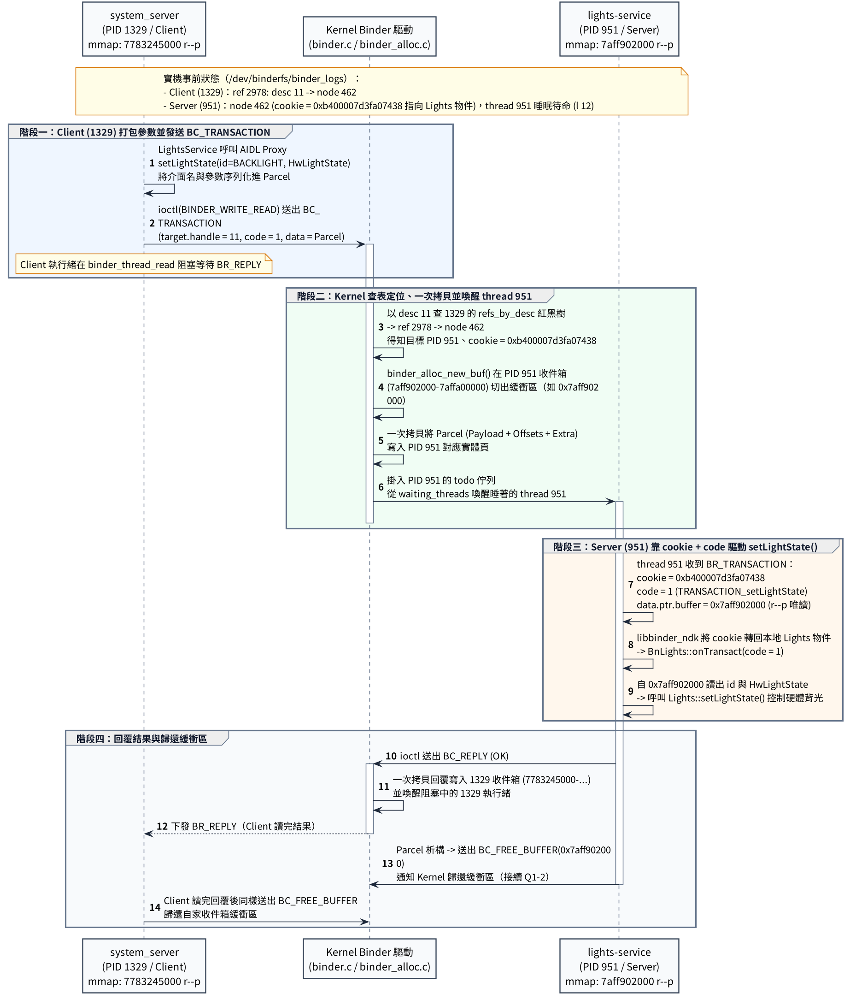

# 5.1 Binder 驅動程式：課後問題

> 對應筆記：[ch05-binder/5.1-driver.md](../ch05-binder/5.1-driver.md)
> 建議先讀：5.1.4（mmap）、5.1.5 Step 3–5
> 作答原則：先不看筆記，自己作答；答完再對照筆記和原始碼。

---

## Q1：mmap 區域為什麼是唯讀？用完怎麼歸還？

在板子上看任一個 binder 行程的 `/proc/<pid>/maps`，binder 的映射權限是 `r--p`：

```
7406c12000-7406d10000 r--p 00000000 00:22 4   /dev/binderfs/binder
```

- 為什麼 userspace 對這塊區域只能讀？
- 收到交易資料、處理完之後，userspace 要怎麼「歸還」這塊緩衝區？kernel 收到之後做了什麼？

**我的回答：**

1. **為什麼 userspace 對這塊區域只能讀？**
   - **角色定位（單向收件箱）**：這塊 `mmap` 區域僅供 **kernel 把別人送來的交易資料寫進來、讓本行程接收與讀取**；要發送資料時，是把自家行程的 Parcel 透過 `ioctl` 交給 kernel 拷貝到**對方**的 mmap 區，不會寫入自己的 mmap 區。
   - **安全性與管理隔離**：這塊空間由 kernel（`binder_alloc`）統一管理與切割，同一張實體頁可能同時存放多筆相鄰交易的緩衝區。若允許 userspace 寫入，可能越界破壞相鄰交易資料或與核心產生競爭（在 Android 2.3 中，甚至連核心的 `struct binder_buffer` metadata 都嵌在這塊共享記憶體內，可寫會直接損毀核心結構）。
   - **Kernel 在 `binder_mmap` 的防堵手段**：
     - 檢查 `proc->tsk == current->group_leader`（禁止跨行程對別人的 binder fd 做 mmap）。
     - 檢查 `FORBIDDEN_MMAP_FLAGS`（即 `VM_WRITE`，拒絕可寫映射，直接回 `-EPERM`）。
     - 透過 `vm_flags_mod` 清除 `VM_MAYWRITE`，防止行程先唯讀 `mmap` 後再用 `mprotect` 偷改為可寫；同時加上 `VM_DONTCOPY`（`fork` 不複製給子行程）與 `VM_MIXEDMAP`（允許後續以 `vm_insert_page` 塞頁）。
     - `binder_vm_fault` 恆回 `VM_FAULT_SIGBUS`，禁止 userspace 透過缺頁異常自行觸發實體頁配置。

   

   > **補充筆記：實機案例——調整背光亮度時 Binder 如何驅動服務方法**
   >
   > 以實機上觀察到的行程為例（`/dev/binderfs/binder_logs`）：
   > - **服務端**：`PID 951`（`android.hardware.lights-service.mediatek`，服務 `android.hardware.light.ILights/default`）
   >   - `r--p` 收件箱 mmap 區：`7aff902000-7affa00000`（`/dev/binderfs/binder`）
   >   - `node 462`：`u=0xb400007c0fa0a160`（`ptr`）、`c=0xb400007d3fa07438`（`cookie`，指向 PID 951 內的 `Lights` 服務物件）；`thread 951` 在 Looper 中等待（`l 12`）。
   >   - 引用者：`proc 1717 1329 504`（`com.android.settings`、`system_server`、`servicemanager`）。
   > - **呼叫端**：`PID 1329`（`system_server`），收件箱 `7783245000-7783343000 r--p`，其引用表中有 `ref 2978: desc 11 node 462`（在 `1329` 中 `handle = 11` 指向 `node 462`；在 `1717` 中同一節點則是 `desc 130`）。
   >
   > **交易驅動流程（`system_server` 呼叫 `ILights::setLightState(id, state)`）**：
   > 1. **打包送出**：`1329` 的 AIDL Proxy 將介面名稱、`id`、`HwLightState` 序列化進 `Parcel`，填入 `target.handle = 11`、`code = 1`（`TRANSACTION_setLightState`），透過 `ioctl(BINDER_WRITE_READ)` 送出 `BC_TRANSACTION` 後阻塞等回覆。
   > 2. **核心轉發與一次拷貝**：kernel 以 `desc 11` 查 `1329` 的紅黑樹找到 `node 462`（目標 `PID 951`、`cookie = 0xb400007d3fa07438`），從 `951` 的 mmap 區（如 `0x7aff902000`）切出緩衝區並將 Parcel（Payload + Offsets + Extra）一次拷貝寫入，掛進 `951` 的 `todo` 並喚醒 `thread 951`。
   > 3. **醒來派發方法**：`thread 951` 收到 `BR_TRANSACTION`，取得 `cookie`、`code = 1` 與 `data.ptr.buffer = 0x7aff902000`；框架將 `cookie` 轉回本地 `Lights` 物件並呼叫 `onTransact()`，依 `code` 從 `0x7aff902000` 讀出參數，最終呼叫 `Lights::setLightState()` 控制硬體背光。
   > 4. **回覆與歸還**：`951` 送出 `BC_REPLY` 回傳結果喚醒 `1329`，並通知 kernel 歸還 `0x7aff902000` 緩衝區（見下方第 2 小題）。
   >
   > 

2. **收到交易資料、處理完之後，userspace 怎麼歸還？kernel 做了什麼？**
   - **Userspace 歸還方式**：收到 `BR_TRANSACTION` / `BR_REPLY` 時，`IPCThreadState` 會用 `Parcel::ipcSetDataReference` 綁定釋放回呼 `IPCThreadState::freeBuffer`；當 `Parcel` 處理完畢析構時，`freeBuffer` 寫入 **`BC_FREE_BUFFER`** 與當時拿到的使用者空間指標 `data_ptr`，隨下次 `ioctl(BINDER_WRITE_READ)` 送入 kernel。
   - **Kernel 查詢與防重複釋放（`binder_alloc_prepare_to_free`）**：
     - 先鎖上 `alloc->mutex`，以 `data_ptr` 搜尋 `allocated_buffers` 紅黑樹找到對應的 `binder_buffer`。
     - 檢查 `buffer->allow_user_free`（僅驅動交付給 userspace 後才為 `1`）：若為 `0` 直接回 `-EPERM`；若為 `1` 則**在鎖內立刻清回 `0`**，防止 userspace 惡意連續兩次 `BC_FREE_BUFFER` 造成 double free / UAF。
   - **清理交易關聯與物件（`binder_free_buf`）**：解除與 `transaction` 的連結；若是 async 交易則從 `target_node->async_todo` 取出下一筆推進 `proc->todo` 喚醒處理並歸還 `free_async_space`；呼叫 `binder_release_entire_buffer` 清理緩衝區內 Binder 物件引用與待補 fd；若交易標記了 `clear_on_free`，在鎖外先清零敏感資料（`binder_alloc_clear_buf`）。
   - **空閒塊合併（`binder_free_buf_locked`）**：將該 `buffer` 從 `allocated_buffers` 移除（`rb_erase`）並設 `free = 1`；檢查 `alloc->buffers` 鏈表中的 `next` 與 `prev`，若相鄰區塊也為空閒，就將其自 `free_buffers` `rb_erase` 並呼叫 `binder_delete_free_buffer()` 合併以減少碎片，最後把合併後的空閒塊 `binder_insert_free_buffer()` 插回 `free_buffers` 紅黑樹。
   - **實體頁延遲回收（Android 17 LRU + Shrinker）**：**不會**立即 unmap 還給 OS，而是透過 `binder_lru_freelist_add()` 將未與鄰居共用的完整實體頁（含合併時釋出的邊界頁）掛入全域 **`binder_freelist`** LRU 快取；若很快有新交易分到同一區段就直接透過 `binder_lru_freelist_del()` 摘回複用（省下反覆配頁與 TLB flush）；唯有系統面臨記憶體壓力時，核心 VM 才呼叫 shrinker（`binder_shrink_scan` → `binder_alloc_free_page`），以 `zap_page_range_single` 清掉 PTE 並以 `binder_free_page`（`__free_page`）真正還給 buddy allocator。

   

   **Q1 原始碼追蹤索引**（相對於 `aosp-note/src/`）：

   | 階段 | 函式 / 關鍵處 | 檔案路徑與行數 |
   |---|---|---|
   | Userspace 請求唯讀 mmap | `ProcessState::ProcessState`（`BINDER_VM_SIZE`、`mmap`） | [ProcessState.cpp:48, 625](../src/platform/frameworks/native/libs/binder/ProcessState.cpp#L625) |
   | Kernel 禁止可寫與 mprotect | `FORBIDDEN_MMAP_FLAGS`、`binder_vm_fault`、`binder_mmap` | [binder.c:103, 6289–6325](../src/kernel/common/drivers/android/binder.c#L6289-L6325) |
   | 初始化緩衝區結構（不配實體頁） | `binder_alloc_mmap_handler` | [binder_alloc.c:910–961](../src/kernel/common/drivers/android/binder_alloc.c#L910-L961) |
   | Userspace 綁定與送出 `BC_FREE_BUFFER` | `ipcSetDataReference`、`IPCThreadState::freeBuffer` | [IPCThreadState.cpp:1215, 1506, 1853–1865](../src/platform/frameworks/native/libs/binder/IPCThreadState.cpp#L1853-L1865) |
   | Kernel 接收 `BC_FREE_BUFFER` | `binder_thread_write` (`case BC_FREE_BUFFER`) | [binder.c:4538–4570](../src/kernel/common/drivers/android/binder.c#L4538-L4570) |
   | 防 double free（鎖 + `allow_user_free`） | `binder_alloc_prepare_to_free_locked` / `binder_alloc_prepare_to_free` | [binder_alloc.c:129–175](../src/kernel/common/drivers/android/binder_alloc.c#L129-L175) |
   | 解除交易關聯與清理物件 | `binder_free_buf` | [binder.c:4326–4367](../src/kernel/common/drivers/android/binder.c#L4326-L4367) |
   | 鎖外清零、前後合併、掛入 LRU | `binder_alloc_clear_buf`、`binder_alloc_free_buf`、`binder_free_buf_locked`、`binder_delete_free_buffer`、`binder_lru_freelist_add` | [binder_alloc.c:193, 728–806, 849, 876–894](../src/kernel/common/drivers/android/binder_alloc.c#L728-L806) |
   | 記憶體壓力延遲回收頁 | `binder_alloc_free_page`、`binder_shrink_scan` | [binder_alloc.c:1151–1245](../src/kernel/common/drivers/android/binder_alloc.c#L1151-L1245) |

---

## Q2：沒有 kernel VA，資料怎麼寫進目標行程？

2.3 的 `binder_mmap` 會額外配置一段 kernel 虛擬位址，讓 user 和 kernel 兩邊映射到同一批實體頁；17 的 `binder_alloc_mmap_handler` 已經不這樣做了。

- 那 `binder_transaction` 要怎麼把發送端的資料寫進目標行程的 buffer？
- 實體頁是什麼時候、由哪個函式配置並裝進目標行程的位址空間的？

**我的回答：**


---

## Q3：hwbinder 上的服務為什麼不會出現在 /dev/binder 的 servicemanager 裡？

請從 **kernel 結構體**的角度回答：行程開啟不同的裝置節點後，kernel 是靠什麼把它們分成互不相通的 domain？

提示：`binder_device`、`binder_context`、`binder_open`

**我的回答：**


---

## 上機練習

1. 找一個 app 行程，對照它的 `/proc/<pid>/maps` 和 `/dev/binderfs/binder_logs/proc/<pid>`，找出 binder 映射區、開啟的 binder fd、handle 0 對應的 node。
2. 驗證 mmap「只保留位址空間、不預先配置實體頁」：

   ```sh
   adb shell "awk '/binderfs\/binder/{f=1} f&&/^Rss/{print; exit}' /proc/<pid>/smaps"
   ```

   Rss 是否遠小於 1016 KiB？為什麼？（對照 5.1.5 Step 4、Step 8）
