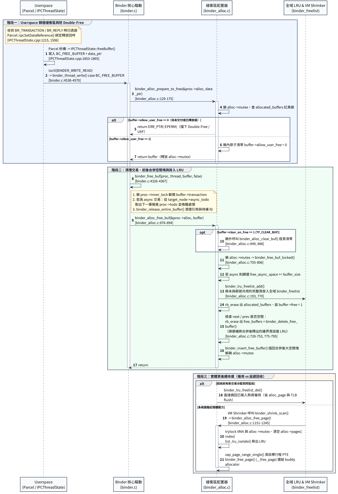
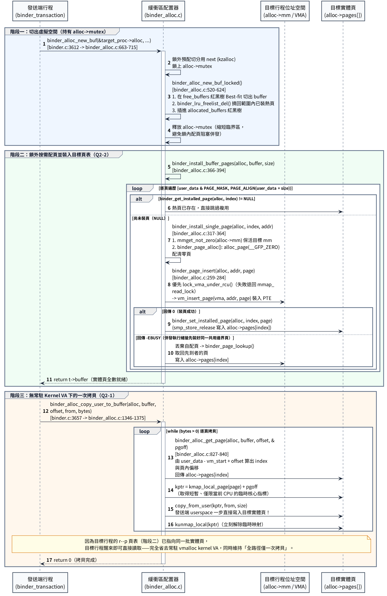
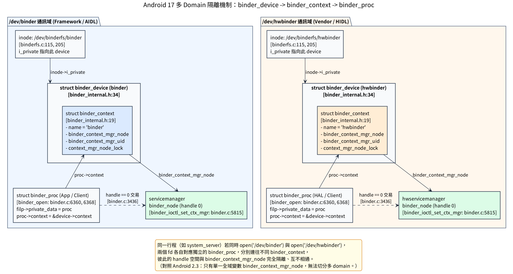

# 5.1 Binder 驅動程式：課後問題

> 對應筆記：[ch05-binder/5.1-driver.md](../ch05-binder/5.1-driver.md)
> 建議先讀：5.1.4（mmap）、5.1.5 Step 3–5
> 作答原則：先不看筆記，自己作答；答完再對照筆記和原始碼。

---

## Q1：mmap 區域為什麼是唯讀？用完怎麼歸還？

在板子上看任一個 binder 行程的 `/proc/<pid>/maps`，binder 的映射權限是 `r--p`：

```
7406c12000-7406d10000 r--p 00000000 00:22 4   /dev/binderfs/binder
```

- 為什麼 userspace 對這塊區域只能讀？
- 收到交易資料、處理完之後，userspace 要怎麼「歸還」這塊緩衝區？kernel 收到之後做了什麼？

**我的回答：**

1. **為什麼 userspace 對這塊區域只能讀？**
   - **角色定位（單向收件箱）**：這塊 `mmap` 區域僅供 **kernel 把別人送來的交易資料寫進來、讓本行程接收與讀取**；要發送資料時，是把自家行程的 Parcel 透過 `ioctl` 交給 kernel 拷貝到**對方**的 mmap 區，不會寫入自己的 mmap 區。
   - **安全性與管理隔離**：這塊空間由 kernel（`binder_alloc`）統一管理與切割，同一張實體頁可能同時存放多筆相鄰交易的緩衝區。若允許 userspace 寫入，可能越界破壞相鄰交易資料或與核心產生競爭（在 Android 2.3 中，甚至連核心的 `struct binder_buffer` metadata 都嵌在這塊共享記憶體內，可寫會直接損毀核心結構）。
   - **Kernel 在 `binder_mmap` 的防堵手段**：
     - 檢查 `proc->tsk == current->group_leader`（禁止跨行程對別人的 binder fd 做 mmap）。
     - 檢查 `FORBIDDEN_MMAP_FLAGS`（即 `VM_WRITE`，拒絕可寫映射，直接回 `-EPERM`）。
     - 透過 `vm_flags_mod` 清除 `VM_MAYWRITE`，防止行程先唯讀 `mmap` 後再用 `mprotect` 偷改為可寫；同時加上 `VM_DONTCOPY`（`fork` 不複製給子行程）與 `VM_MIXEDMAP`（允許後續以 `vm_insert_page` 塞頁）。
     - `binder_vm_fault` 恆回 `VM_FAULT_SIGBUS`，禁止 userspace 透過缺頁異常自行觸發實體頁配置。

   

   > **補充筆記：實機案例——調整背光亮度時 Binder 如何驅動服務方法**
   >
   > 以實機上觀察到的行程為例（`/dev/binderfs/binder_logs`）：
   > - **服務端**：`PID 951`（`android.hardware.lights-service.mediatek`，服務 `android.hardware.light.ILights/default`）
   >   - `r--p` 收件箱 mmap 區：`7aff902000-7affa00000`（`/dev/binderfs/binder`）
   >   - `node 462`：`u=0xb400007c0fa0a160`（`ptr`）、`c=0xb400007d3fa07438`（`cookie`，指向 PID 951 內的 `Lights` 服務物件）；`thread 951` 在 Looper 中等待（`l 12`）。
   >   - 引用者：`proc 1717 1329 504`（`com.android.settings`、`system_server`、`servicemanager`）。
   > - **呼叫端**：`PID 1329`（`system_server`），收件箱 `7783245000-7783343000 r--p`，其引用表中有 `ref 2978: desc 11 node 462`（在 `1329` 中 `handle = 11` 指向 `node 462`；在 `1717` 中同一節點則是 `desc 130`）。
   >
   > **交易驅動流程（`system_server` 呼叫 `ILights::setLightState(id, state)`）**：
   > 1. **打包送出**：`1329` 的 AIDL Proxy 將介面名稱、`id`、`HwLightState` 序列化進 `Parcel`，填入 `target.handle = 11`、`code = 1`（`TRANSACTION_setLightState`），透過 `ioctl(BINDER_WRITE_READ)` 送出 `BC_TRANSACTION` 後阻塞等回覆。
   > 2. **核心轉發與一次拷貝**：kernel 以 `desc 11` 查 `1329` 的紅黑樹找到 `node 462`（目標 `PID 951`、`cookie = 0xb400007d3fa07438`），從 `951` 的 mmap 區（如 `0x7aff902000`）切出緩衝區並將 Parcel（Payload + Offsets + Extra）一次拷貝寫入，掛進 `951` 的 `todo` 並喚醒 `thread 951`。
   > 3. **醒來派發方法**：`thread 951` 收到 `BR_TRANSACTION`，取得 `cookie`、`code = 1` 與 `data.ptr.buffer = 0x7aff902000`；框架將 `cookie` 轉回本地 `Lights` 物件並呼叫 `onTransact()`，依 `code` 從 `0x7aff902000` 讀出參數，最終呼叫 `Lights::setLightState()` 控制硬體背光。
   > 4. **回覆與歸還**：`951` 送出 `BC_REPLY` 回傳結果喚醒 `1329`，並通知 kernel 歸還 `0x7aff902000` 緩衝區（見下方第 2 小題）。
   >
   > 

2. **收到交易資料、處理完之後，userspace 怎麼歸還？kernel 做了什麼？**
   - **Userspace 歸還方式**：收到 `BR_TRANSACTION` / `BR_REPLY` 時，`IPCThreadState` 會用 `Parcel::ipcSetDataReference` 綁定釋放回呼 `IPCThreadState::freeBuffer`；當 `Parcel` 處理完畢析構時，`freeBuffer` 寫入 **`BC_FREE_BUFFER`** 與當時拿到的使用者空間指標 `data_ptr`，隨下次 `ioctl(BINDER_WRITE_READ)` 送入 kernel。
   - **Kernel 查詢與防重複釋放（`binder_alloc_prepare_to_free`）**：
     - 先鎖上 `alloc->mutex`，以 `data_ptr` 搜尋 `allocated_buffers` 紅黑樹找到對應的 `binder_buffer`。
     - 檢查 `buffer->allow_user_free`（僅驅動交付給 userspace 後才為 `1`）：若為 `0` 直接回 `-EPERM`；若為 `1` 則**在鎖內立刻清回 `0`**，防止 userspace 惡意連續兩次 `BC_FREE_BUFFER` 造成 double free / UAF。
   - **清理交易關聯與物件（`binder_free_buf`）**：解除與 `transaction` 的連結；若是 async 交易則從 `target_node->async_todo` 取出下一筆推進 `proc->todo` 喚醒處理並歸還 `free_async_space`；呼叫 `binder_release_entire_buffer` 清理緩衝區內 Binder 物件引用與待補 fd；若交易標記了 `clear_on_free`，在鎖外先清零敏感資料（`binder_alloc_clear_buf`）。
   - **空閒塊合併（`binder_free_buf_locked`）**：將該 `buffer` 從 `allocated_buffers` 移除（`rb_erase`）並設 `free = 1`；檢查 `alloc->buffers` 鏈表中的 `next` 與 `prev`，若相鄰區塊也為空閒，就將其自 `free_buffers` `rb_erase` 並呼叫 `binder_delete_free_buffer()` 合併以減少碎片，最後把合併後的空閒塊 `binder_insert_free_buffer()` 插回 `free_buffers` 紅黑樹。
   - **實體頁延遲回收（Android 17 LRU + Shrinker）**：**不會**立即 unmap 還給 OS，而是透過 `binder_lru_freelist_add()` 將未與鄰居共用的完整實體頁（含合併時釋出的邊界頁）掛入全域 **`binder_freelist`** LRU 快取；若很快有新交易分到同一區段就直接透過 `binder_lru_freelist_del()` 摘回複用（省下反覆配頁與 TLB flush）；唯有系統面臨記憶體壓力時，核心 VM 才呼叫 shrinker（`binder_shrink_scan` → `binder_alloc_free_page`），以 `zap_page_range_single` 清掉 PTE 並以 `binder_free_page`（`__free_page`）真正還給 buddy allocator。

   

   **Q1 原始碼追蹤索引**（相對於 `aosp-note/src/`）：

   | 階段 | 函式 / 關鍵處 | 檔案路徑與行數 |
   |---|---|---|
   | Userspace 請求唯讀 mmap | `ProcessState::ProcessState`（`BINDER_VM_SIZE`、`mmap`） | [ProcessState.cpp:48, 625](../src/platform/frameworks/native/libs/binder/ProcessState.cpp#L625) |
   | Kernel 禁止可寫與 mprotect | `FORBIDDEN_MMAP_FLAGS`、`binder_vm_fault`、`binder_mmap` | [binder.c:103, 6289–6325](../src/kernel/common/drivers/android/binder.c#L6289-L6325) |
   | 初始化緩衝區結構（不配實體頁） | `binder_alloc_mmap_handler` | [binder_alloc.c:910–961](../src/kernel/common/drivers/android/binder_alloc.c#L910-L961) |
   | Userspace 綁定與送出 `BC_FREE_BUFFER` | `ipcSetDataReference`、`IPCThreadState::freeBuffer` | [IPCThreadState.cpp:1215, 1506, 1853–1865](../src/platform/frameworks/native/libs/binder/IPCThreadState.cpp#L1853-L1865) |
   | Kernel 接收 `BC_FREE_BUFFER` | `binder_thread_write` (`case BC_FREE_BUFFER`) | [binder.c:4538–4570](../src/kernel/common/drivers/android/binder.c#L4538-L4570) |
   | 防 double free（鎖 + `allow_user_free`） | `binder_alloc_prepare_to_free_locked` / `binder_alloc_prepare_to_free` | [binder_alloc.c:129–175](../src/kernel/common/drivers/android/binder_alloc.c#L129-L175) |
   | 解除交易關聯與清理物件 | `binder_free_buf` | [binder.c:4326–4367](../src/kernel/common/drivers/android/binder.c#L4326-L4367) |
   | 鎖外清零、前後合併、掛入 LRU | `binder_alloc_clear_buf`、`binder_alloc_free_buf`、`binder_free_buf_locked`、`binder_delete_free_buffer`、`binder_lru_freelist_add` | [binder_alloc.c:193, 728–806, 849, 876–894](../src/kernel/common/drivers/android/binder_alloc.c#L728-L806) |
   | 記憶體壓力延遲回收頁 | `binder_alloc_free_page`、`binder_shrink_scan` | [binder_alloc.c:1151–1245](../src/kernel/common/drivers/android/binder_alloc.c#L1151-L1245) |

---

## Q2：沒有 kernel VA，資料怎麼寫進目標行程？

2.3 的 `binder_mmap` 會額外配置一段 kernel 虛擬位址，讓 user 和 kernel 兩邊映射到同一批實體頁；17 的 `binder_alloc_mmap_handler` 已經不這樣做了。

- 那 `binder_transaction` 要怎麼把發送端的資料寫進目標行程的 buffer？
- 實體頁是什麼時候、由哪個函式配置並裝進目標行程的位址空間的？

**我的回答：**

1. **沒有常駐 kernel VA，`binder_transaction` 怎麼把資料一次拷貝寫進目標 buffer？**
   - 目標行程的 `binder_alloc` 除了用 `buffers` 鏈表與紅黑樹管理虛擬區段外，還維護了一個 **`struct page **pages`** 陣列（在 `mmap` 時僅用 `kvcalloc` 配置指標陣列，初始皆為 `NULL`），記錄每個分頁槽位對應的實體頁。
   - 拷貝交易資料時，`binder_transaction` 呼叫 **`binder_alloc_copy_user_to_buffer()`** 逐頁寫入：
     1. 透過 **`binder_alloc_get_page()`** 依 `(buffer->user_data - alloc->vm_start) + buffer_offset` 算出頁索引 `index` 與頁內偏移 `pgoff`，從 `alloc->pages[index]` 取出該實體頁 `struct page *`。
     2. 呼叫極輕量的 **`kmap_local_page(page) + pgoff`** 取得**僅限當前 CPU 的短暫臨時核心指標 `kptr`**（完全不佔用常駐 vmalloc 空間）。
     3. 直接執行 **`copy_from_user(kptr, from, size)`**，把發送端 userspace 的資料**一步拷貝進目標實體頁**，隨即 **`kunmap_local(kptr)`** 解除臨時映射。
     4. 若來源為核心資料（如 SELinux `security_ctx` 或轉譯後的 `flat_binder_object`），則改走 `binder_alloc_copy_to_buffer()`（內部使用 `memcpy_to_page`）。
   - 因為這批實體頁已預先裝進目標行程的 `r--p` 頁表，目標行程醒來直接讀取即可，**省下整個核心 vmalloc 空間的同時，依然維持「全路徑僅一次拷貝」**。

2. **實體頁是什麼時候、由哪個函式配置並裝進目標行程位址空間的？**
   - **時機**：`mmap` 當下（`binder_alloc_mmap_handler`）**完全不預配實體頁**；直到 **transaction 發生**、`binder_transaction` 呼叫 **`binder_alloc_new_buf()`** 為目標行程分配緩衝區時才**按需配頁**。
   - **鎖內切空間、鎖外裝頁**：
     - 先在持有 `alloc->mutex` 下執行 `binder_alloc_new_buf_locked()` 從 `free_buffers` 切出虛擬區段，並用 `binder_lru_freelist_del()` 把範圍內已在 LRU 的熱頁摘回保護。
     - **釋放 `alloc->mutex` 之後**，才呼叫 **`binder_install_buffer_pages()`** 逐頁檢查：若 `binder_get_installed_page()` 已有熱頁就跳過複用；若為 `NULL` 則呼叫 **`binder_install_single_page()`**：
       1. `mmget_not_zero(alloc->mm)` 保活目標行程位址空間。
       2. `binder_page_alloc()` 以 `alloc_page(GFP_KERNEL | __GFP_HIGHMEM | __GFP_ZERO)` 配置清零實體頁，並把 `binder_shrinker_mdata` 掛到 `page->private`。
       3. **`binder_page_insert()`** 優先嘗試 Linux 6.x 的 **per-VMA RCU lock**（`lock_vma_under_rcu`），失敗才回退到 `mmap_read_lock(mm)` + `vma_lookup`，再呼叫 **`vm_insert_page(vma, addr, page)`** 把實體頁塞進目標行程頁表（PTE）。
       4. **無鎖併發競態處理**：若兩筆併發交易共用同一邊界頁，後到者呼叫 `vm_insert_page` 會收到 `-EBUSY`；此時丟棄自己多配的頁，改以 `binder_page_lookup()` 取回先到者裝好的頁即可。
       5. 最後呼叫 `binder_set_installed_page()`（`smp_store_release`）寫入 `alloc->pages[index]`。

   

   **Q2 原始碼追蹤索引**（相對於 `aosp-note/src/`）：

   | 階段 | 函式 / 關鍵處 | 檔案路徑與行數 |
   |---|---|---|
   | 交易發起緩衝區分配與資料拷貝 | `binder_transaction`（呼叫 `binder_alloc_new_buf`、`binder_alloc_copy_user_to_buffer`） | [binder.c:3612, 3657](../src/kernel/common/drivers/android/binder.c#L3612-L3665) |
   | 兩階段配置入口（鎖內切段 + 鎖外裝頁） | `binder_alloc_new_buf`、`binder_alloc_new_buf_locked` | [binder_alloc.c:520–624, 663–715](../src/kernel/common/drivers/android/binder_alloc.c#L663-L715) |
   | 按需逐頁配置並裝入目標頁表 | `binder_install_buffer_pages`、`binder_install_single_page` | [binder_alloc.c:317–394](../src/kernel/common/drivers/android/binder_alloc.c#L317-L394) |
   | per-VMA lock + `vm_insert_page` 塞入 PTE | `binder_page_insert` | [binder_alloc.c:259–284](../src/kernel/common/drivers/android/binder_alloc.c#L259-L284) |
   | 查頁與 `kmap_local_page` 一次拷貝 | `binder_alloc_get_page`、`binder_alloc_copy_user_to_buffer`、`binder_alloc_copy_to_buffer` | [binder_alloc.c:827–840, 1346–1375, 1408](../src/kernel/common/drivers/android/binder_alloc.c#L1346-L1375) |

---

## Q3：hwbinder 上的服務為什麼不會出現在 /dev/binder 的 servicemanager 裡？

請從 **kernel 結構體**的角度回答：行程開啟不同的裝置節點後，kernel 是靠什麼把它們分成互不相通的 domain？

提示：`binder_device`、`binder_context`、`binder_open`

**我的回答：**

1. **每個裝置節點持有獨立的 `binder_device` 與 `binder_context`**
   - 掛載 `binderfs` 時，`binderfs_fill_super()` 會依 `binder_devices_param`（`binder,hwbinder,vndbinder`）逐一呼叫 `binderfs_binder_device_create()`，為每個節點配置各自的 **`struct binder_device`**（內嵌一份獨立的 **`struct binder_context`**，包含該 domain 專屬的 `binder_context_mgr_node`、`binder_context_mgr_uid`、`context_mgr_node_lock` 與 `name`），並將 `struct binder_device *` 存入該裝置節點 inode 的 **`inode->i_private`**。
2. **`binder_open()` 將行程的 `binder_proc` 綁定到對應的 `binder_context`**
   - 行程 `open("/dev/binder")` 或 `open("/dev/hwbinder")` 進入 `binder_open()` 時，核心建出新的 `struct binder_proc` 掛在 `filp->private_data`。
   - 若為 binderfs 裝置（`is_binderfs_device(nodp)`），核心從 **`nodp->i_private`** 取出對應的 `binder_dev`（傳統 misc 裝置則由 `filp->private_data` 反推），遞增 `binder_dev->ref`，並執行 **`proc->context = &binder_dev->context`**。
   - 即使**同一個行程**（例如 `system_server`）同時開啟 `/dev/binder` 與 `/dev/hwbinder`，兩個 fd 各自對應一份獨立的 `binder_proc`，分別綁到不同 domain 的 `binder_context`。
3. **Context Manager（`handle 0`）按 `binder_context` 各自註冊與路由**
   - `servicemanager`（開 `/dev/binder`）與 `hwservicemanager`（開 `/dev/hwbinder`）呼叫 `BINDER_SET_CONTEXT_MGR` / `BINDER_SET_CONTEXT_MGR_EXT`（`binder_ioctl_set_ctx_mgr`）時，各自把自己的 `binder_node` 註冊到**所屬 `proc->context->binder_context_mgr_node`**。
   - 往後行程向 **`handle == 0`** 發送交易時，`binder_transaction()` 是查 **`proc->context->binder_context_mgr_node`** 取得目標節點：開 `/dev/hwbinder` 的行程找到的是 `hwservicemanager`，開 `/dev/binder` 找到的是 `servicemanager`，兩者的服務與引用空間完全隔離。
   - **與 Android 2.3 差異**：2.3 只有單一全域變數 `binder_context_mgr_node` 與單一 `/dev/binder`，無法區隔多個通訊域；Android 17 將其收斂進 per-device 的 `struct binder_context`（並搭配 `binderfs` 支援 per-`ipc_namespace` 隔離）。

   

   > **延伸補充：為什麼要切分 `binder`、`hwbinder`、`vndbinder` 三個裝置節點？**
   >
   > 核心動機是 **Android 8.0 Project Treble（`/system` 與 `/vendor` 升級解耦 + SELinux 權限強制隔離）**。過去單一 `/dev/binder` 讓 Vendor 程式直接依賴 `/system` 的 `libbinder` 與私有 Framework 服務，導致系統 OTA 升級容易破壞相容性、安全邊界模糊；切出三個獨立 `binder_context` 後形成「三線車道」：
   >
   > | 裝置節點 | 對應管理者 | 通訊雙方 | 設計定位 |
   > |---|---|---|---|
   > | `/dev/binder` | `servicemanager` | Framework $\leftrightarrow$ App／Framework 內部 | 標準系統與應用 IPC；搭配 SELinux 阻擋 Vendor 任意存取私有服務。 |
   > | `/dev/hwbinder` | `hwservicemanager` | Framework $\leftrightarrow$ Vendor（跨分區邊界） | HIDL 時代唯一允許跨越 `/system` 與 `/vendor` 的通道，強制走版本化且受 VINTF 驗證的穩定介面。 |
   > | `/dev/vndbinder` | `vndservicemanager` | Vendor $\leftrightarrow$ Vendor 內部 | 廠商內部多支 vendor daemon 私有通訊通道，與 `/system` 升級完全解耦。 |
   >
   > **Android 11 → 17 的現代演進**：Google 以 **Stable AIDL HAL（透過 `libbinder_ndk.so` 穩定 C ABI 與介面凍結）** 逐步取代 HIDL，因此現代新寫的 HAL（例如實機上的 `lights-service`）改回註冊在 `/dev/binder`；`/dev/hwbinder` 逐步退役僅保留給舊版遺留 HIDL HAL，`/dev/vndbinder` 則續留給 vendor 內部通訊。

   **Q3 原始碼追蹤索引**（相對於 `aosp-note/src/`）：

   | 階段 | 結構體 / 函式 | 檔案路徑與行數 |
   |---|---|---|
   | 多 Domain 核心結構定義 | `struct binder_context`、`struct binder_device` | [binder_internal.h:19–41](../src/kernel/common/drivers/android/binder_internal.h#L19-L41) |
   | 建立裝置節點並將 `device` 存入 `inode->i_private` | `binderfs_binder_device_create`、`binderfs_fill_super` | [binderfs.c:115–211, 721](../src/kernel/common/drivers/android/binderfs.c#L115-L211) |
   | 開啟裝置時取出 `i_private` 並綁定 `proc->context` | `binder_open`（`nodp->i_private`、`proc->context = &binder_dev->context`） | [binder.c:6327–6375](../src/kernel/common/drivers/android/binder.c#L6327-L6375) |
   | 註冊該 Domain 的 Context Manager | `binder_ioctl_set_ctx_mgr`（寫入 `context->binder_context_mgr_node`） | [binder.c:5779–5820](../src/kernel/common/drivers/android/binder.c#L5779-L5820) |
   | `handle == 0` 交易查表定位所屬 Domain 的 Manager | `binder_transaction`（`target_node = context->binder_context_mgr_node`） | [binder.c:3436](../src/kernel/common/drivers/android/binder.c#L3436) |

---

## 上機練習

1. 找一個 app 行程，對照它的 `/proc/<pid>/maps` 和 `/dev/binderfs/binder_logs/proc/<pid>`，找出 binder 映射區、開啟的 binder fd、handle 0 對應的 node。
2. 驗證 mmap「只保留位址空間、不預先配置實體頁」：

   ```sh
   adb shell "awk '/binderfs\/binder/{f=1} f&&/^Rss/{print; exit}' /proc/<pid>/smaps"
   ```

   Rss 是否遠小於 1016 KiB？為什麼？（對照 5.1.5 Step 4、Step 8）

### 實機練習紀錄（以 `camerahalserver` 為對象）

> 選用 `camerahalserver`（實機 `PID 1169`）的原因：它**同時開啟了 `binder`、`hwbinder`、`vndbinder` 三個裝置節點**，一次就能對照「有實際交易」與「僅 mmap 未跑交易」的差異，並同步驗證 Q1、Q2、Q3。

#### 1. 映射區、Binder fd、三通訊域狀態與 `handle 0` 對照

- **開啟的 Binder fd**（`ls -l /proc/1169/fd | grep binder`）：
  ```text
  5 -> /dev/binderfs/vndbinder
  6 -> /dev/binderfs/hwbinder
  7 -> /dev/binderfs/binder
  ```
- **三段 `r--p` 映射區**（`grep binderfs /proc/1169/maps`，注意三個節點的 inode 分別為 `4`、`5`、`6`）：
  ```text
  797e702000-797e800000 r--p 00000000 00:22 4   /dev/binderfs/binder
  7c7c35d000-7c7c45b000 r--p 00000000 00:22 5   /dev/binderfs/hwbinder
  7c7c47d000-7c7c57b000 r--p 00000000 00:22 6   /dev/binderfs/vndbinder
  ```
- **`binder_logs` 一次印出三個獨立 `binder_proc` 區塊**（`/dev/binderfs/binder_logs/proc/1169`）：
  ```text
  proc 1169
  context binder
    thread 1169: l 12 need_return 0 tr 0
    thread 1301: l 12 need_return 0 tr 0
    thread 1302: l 11 need_return 0 tr 0
    node 2633 / 2643 / 2637 ... (由 504 servicemanager、1130 cameraserver、1717 settings 引用)
    ref 2622: desc 0 node 2 s 1 w 1 d 0000000000000000
    ref 2625: desc 1 node 427 ...
    ref 2652: desc 2 node 2651 ...
  proc 1169
  context hwbinder
    thread 1169: l 00 need_return 0 tr 0     # 空（0 node、0 ref）
  proc 1169
  context vndbinder
    thread 1169: l 00 need_return 0 tr 0     # 空（0 node、0 ref）
  ```
  這同時印證了 Q3 與 `binder_open` 的 `existing_pid` 機制：同一行程開啟三個裝置節點會建出三個獨立 `binder_proc` 分綁三個 `binder_context`，但除錯檔只建立一份，讀取時一次列出該 PID 在所有 context 的狀態。
- **`handle 0` 對應的 `node` 反查**：
  - 在 `proc/1169` 的 `context binder` 中看到 `ref 2622: desc 0 node 2`。
  - 反查 `servicemanager`（`PID 504`）的 `/dev/binderfs/binder_logs/proc/504`：
    ```text
    node 2: u0000000000000000 c0000000000000000 pri 0:120 hs 1 hw 1 ls 1 lw 1 is 92 iw 92 tr 1 proc ... 1169 ...
    ```
    確認 **`node 2` 就是 `/dev/binder` 的 Context Manager（`servicemanager`，`ptr = 0, cookie = 0`）**，被全系統 92 個行程（包含 `1169`）持有引用。

#### 2. 驗證 `mmap` 不預配實體頁與 `VmFlags` 防堵（對照 `smaps`）

實測 `/proc/1169/smaps` 三個 `binderfs` VMA 區段：

| 裝置節點 | 虛擬區間 `Size` | `KernelPageSize` | 實測 `Rss` | `VmFlags` | 意義解讀 |
|---|---:|---:|---:|---|---|
| `/dev/binderfs/binder` | `1016 kB` | `4 kB` | **`4 kB`** | `rd mr dc nr mm` | 遠小於 1016 KiB！僅因實際收發過小交易，在 `binder_install_buffer_pages()`（5.1.5 Step 4）按需裝入 **1 頁（4 KiB）**，用完後熱頁留在 `binder_freelist` LRU 中（5.1.5 Step 8）等待複用或記憶體吃緊時由 shrinker 回收。 |
| `/dev/binderfs/hwbinder` | `1016 kB` | `4 kB` | **`0 kB`** | `rd mr dc nr mm` | 只做了 `mmap`、從未收發交易 $\rightarrow$ **0 張實體頁**，直接證明 `binder_alloc_mmap_handler` 確實只保留虛擬位址空間、不預配實體頁。 |
| `/dev/binderfs/vndbinder` | `1016 kB` | `4 kB` | **`0 kB`** | `rd mr dc nr mm` | 同上，**0 張實體頁**。 |

> **額外驗證 Q1-1 的 `VmFlags: rd mr dc nr mm`**：
> `rd`（`VM_READ`）、`mr`（`VM_MAYREAD`）、`dc`（`VM_DONTCOPY`）、`nr`（`VM_NORESERVE`）、`mm`（`VM_MIXEDMAP`）——**沒有 `wr` 也沒有 `mw`（`VM_MAYWRITE`）**，直接驗證 `binder_mmap` 確實清除了 `VM_MAYWRITE` 以封死 `mprotect`！

#### 3. 實機全系統 `hwbinder` / `vndbinder` 現況觀察

- **`/dev/hwbinder`（已全面退役）**：`hwservicemanager` 未啟動，`lshal -i --types=b` 顯示 **0 個** HIDL binderized 服務；雖有 10 支行程（如 `system_server`、`surfaceflinger`、`cameraserver`、`camerahalserver`、`neuronservice` 等）因相容函式庫仍 `open` 了 `/dev/hwbinder`，但 `context hwbinder` 內皆為空（`l 00`），實際 HAL 服務皆已遷移至 Stable AIDL（`/dev/binder`）。
- **`/dev/vndbinder`（僅留骨架）**：`PID 507`（`/vendor/bin/vndservicemanager /dev/vndbinder`）有運行，但 `vndservice list` 僅見管理者自己（`0 manager: [android.os.IServiceManager]`）；除 `507` 外僅 `camerahalserver (1169)` 開啟過且為空。

---

### 實機 Binder 排查常用指令與技巧速查

> **多裝置提示**：同時連接多台裝置時，先用 `adb devices -l` 查序號，再於指令加上 `adb -s <serial> shell ...` 指定目標。

#### A. 非 root（一般 `user` build 手機也可用）

| 指令 | 常用寫法 | 應用與解讀技巧 |
|---|---|---|
| **`ps`** | `adb shell "ps -A -o PID,USER,NAME \| grep -E 'servicemanager\|hal\|composer'"` | 快速確認三個 Context Manager（`servicemanager`、`hwservicemanager`、`vndservicemanager`）哪些有啟動，以及某個 HAL 服務行程是否存活、跑在哪個 UID（`system` / `cameraserver` 等）。 |
| **`service list`** | `adb shell "service list \| grep -iE 'display\|power\|light'"` | 查詢 `/dev/binder`（`servicemanager`）上所有已註冊的 Framework 與 Stable AIDL HAL 服務。<br>技巧：在非 root `user` build 上，若服務後方介面名稱顯示為空 `[]`（如 `android.hardware.power.IPower/default: []`），通常代表 SELinux 擋掉 `shell` 查詢該 Vendor HAL 的介面描述符，但仍可確認該服務已註冊在 `/dev/binder`。 |
| **`lshal`** | `adb shell "lshal"`<br>`adb shell "lshal -i --types=b"`<br>`adb shell "lshal debug <介面/實例>"`<br>`adb shell "lshal --init-vintf"` | **List HALs**（`/system/bin/lshal`，僅針對 HIDL HAL；AIDL HAL 改用 `service list` / `dumpsys`）：<br>- `lshal`：等同 `lshal list -Vliepc`，列出 VINTF、介面名、執行緒數、Server/Client PID（加 `-m` 可顯示 cmdline、加 `-t` 顯示 Transport、加 `-S` 顯示服務狀態）。<br>- `--types=<arg>`：篩選區段（預設 `b,c,l`），合法值為 **`b`（`binderized`）**、**`c`（`passthrough_clients`）**、**`l`（`passthrough_libs`）**、**`v`（`vintf`）**、**`z`（`lazy`）**、**`a`（`all`）**；`-i --types=b` 可快速判斷裝置是否仍有遺留 HIDL `hwbinder` 服務。<br>- `debug <介面/實例>`：類似 `dumpsys`，透過 `hwbinder` 呼叫 HIDL HAL 的 `IBase::debug()` 傾印內部狀態（如 `android.hardware.graphics.composer@2.4::IComposer/default`）。<br>- `--init-vintf`：輸出 VINTF manifest 骨架 XML（可用 `--init-vintf-partition=vendor\|system\|odm` 指定分區）。<br>- *(非 root 下因 SELinux 無法讀取跨行程 PID 細節，會出現 `are you root?` 警告，但仍可看到介面清單。)* |
| **`dumpsys`** | `adb shell "dumpsys -l"`<br>`adb shell "dumpsys display"`<br>`adb shell "dumpsys power"` | 透過 Binder 向目標服務發送 **`DUMP_TRANSACTION`**（觸發對端 `Binder.onTransact` $\rightarrow$ `doDump`），直接傾印服務當下的內部狀態、權限與統計資訊；先用 `dumpsys -l` 查所有可 dump 的服務名。 |
| **`/proc/self/maps`** | `adb shell "cat /proc/self/maps"`<br>`adb shell "run-as <debuggable_pkg> cat /proc/self/maps \| grep binder"` | 非 root 無法讀其他行程的 `/proc/<pid>/maps`，但**每個行程永遠能讀自己的 `/proc/self/maps`**。<br>技巧：直接 `cat /proc/self/maps` 看到的是 `toybox` 自身（未開 binder）；若要觀察 App 自己的 `r--p /dev/binderfs/binder` 映射區，可用 `run-as <可除錯 App 包名>` 切到該 App 身分讀取其 `/proc/self/maps`（或在自寫測試程式中讀取）。 |

#### B. 需要 root（`userdebug` / 開發實機深度核心觀察）

| 目的 | 指令 | 解讀技巧 |
|---|---|---|
| 查 `/dev/vndbinder` 服務清單 | `adb shell "vndservice list"` | 查詢 `vndservicemanager` 上註冊的廠商內部服務（若只剩 `0 manager`，代表目前無 vendor 內部服務註冊）。 |
| 找哪些行程開了某個 Binder Domain | `adb shell "grep -l 'context hwbinder' /dev/binderfs/binder_logs/proc/*"` | 把 `hwbinder` 換成 `vndbinder` 或 `binder` 即可快速列出所有開啟該通訊域的 PID。 |
| 看行程開啟的 Binder fd | `adb shell "ls -l /proc/<pid>/fd \| grep binder"` | 確認該行程開了哪些 `/dev/binderfs/*` 節點與對應 fd 編號。 |
| 看 Binder 唯讀 mmap 區與 inode | `adb shell "grep binderfs /proc/<pid>/maps"` | 確認權限為 `r--p`、區段大小（4KB 頁下為 `0xfe000` = `1016 KiB`），不同裝置節點有不同 inode 編號。 |
| 驗證實體頁 `Rss` 與 `VmFlags` | `adb shell "awk '/binderfs/{print; f=1; next} f && /^(Size\|KernelPageSize\|Rss\|Pss):/{print} f && /^VmFlags:/{print; f=0}' /proc/<pid>/smaps"` | 一次印出所有 binderfs VMA 的 `Size`、`Rss`、`Pss` 與 `VmFlags`；檢查是否缺少 `mw`（確認 `VM_MAYWRITE` 被清掉）且 `Rss << Size`。 |
| 查行程的 `node`、`ref`、`thread` 狀態 | `adb shell "cat /dev/binderfs/binder_logs/proc/<pid>"` | **`node <id>: u<ptr> c<cookie> ... proc <pids>`**：本行程提供的服務物件（`c` 為 `BBinder*`、`proc` 列出所有引用者 PID）。<br>**`ref <id>: desc <handle> node <node_id>`**：本行程持有的遠端引用（`desc 0` 即 Context Manager）。<br>**`thread <tid>: l <flags>`**：Looper 狀態（`l 12` = 已進入且待機中，`l 00` = 尚未進入 Looper）。 |
| 反查某個服務誰在使用（串接呼叫鏈） | 先從 Server 的 `binder_logs` 找到 `node <N>` 與引用者 `proc <client_pid>`，再執行：<br>`adb shell "grep 'node <N> ' /dev/binderfs/binder_logs/proc/<client_pid>"` | 立刻查出該 Client 行程用哪一個 `desc <handle>` 指向這個 Server 的 `node <N>`（同一 `node` 在不同 Client 的 `desc` 編號各自獨立）。 |
